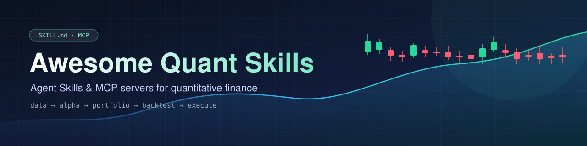
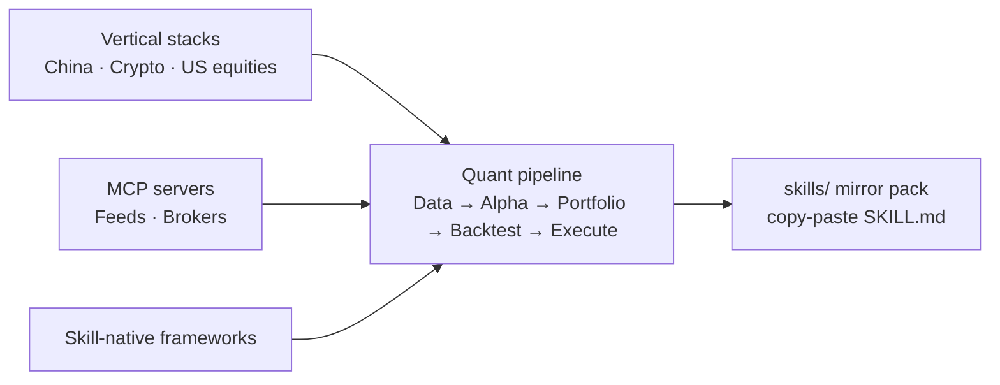

<div align="center">



<h3>Agent Skills &amp; MCP servers for quantitative finance, systematic research and algorithmic trading</h3>

<a href="https://awesome.re"></a> <a href="LICENSE"></a> [](https://github.com/JerryLiu369/awesome-quant-skills/actions/workflows/ci.yml) [](https://github.com/JerryLiu369/awesome-quant-skills) <a href="CONTRIBUTING.md"></a><br>
 

**Works with**:      

<a href="#-quickstart">Quickstart</a> · <a href="skills/README.md">Skill catalog</a> · <a href="#-vertical-market-stacks">Directory</a> · <a href="#-quant-mcp-servers">MCP Servers</a> · <a href="#-contributing">Contributing</a>

**English** | [中文](README.zh-CN.md)

</div>


Unlike legacy quant lists cluttered with abandoned libraries, this directory focuses strictly on **autonomous agent capabilities**: machine-executable `SKILL.md` workflows, Model Context Protocol (MCP) tooling, and deterministic quantitative reasoning.

---

## At a glance

| Section | What you will find | Entries |
|:--|:--|--:|
| 🌐 [Vertical Market Stacks](#-vertical-market-stacks) | Region-specific stacks: China A-shares and futures, crypto and DeFi, US and global equities | 131 |
| ⚙ [Universal Quant Pipeline](#-universal-quant-pipeline) | Data, alpha, portfolio, backtesting audit and execution skills | 86 |
| 🔌 [Quant MCP Servers](#-quant-mcp-servers) | MCP servers for market feeds, fundamentals and broker gateways | 55 |
| 🏗 [Skill-Native Quant Frameworks](#-skill-native-quant-frameworks) | Open-source agent frameworks with modular skill architectures | 28 |
| 📊 [Agent Evaluation & Benchmarks](#-agent-evaluation--benchmarks) | Benchmarks and evals for finance agents | 18 |
| 🧪 [Miscellaneous & Other Skills](#-miscellaneous--other-skills) | Everything else worth a look | 1 |

**Legend:** a `mirrored at` note marks entries with a local `SKILL.md` copy under [`skills/`](skills/) (browse the [skill catalog](skills/README.md)); entries without it are link-only.

---

## 📌 Scope & Inclusion Standards

Entries are organized across three operational tiers (in rough order of emphasis):

1. **Native Agent Skills**: Portable `SKILL.md` specifications, prompts, and orchestration recipes. Skills follow the open `SKILL.md` convention (`name` + `description` frontmatter), so the same file loads in Claude Code, OpenCode, Codex, Cursor, OpenClaw, Hermes, and other compatible harnesses — only the install path differs (see Quickstart). No proprietary daemon lock-in.
2. **Quant MCP Servers**: Model Context Protocol servers exposing standardized financial tools (market feeds, order routing, statistical testing).
3. **Skill-Native Systems**: Open-source quant agent frameworks that expose modular, plug-and-play skill architectures.



---

## 📦 Embedded Skills Library

This repository doubles as a **quant skill pack**: 45 `SKILL.md` files mirrored directly inside [`skills/`](skills/), ready to copy into your agent harness (see Quickstart for per-harness install paths). Two caveats: mirrors are `SKILL.md`-only excerpts — helper scripts and reference docs stay upstream (see each file's `Imported from` header) — and most but not all are permissively licensed: three are GPL-family and one (`quant-buddy`) needs a commercial API backend. Check per-skill licenses in [NOTICE.md](NOTICE.md) before redistributing.

- **China A-Shares & Futures**: CTP API, PTrade, TqSdk, TDX, Wencai, CnInfo, AKQuant, plus A-share filters and futures workflows.
- **Alpha & Factors**: Paper-derived factor mining, Alpha Zoo, CANSLIM screeners.
- **Backtesting & Auditing**: Lookahead bias avoidance, PBO overfitting checks, VectorBT, Pine Script backtester.
- **Crypto & Web3**: Pine Script developer/debugger, DefiLlama yields & flows, Perp funding basis.
- **Global Equities & Risk**: EDGAR 10-K extraction, LLMQuant equities & macro, OpenQuant VaR risk.

> The bullets above are the mirrored skill set. The directory below additionally links non-mirrored tools (e.g. MiniQMT gateways, Purged CV, Tushare/AKShare MCP servers) — entries without a `mirrored at` note are link-only.

---

## 🚀 Quickstart

**Use a mirrored skill (30 seconds):**

1. Pick a skill under [`skills/`](skills/). Layout is always `skills/<category>/<name>/SKILL.md`; per-skill licenses are in [NOTICE.md](NOTICE.md).
2. Copy the skill folder into your harness's skills directory — e.g. `~/.claude/skills/` for Claude Code (other harnesses use different paths; check your harness docs).
3. Ask your agent to use it — and default to paper trading first (see [SECURITY.md](SECURITY.md)).

```bash
# example: install the CTP futures skill into Claude Code
cp -r skills/china-markets/ctp-api ~/.claude/skills/
# or use the install script (supports claude, hermes, codex, opencode, agents, or all)
./scripts/install_skill.sh ctp-api --target claude
```

**Use a directory link:** entries below are upstream repos (skills, MCP servers, frameworks), not vendored code. For MCP servers, register the server in your host's MCP config with your own API keys and start read-only; for skill repos, copy their `SKILL.md` the same way as above. Registration shape (exact command and env keys come from each upstream repo's README — never commit real keys):

```json
{
  "mcpServers": {
    "<server-name>": {
      "command": "<install-command>",
      "env": { "<VENDOR_API_KEY>": "paste-your-key-here" }
    }
  }
}
```

**Find your stack:** A-share / futures trader → [China](#china-a-shares--domestic-futures) + [Data](#1-data-ingestion--market-feeds) + [Execution](#5-execution--order-routing); crypto → [Crypto](#crypto--web3-markets) plus the funding-basis/pine mirrors; US equity researcher → [US](#us--global-equities) + EDGAR/FRED + [Backtesting audit](#4-backtesting--safety-auditing).

**For agents reading this file:** the mirror-to-upstream index is the table in [NOTICE.md](NOTICE.md); each mirrored file also carries an `Imported from` header with its exact upstream source path. Inline `mirrored at` notes mark which directory entries have a local copy. A compact machine summary lives in [llms.txt](llms.txt).

---

## 📑 Table of Contents

- [Quickstart](#-quickstart)
- [Vertical Market Stacks](#-vertical-market-stacks)
  - [China A-Shares & Domestic Futures](#china-a-shares--domestic-futures)
  - [Crypto & Web3 Markets](#crypto--web3-markets)
  - [US & Global Equities](#us--global-equities)
- [Universal Quant Pipeline](#-universal-quant-pipeline)
  - [1. Data Ingestion & Market Feeds](#1-data-ingestion--market-feeds)
  - [2. Alpha Generation & Factor Mining](#2-alpha-generation--factor-mining)
  - [3. Portfolio & Risk Allocation](#3-portfolio--risk-allocation)
  - [4. Backtesting & Safety Auditing](#4-backtesting--safety-auditing)
  - [5. Execution & Order Routing](#5-execution--order-routing)
- [Quant MCP Servers](#-quant-mcp-servers)
  - [Market Feeds & Fundamentals](#market-feeds--fundamentals)
  - [Broker & Exchange Gateways](#broker--exchange-gateways)
- [Skill-Native Quant Frameworks](#-skill-native-quant-frameworks)
- [Agent Evaluation & Benchmarks](#-agent-evaluation--benchmarks)
- [Miscellaneous & Other Skills](#-miscellaneous--other-skills)
- [Contributing](#-contributing)
- [Disclaimer](#-disclaimer)
- [License](#-license)

---

## 🌐 Vertical Market Stacks

*Full-lifecycle skills engineered for specific regional regulations, session rhythms, or market microstructure.*

### China A-Shares & Domestic Futures
- [adambbhe/tdx-finance-mcp-plugin-v3](https://github.com/adambbhe/TDX-finance-mcp-plugin-v3) - OpenClaw plugin wrapping Tongdaxin (TDX) A-share data tools (real-time quotes, K-lines, F10 fundamentals, screeners, indicator filters, symbol search) and bundling 48 investment-analysis SKILL.md skills on top of the MCP server.
- [agentpit-io/hunter-community](https://github.com/agentpit-io/hunter-community) - Open-source, self-hosted multi-agent investment research terminal for A-shares, Hong Kong, and US markets with domain hooks for trading calendars, compliance attribution, and audit logging (BYOK LLM API key).
- [aifinlab/finclaw](https://github.com/aifinlab/FinClaw) - Large A-share analysis skill library (1,500 SKILL.md files) spanning factor alpha decay and crowding, anomaly detection, breakout and calendar-spread research, backed by bundled cn-stock-data scripts with AkShare, adata and efinance adapters.
- [akfamily/akquant](https://github.com/akfamily/akquant) - Rust-core, Python-interface quantitative backtesting and trading framework with zero-copy NumPy ingestion, native AKShare integration, A-share T+1/lot-size/fee broker profiles, walk-forward ML validation, and MCP registry metadata.
- [algoderiv/agent-skills](https://github.com/algoderiv/agent-skills) - Claude Code skills for Chinese quantitative derivatives and CTP 6.7.8 API integration (`skills/china-markets/ctp-api/SKILL.md`), order execution, and position management alongside TqSdk.
- [aliwangzai/myquant-dev](https://github.com/aliwangzai/myquant-dev) - Claude Code skill embedding 29 GM SDK references so an agent writes compliant event-driven MyQuant strategies: subscriptions, multi-frequency queries, backtest config and order execution.
- [charliedream1/ai_quant_trade](https://github.com/charliedream1/ai_quant_trade) - Self-hosted AI stock-trading platform whose skills layer carries 10 `quant-*` SKILL.md workflows (stock analysis, backtest review, alpha mining, regime research, CN debate, ETF and market review) executed against the project's own data, backtest and HTML-report services.
- [CharmYue/ashare-mcp](https://github.com/CharmYue/ashare-mcp) - A-share data MCP server on FastMCP and AKShare with Baostock/Tushare fallback, covering limit-up and limit-down pools, dragon-tiger lists, margin trading, chip distribution and statement filings.
- [dfkai/xtquantai](https://github.com/dfkai/xtquantai) - Agent skills for the QMT research terminal whose `qmt-inner-backtest` skill turns factor research into QMT native cross-sectional backtests with Barra-style normalisation and lookahead audits.
- [dustinliang666-blip/lava-mcp](https://github.com/dustinliang666-blip/lava-mcp) - Hosted Streamable HTTP MCP server, REST API and `SKILL.md` exposing read-only A-share stock and concept-board news-flow heat (hot concepts, related tickers, key-point summaries, daily heat panels) for Claude Code, Cursor, Codex and other MCP hosts (paid per-request API key with starter credit).
- [electkismet/eltdx](https://github.com/electkismet/eltdx) - Rust-powered Tongdaxin (TDX) A-share market protocol Python library, HTTP/WebSocket server, and MCP server supporting snapshots, intraday, ticks, K-lines, and call auctions (non-commercial learning and data research license).
- [gaaiyun/joinquant-skill](https://github.com/gaaiyun/joinquant-skill) - JoinQuant strategy development skill with an AST-based static linter (`scripts/strategy_lint.py`) that blocks lookahead bias and unadjusted-price mistakes, plus a `jqskill_mcp` tool service.
- [guangxiangdebizi/FinanceMCP-DCTHS](https://github.com/guangxiangdebizi/FinanceMCP-DCTHS) - TypeScript MCP server merging Tushare with EastMoney and Tonghuashun sources for sector and concept indices, constituents, leading stocks and sector fund flows over stdio or HTTP.
- [guangxiangdebizi/QMT-MCP](https://github.com/guangxiangdebizi/QMT-MCP) - FastMCP service over XunTou XTQuant (miniQMT) offering quote subscription, position and asset queries plus order placement, with a built-in risk-control layer.
- [hexonal/vnpy_agentbridge](https://github.com/hexonal/vnpy_agentbridge) - FastMCP bridge and IntentEngine running in the VeighNa (vnpy) `MainEngine` process enforcing a "propose-never-execute" boundary with human and `vnpy_riskmanager` approval gating.
- [Hithink-Tech-Org/Financial-API](https://github.com/Hithink-Tech-Org/Financial-API) - Official Tonghuashun (HiThink) A-share financial data service exposing real-time and historical quotes, call auctions, financial statements, valuations, indices, sectors, funds, and public futures/options via REST API, MCP, CLI, Python SDK, DuckDB, and built-in agent skills (needs a Hithink Fuyao API key or OAuth login; mirrored at `skills/china-markets/hithink-finance-market/SKILL.md`, `skills/china-markets/hithink-finance-financials/SKILL.md`).
- [itsadrianxv/quant-strategy-builder-skill](https://github.com/itsadrianxv/quant-strategy-builder-skill) - Modular skill suite for Claude Code, Codex, and OpenClaw supporting domestic futures (`implement-cn-futures-strategy`) and A-share/ETF execution constraints (`implement-cn-equity-etf-strategy`).
- [jasonhu/xqshare](https://github.com/jasonhu/xqshare) - Remote-execution layer that keeps `xtquant` running on a Windows host and exposes it over RPC, paired with four SKILL.md skills (`xtdata`, `xttrader`, `stock-pool`, `stock-strategy-ma-cross`) so macOS and Linux agents can read QMT quotes and place orders.
- [juju-w/qmt-mcp](https://github.com/juju-w/qmt-mcp) - Streamable HTTP MCP server running `xtquant` (miniQMT) in Docker/Wine or native Windows for ticker search, historical K-lines, and portfolio inspection.
- [jwangkun/claude-for-financial-services-cn](https://github.com/jwangkun/claude-for-financial-services-cn) - Comprehensive collection of 63 Claude Skills adapted for Chinese financial institutions alongside bundled MCP servers (`akshare-mcp`, `ifind-mcp`, `wind-mcp`; Wind/iFind legs need institutional licenses).
- [lingfan/tdxquant-mcp](https://github.com/lingfan/tdxquant-mcp) - Model Context Protocol server and native `skills/china-markets/tdxquant/SKILL.md` skill for TdxQuant / TongDaXin across Cursor, Claude Code, and Hermes.
- [longbridge/skills](https://github.com/longbridge/skills) - Official Longbridge suite of 13 skills covering market data, Chanlun/SMC technicals, derivatives, fundamentals, portfolio, and quant stats across Hong Kong, US, A-share, and Singapore markets for Claude Code, Codex, Gemini CLI, and OpenCode (needs Longbridge CLI and Longbridge account OAuth login; mirrored at `skills/china-markets/longbridge-market-data/SKILL.md`, `skills/china-markets/longbridge-derivatives/SKILL.md`).
- [lzwme/finance-quant-skills](https://github.com/lzwme/finance-quant-skills) - Agent skills tailored for A-share quantitative trading, market analysis, and rule checking (mirrored at `skills/china-markets/akquant/SKILL.md`).
- [NBreeze-Eric/financial-services-plugins-cn](https://github.com/NBreeze-Eric/financial-services-plugins-cn) - A-share and HK research framework adapted from Anthropic's financial-services-plugins, swapping foreign vendors for four Tonghuashun iFinD MCP servers and shipping an equity-research skill tree.
- [oopslink/trading-skills](https://github.com/oopslink/trading-skills) - Claude Code skill pack built on a `tushare-cli` front end: futures contracts, exchange warehouse receipts, institutional futures holdings and minute bars, plus A-share concepts, financials, index, forex and alpha queries, alongside a bundled `miniqmt_cli` execution skill.
- [QmQsun/Wind-MCP](https://github.com/QmQsun/Wind-MCP) - MCP server bridging the Wind Financial Terminal through WindPy COM, exposing quotes, financial statements, EDB macro series and conditional screening to agents (Windows plus an institutional Wind licence required).
- [quantskills/agent-ssquant](https://github.com/quantskills/agent-ssquant) - Futures quantitative agent workflow with Anthropic-compatible `skills/china-markets/ssquant-futures/SKILL.md` to gate CTP/SimNow runtime execution.
- [quantskills/skill-xingtai-catcher](https://github.com/quantskills/skill-xingtai-catcher) - K-line pattern similarity skill with MCP tools for A-shares and commodity futures, matching natural-language descriptions, hand-drawn curves or chart screenshots against historical shapes.
- [renjiegod/dyt-ashare-cli](https://github.com/renjiegod/dyt-ashare-cli) - Rust CLI (`dytcn`) and `dyt-ashare` agent skill for historical A-share minute K-lines, data quality checks, Parquet dataset downloads, and local daily backtests across Claude Code, Codex, and Cursor (free guest quota; paid API key for extended history and bulk Parquet downloads).
- [ricequant/ricequant-skills](https://github.com/ricequant/ricequant-skills) - Official RiceQuant skills pack for Claude Code with 14 `SKILL.md` files covering RQData queries, RQAMS portfolio operations, earnings analysis and sector overviews.
- [roberts9012062/futures-factor-mining-experiment](https://github.com/roberts9012062/futures-factor-mining-experiment) - Self-hosted Chinese futures factor-mining, multi-timeframe backtesting, paper trading, and LLM market-watching platform with 60+ expression features (built-in free Sina quotes; optional custom CTP/OpenCTP feed and LLM key).
- [rollysys/use_cninfo [Archived Mirror]](skills/china-markets/cninfo-disclosure/SKILL.md) - Specialized CLI and Claude Code `SKILL.md` skill querying official A-share statutory disclosures on CnInfo and extracting full-text Markdown via PyMuPDF (upstream `rollysys/use_cninfo` is offline/private as of 2026-11; complete `SKILL.md` archived and mirrored at `skills/china-markets/cninfo-disclosure/SKILL.md`).
- [rootSunc/CNEquity](https://github.com/rootSunc/CNEquity) - Open-source local China A-share Parquet data lake with 86 daily-updated datasets, built-in price adjustments, point-in-time (PIT) and delisted stock retention, row-level lineage, and a native MCP server (no registration or token required for base ingestion).
- [sencloud/futures_mcp](https://github.com/sencloud/futures_mcp) - Domestic commodity and financial futures MCP server combining AKShare market data feeds, multi-indicator technical analysis, and DeepSeek analytical integration.
- [shaoxing-xie/openclaw-data-china-stock](https://github.com/shaoxing-xie/openclaw-data-china-stock) - OpenClaw data foundation for China markets: a quote-fetch and 58-indicator computation layer plus seven SKILL.md analytics skills (technical, market scanner, fund flow, fundamentals, macro, strategy backtest, sentinel) over A-shares, ETFs, indices, options and fund flows.
- [shinnytech/tqsdk-python](https://github.com/shinnytech/tqsdk-python) - Official Tianqin Quant SDK featuring an embedded agent skill (`skills/china-markets/tqsdk-trading/SKILL.md`) for CTP futures/options event loops and margin execution.
- [shouldnotappearcalm/a-share-skill](https://github.com/shouldnotappearcalm/a-share-skill) - A-share quant trading and paper-trading skill suite for Claude Code and agent harnesses, providing real-time quotes, technical indicators, trend-pullback strategies, and simulated execution accounts.
- [simonlin1212/a-stock-data](https://github.com/simonlin1212/a-stock-data) - Self-contained China A-share full-stack data skill for Claude Code and AI coding agents spanning 15 layers, 87 endpoints, and 34 sources (K-lines, ticks, financials, fund flows, filings, options, macro, futures, and convertibles; no API key required except iwencai X-Claw auth; mirrored at `skills/china-markets/a-stock-data/SKILL.md`).
- [simonlin1212/Vibe-Research](https://github.com/simonlin1212/Vibe-Research) - Local-first investment research workbench for A-shares, US, and Hong Kong stocks integrating 168 data endpoints across 35 layers with watchlists, daily market reviews, sector research, bull/bear debates, and backtesting (needs a Claude Code, Codex, WorkBuddy, or LLM API backend).
- [songshuquant/ssquant](https://github.com/songshuquant/ssquant) - Domestic futures CTP framework shipping a root SKILL.md and an `ai_agent/` guide that confine an agent to the `StrategyAPI` surface when writing strategies for backtest, SIMNOW simulation and live CTP trading, including continuous-contract adjustment for 888/777 series.
- [TNT-Likely/PanWatch](https://github.com/TNT-Likely/PanWatch) - Self-hosted AI stock monitoring and multi-account portfolio analysis platform for A-shares, Hong Kong, and US markets powered by TradingAgents, AKShare, LangGraph, and MCP (needs an OpenAI-compatible API key or local Ollama).
- [waditu-tushare/skills](https://github.com/waditu-tushare/skills) - Official Tushare skill pack (`tushare` and `tushare-data` SKILL.md files) that turns Chinese natural-language requests into executable Tushare Pro queries across A-shares, indices, ETFs, financials, valuation, money flow and macro series (needs a Tushare Pro token).
- [Wangshengyang2004/myquant-mcp](https://github.com/Wangshengyang2004/myquant-mcp) - MCP server and companion `SKILL.md` on the MyQuant GM API, covering A-share quotes, fundamentals, positions, T+0 intraday trading and paper or live orders.
- [wbh604/UZI-Skill](https://github.com/wbh604/UZI-Skill) - Single-stock deep-analysis skill for A-shares, Hong Kong, and US equities combining 66 investor personas, 9 investment schools, 22 data dimensions, and 22 institutional methods with HTML report output across Claude Code, Hermes Agent, and WorkBuddy (mirrored at `skills/china-markets/uzi-deep-analysis/SKILL.md`).
- [xiongcp/stock-skill](https://github.com/xiongcp/stock-skill) - Agent Skills (`kline-structure-chart`) implementation for deterministic K-line structure detection, triple-barrier risk plans, 15-day normal volatility ranges, and no-lookahead backtests across A-shares, Hong Kong, and US stocks for Claude Code, Codex, Hermes Agent, Cursor, and Gemini CLI.
- [xxbbzy/ptrade-agent-skills](https://github.com/xxbbzy/ptrade-agent-skills) - Dedicated `SKILL.md` skill suite (mirrored at `skills/china-markets/ptrade-strategy-writing/SKILL.md`) for Claude Code and Codex with static AST checkers to write and inspect PTrade institutional trading algorithms.
- [yywx55/qmt-trade-mcp](https://github.com/yywx55/qmt-trade-mcp) - QMT/xtquant MCP server whose tools split into a market-data group (snapshots, adjustment factors, trading calendar) and an execution group (orders, cancellations, positions), served over SSE.
- [zer0quant/zer0share](https://github.com/zer0quant/zer0share) - Local A-share, futures and options data pipeline (Tushare Pro ingest into partitioned Parquet, queried through DuckDB via a Tushare-like `pro_api`) plus a `zer0share-data` skill that keeps agent queries offline and consumes no Tushare points.
- [zhangchiep/joinquant-skill](https://github.com/zhangchiep/joinquant-skill) - Minimal JoinQuant API reference skill for Claude Code covering strategy lifecycle callbacks, timer tasks, adjustment and slippage settings, fundamental queries and order functions.
- [zhangxiangliang/stock-api](https://github.com/zhangxiangliang/stock-api) - TypeScript stock quote toolkit and MCP server querying A-shares, Hong Kong, US equities, and exchange-traded funds from Tencent, Sina, and Eastmoney across Node.js, browsers, and CLI.

### Crypto & Web3 Markets
- [aaronjmars/web3-research-mcp](https://github.com/aaronjmars/web3-research-mcp) - Local MCP server bundling CoinGecko, CoinMarketCap and DeFiLlama lookups (protocol TVL, ATH TVL, period changes) without requiring external API keys.
- [AlgoVaultLabs/crypto-quant-signal-mcp](https://github.com/AlgoVaultLabs/crypto-quant-signal-mcp) - Multi-venue derivatives intelligence MCP server with 20 pre-built Anthropic agent skills scanning cross-venue funding rate arbitrage across 7 perpetual exchanges.
- [alsk1992/CloddsBot](https://github.com/alsk1992/CloddsBot) - Self-hosted Claude-powered AI trading terminal bundling 121+ skills across Polymarket, Kalshi, Binance, Hyperliquid, Solana DEXs, and 5 EVM chains with x402 machine-to-machine payments (needs Anthropic/LLM and exchange or wallet credentials).
- [asterdex/aster-skills-hub](https://github.com/asterdex/aster-skills-hub) - Official Aster Finance `agentskills.io` skills for Aster Futures and Spot (testnet) APIs covering v1 HMAC / v3 EIP-712 authentication, order management, WebSocket streams, and wallet deposits for OpenClaw and compatible agents (needs Aster API/wallet credentials for private endpoints).
- [awarexone/web3-bug-bounty-hunting-ai-skills](https://github.com/awarexone/web3-bug-bounty-hunting-ai-skills) - 11 Web3 smart contract security and bug-bounty `SKILL.md` modules synthesized from 2,749 Immunefi reports and 681 DeFiHackLabs reproductions, with Foundry PoC and triage templates.
- [binance/binance-skills-hub](https://github.com/binance/binance-skills-hub) - Official Binance skills hub with 21 `SKILL.md` files giving agents an agentic-wallet surface for spot and perpetual orders, on-chain transfer tracking and Web3 DeFi interaction.
- [bitget-wallet-ai-lab/bitget-wallet-skill](https://github.com/bitget-wallet-ai-lab/bitget-wallet-skill) - Zero-bloat Bitget Wallet AI agent skill supporting token discovery, anti-manipulation and security checks, cross-chain bridges, and gasless swaps across 7 EVM chains and Solana with human-in-the-loop signing.
- [BlockRunAI/blockrun-mcp](https://github.com/BlockRunAI/blockrun-mcp) - MCP server exposing 19 tools for markets, on-chain data, X/Twitter, web research, and live Polymarket trading settled via x402 micropayments (pay-per-call via USDC x402 wallet or a BlockRun API key).
- [bowtieddevil/degenbot](https://github.com/BowTiedDevil/degenbot) - Rust-core MEV and DEX arbitrage engine with Python PyO3 bindings supporting Uniswap V2/V3/V4, Curve V1, Balancer V2, and Aave V3, plus `.agents/skills/bot-telemetry/SKILL.md`.
- [brandononchain/opentrade](https://github.com/brandononchain/opentrade) - Agent skills supporting 24/7 crypto microstructure, Pine Script v6 strategy synthesis, and high-frequency trading heuristics.
- [bybit-exchange/skills](https://github.com/bybit-exchange/skills) - Official Bybit natural-language trading skill (`SKILL.md`) covering spot, derivatives, earn, trading bots, copy trading, and WebSocket streams across OpenClaw, Claude, ChatGPT, Gemini, Cursor, and Codex (needs a Bybit API key and secret).
- [caiovicentino/polymarket-mcp-server](https://github.com/caiovicentino/polymarket-mcp-server) - MCP server for Polymarket covering market discovery, WebSocket order-book monitoring, portfolio inspection and live execution.
- [ccxt/ccxt](https://github.com/ccxt/ccxt) - Unified multi-language trading library (Python, JS/TS, Rust, Go, C#, Java, PHP) supporting 100+ cryptocurrency exchanges and prediction markets including Kalshi, widely used as the execution and market-data substrate for trading agents (needs exchange API keys for private and trading endpoints; mirrored at `skills/crypto-web3/ccxt-python/SKILL.md`).
- [chainstacklabs/polymarket-alpha-bot](https://github.com/chainstacklabs/polymarket-alpha-bot) - Polymarket hedging-pair discovery and execution bot with 6 `.claude/skills/` `SKILL.md` workflows for market screening, position entry/exit, and P&L tracking (requires paid OpenRouter API key and Polymarket relayer key).
- [chrisling-dev/hyperliquid-cli](https://github.com/chrisling-dev/hyperliquid-cli) - TypeScript CLI and `skills/hyperliquid/SKILL.md` for Hyperliquid DEX supporting real-time order-book/trade terminal watch modes and order execution via `@nktkas/hyperliquid`.
- [coinbase/agentkit](https://github.com/coinbase/agentkit) - Coinbase Developer Platform framework giving agents wallet management plus action providers for swaps, lending and price feeds across Base, EVM and Solana, with a native MCP smart-wallet server.
- [coinglass-official/coinglass-api-skills](https://github.com/coinglass-official/coinglass-api-skills) - Official CoinGlass `SKILL.md` router and sub-skill specs covering crypto futures funding rates, open interest, liquidations, L2 order books, options, ETF flows, and on-chain indicators (requires paid CoinGlass API plan).
- [coinpaprika/dexpaprika-mcp](https://github.com/coinpaprika/dexpaprika-mcp) - MCP server from DexPaprika for multi-chain DEX analytics: pool TVL, swap volume, price impact and historical OHLCV.
- [darknavysecurity/web3-skills](https://github.com/DarkNavySecurity/web3-skills) - Web3 security `SKILL.md` suite for Claude Code and Codex covering Solidity contract auditing, Go/Rust/C++ blockchain client auditing, and on-chain exploit transaction tracing.
- [DefiLlama/defillama-skills](https://github.com/DefiLlama/defillama-skills) - Official agent skills (`yield-strategies`, `defi-data`, `flows-and-events`, mirrored at `skills/crypto-web3/defillama-yields/SKILL.md`, `skills/crypto-web3/defillama-data/SKILL.md`, and `skills/crypto-web3/defillama-flows/SKILL.md`) connecting agents to DefiLlama for protocol TVL, DEX volumes, yields, and token unlocks.
- [dex-original/okx-agent-trade-kit](https://github.com/dex-original/okx-agent-trade-kit) - AI agent trading kit and MCP server (`okx-trade-mcp`) providing 145 tools across 11 modules for spot and derivatives algorithmic order execution.
- [dprolabs/dpro-hyperliquid](https://github.com/dProLabs/dpro-hyperliquid) - Agent skill (`SKILL.md`) for Hyperliquid spot, perp, and HIP-3 trading alongside dPro read-only on-chain analytics, liquidation heatmaps, holder distributions, and market/account monitoring.
- [edkdev/hyperliquid-mcp](https://github.com/edkdev/hyperliquid-mcp) - Python MCP server for Hyperliquid perpetual DEX with EIP-712 order signing, atomic bracket orders (entry + TP + SL), and funding rate streams.
- [emlai/defi-native-skill](https://github.com/emlai/defi-native-skill) - DeFi capital-markets `SKILL.md` teaching AI agents yield decomposition, vault/curator due diligence, lending architectures, stablecoin/RWA mechanics, and live DefiLlama/Morpho data sourcing.
- [galleonlabs/crypto-defi-skills](https://github.com/galleonlabs/crypto-defi-skills) - Modular DeFi skill collection with 85 `SKILL.md` procedures across 17 packs for inspecting Aave/Morpho lending risk, comparing DEX swap quotes, checking vault exits, and x402 payment flows.
- [gate/gate-skills](https://github.com/gate/gate-skills) - Official Gate.io skills marketplace and Gate CEX Skill 2.0 bundling 6 source skills across 376 CLI command paths (trade, earn, assets, subaccounts, affiliate, bots) plus Gate Pay x402 MCP (needs Gate CLI and Gate API credentials for private/trade actions).
- [GMGNAI/gmgn-skills](https://github.com/GMGNAI/gmgn-skills) - Official GMGN OpenAPI skills pack with 19 `SKILL.md` files for smart-money tracking, wallet PnL, token security audits and swap or conditional-order execution on Solana, Base and Ethereum.
- [guzus/dr-manhattan](https://github.com/guzus/dr-manhattan) - CCXT-style unified Python library for prediction-market market-making, order tracking, WebSocket streaming, and data analysis across Polymarket, Kalshi, Limitless, Opinion, and Predict.fun (needs exchange API keys for authenticated trading).
- [helius-labs/core-ai](https://github.com/helius-labs/core-ai) - Helius AI tooling for Solana pairing a `helius-mcp` server (on-chain assets, transaction parsing, priority fees) with 24 `SKILL.md` files including DFlow routing skills.
- [HKUDS/Vibe-Trading](https://github.com/HKUDS/Vibe-Trading) - Multi-asset trading agent framework with native `SKILL.md` packaging and `perp-funding-basis` (`skills/crypto-web3/perp-funding-basis/SKILL.md`) skills for perpetual funding rate cash-and-carry basis arbitrage (mirrored at `skills/alpha-factors/alpha-zoo/SKILL.md`, `skills/china-markets/ashare-pre-st-filter/SKILL.md`).
- [jesseliverse01/perpetual-arbitrage-skill](https://github.com/Jesseliverse01/perpetual-arbitrage-skill) - Perpetual futures funding-rate arbitrage `SKILL.md` with Python scanners and runnable backtests for funding harvest, spot-perp basis, and cross-venue delta-neutral spreads on Hyperliquid and CEXs.
- [jup-ag/agent-skills](https://github.com/jup-ag/agent-skills) - Official Jupiter ecosystem `agentskills.io` skills and packaged plugins for Claude Code and Codex covering Solana swaps, Jupiter Lend, and token verification workflows.
- [kukapay/crypto-liquidations-mcp](https://github.com/kukapay/crypto-liquidations-mcp) - FastMCP streaming server streaming Binance Futures liquidation cascades and order size distributions for market stress detection.
- [kukapay/jupiter-mcp](https://github.com/kukapay/jupiter-mcp) - Dedicated MCP server executing Solana DEX token swaps via Jupiter Ultra API with quote generation, slippage tolerance, and priority fee controls.
- [mcpdotdirect/evm-mcp-server](https://github.com/mcpdotdirect/evm-mcp-server) - Model Context Protocol server providing 22 tools and 10 prompts across 60+ EVM-compatible networks for balances, ERC-20/NFT reads, ENS resolution, contract calls, and transactions (optional Etherscan key for ABI fetching).
- [mirror29/openfinclaw-cli](https://github.com/mirror29/openfinclaw-cli) - Plug-and-play crypto research, backtest, and paper-trade skill integrations for multi-agent environments.
- [mncrftfrcnm/mexc-agent-trading-skills](https://github.com/mncrftfrcnm/mexc-agent-trading-skills) - Agent skill pack with 12 `SKILL.md` files for the official MEXC Spot and Futures REST/WebSocket APIs, supporting market data queries, signed requests, test orders, and live execution (needs MEXC API credentials).
- [moss-site/moss-trade-bot-skills](https://github.com/moss-site/moss-trade-bot-skills) - Self-evolving crypto trading agent skills translating natural language into 5-pillar strategies (Trend, Mean-Reversion, Momentum, Volume, Risk) with 30+ tunable parameters on Hyperliquid perpetuals.
- [nanookai/binance-api](https://github.com/NanookAI/binance-api) - Keyless `SKILL.md` teaching AI agents to query Binance Spot and USD-M/COIN-M Futures public REST APIs for live prices, klines, order books, funding rates, open interest, and long/short ratios.
- [OctagonAI/kalshi-trading-bot-cli](https://github.com/OctagonAI/kalshi-trading-bot-cli) - AI-native Kalshi prediction-market trading CLI running deep fundamental research, independent probability estimates, half-Kelly position sizing, and a 5-gate risk engine (needs a Kalshi API key + RSA key and an LLM API key; optional Octagon/Tavily keys).
- [okx/onchainos-skills](https://github.com/okx/onchainos-skills) - Official OKX OnchainOS skills for AI coding agents covering agentic wallets, read-only DEX market and smart-money analytics, x402/MPP/a2a-pay payments, DeFi aggregation, and DApp routing across 20+ blockchains (mirrored at `skills/crypto-web3/okx-dex-market/SKILL.md`).
- [pmxt-dev/pmxt](https://github.com/pmxt-dev/pmxt) - CCXT-style unified API and self-hostable SDK for prediction-market data and order routing across Polymarket, Kalshi, Opinion, and Limitless (needs venue credentials for authenticated trading).
- [qedgen/solana-skills](https://github.com/QEDGen/solana-skills) - Formal verification and auditing `SKILL.md` suite for Solana programs generating property tests, Kani harnesses, and Lean 4 proofs from `.qedspec` specs (optional paid Mistral/Aristotle API keys for deep proof search).
- [runesleo/polymarket-toolkit](https://github.com/runesleo/polymarket-toolkit) - CLI, MCP server, and 3 `SKILL.md` workflows for profiling Polymarket trader addresses, computing fee-adjusted PnL, and scoring Brier calibration using public Polymarket APIs without API keys.
- [sendaifun/solana-agent-kit](https://github.com/sendaifun/solana-agent-kit) - Foundational open-source toolkit connecting AI agents to Solana protocols with 60+ actions (Jupiter, Raydium, Orca, Meteora, Drift).
- [Senpi-ai/senpi-skills](https://github.com/Senpi-ai/senpi-skills) - Hyperliquid perpetuals skill library with 15 `SKILL.md` files covering market pulse, smart-money flow, funding rates, position sizing and risk guardrails.
- [sieblyio/agent-skills](https://github.com/sieblyio/agent-skills) - MIT `SKILL.md` for Claude Code, Codex, Cursor and OpenClaw that guides agents writing JavaScript/TypeScript integrations with the open-source Siebly SDKs (Binance, OKX, Bitget, Gate, KuCoin, Kraken, Coinbase, Hyperliquid) for REST, WebSocket streams and WebSocket API requests. Docs: https://sieblyio.github.io/docs/
- [smartcontractkit/chainlink-agent-skills](https://github.com/smartcontractkit/chainlink-agent-skills) - Official Chainlink `agentskills.io` skills for CRE workflows, CCIP cross-chain messaging, multi-chain Data Feeds, Data Streams, ACE compliance for tokenized funds, and node operator diagnostics.
- [solana-foundation/solana-dev-skill](https://github.com/solana-foundation/solana-dev-skill) - Official Solana Foundation Agent Skill (`SKILL.md`) for modern Solana dApp and program development with `@solana/kit`, Anchor, Pinocchio, Codama IDL generation, and Surfpool/LiteSVM testing.
- [SpartanLabsXyz/simmer-sdk](https://github.com/SpartanLabsXyz/simmer-sdk) - Prediction-market harness for agents: 37 `SKILL.md` files, a bundled `simmer-mcp` server and a Python SDK for paper-trading Polymarket, Kalshi and Hyperliquid.
- [StalkChain/fomo-mcp-api](https://github.com/StalkChain/fomo-mcp-api) - Hosted OAuth MCP for Solana token holders and tracked-trader flows, plus Hyperliquid funding rates and candles, usable from Claude, Codex, Cursor and Gemini CLI (some queries use metered credits).
- [Superior-Trade/superior-skills](https://github.com/Superior-Trade/superior-skills) - Open skill and tool-schema pack for Superior Trade; 31 `SKILL.md` files let an agent author, backtest and deploy strategies on Hyperliquid perpetuals and Polymarket.
- [Uniswap/uniswap-ai](https://github.com/Uniswap/uniswap-ai) - Official Uniswap AI skills and Claude Code plugins covering Trading API swap integration, Uniswap v4 hooks, CCA auctions, x402/MPP `pay-with-any-token`, and automated DCA/copy-trade tooling.
- [vooi-app/mcp](https://github.com/vooi-app/mcp) - Unified perpetual futures MCP server connecting AI agents to Hyperliquid, Lighter, Aster, and Kinetiq for cross-venue funding rate spread arbitrage.
- [vybenetwork/solana-mcp-vybe](https://github.com/vybenetwork/solana-mcp-vybe) - Solana MCP server metadata and 3 agent skills for the Vybe API covering wallet analytics, token market intelligence, transfers, and unsigned Jupiter swap transaction building (paid via Vybe API key or x402 pay-per-call).
- [YichengYang-Ethan/oracle3-prediction-market-agent](https://github.com/YichengYang-Ethan/oracle3-prediction-market-agent) - Prediction-market arbitrage engine and MCP server scanning fee-adjusted no-arbitrage gaps across Kalshi, Polymarket and Solana, with 12 `SKILL.md` files and pre-trade risk rails.

### US & Global Equities
- [AhaSignals/value-investor-skill](https://github.com/AhaSignals/value-investor-skill) - US nonfinancial equity research skill for Claude Code and Codex: company-name SEC/price retrieval, cash-flow and historical P/E screens, source-hash replay, and a reproducible Microsoft financial example; research only.
- [alpacahq/cli](https://github.com/alpacahq/cli) - Official Alpaca CLI in Go with two SKILL.md skills (`alpaca-cli`, `alpaca-cli-regenerate`) covering installation, API-key authentication, profile management and scripted stock or crypto trading and market-data calls (needs Alpaca API keys).
- [AlphaGBM/skills](https://github.com/AlphaGBM/skills) - 27 `SKILL.md` workflows for options and equity research, spanning Greeks attribution, IV percentile ranking, volatility-surface fitting and earnings-crush backtests (mirrored at `skills/global-equities/alphagbm-greeks/SKILL.md`, `skills/global-equities/alphagbm-vol-surface/SKILL.md`).
- [anthropics/financial-services](https://github.com/anthropics/financial-services) - Official Anthropic reference agents, skills, and data connectors for investment banking, equity research, private equity, and wealth management, packaged as Claude Cowork plugins and Managed Agent cookbooks (partner connectors such as LSEG and S&P Global require provider access; mirrored at `skills/global-equities/dcf-model/SKILL.md`, `skills/global-equities/comps-analysis/SKILL.md`).
- [daniel3303/Equibles](https://github.com/daniel3303/Equibles) - Self-hosted financial terminal MCP server providing 62+ agent tools across SEC EDGAR, 13F ownership, congressional disclosures, and FRED data.
- [defeat-beta/defeatbeta-api](https://github.com/defeat-beta/defeatbeta-api) - Python library, MCP server and five SKILL.md skills (analyst, DCF, earnings preview, earnings analysis, earnings key data) offering an open-source drop-in replacement for Yahoo Finance market-data endpoints.
- [eodhistoricaldata/eodhd-claude-skills](https://github.com/EodHistoricalData/eodhd-claude-skills) - Official EODHD Claude Code plugin with 13 SKILL.md skills (market overview, screener, options analyzer, earnings monitor, macro dashboard, portfolio risk) plus an OAuth MCP server covering 150k+ tickers on 70+ exchanges (needs an EODHD API token; the free tier is capped at 20 calls a day and full coverage requires a paid plan from USD 19.99/month).
- [fatwang2/ibkr-cli](https://github.com/fatwang2/ibkr-cli) - `ibkr-cli` skill plus Python CLI for Interactive Brokers: IB Gateway or TWS setup and connection tests, quotes, historical bars, options chains and Greeks, scanners, orders, and account or portfolio monitoring (needs a running IB Gateway or TWS).
- [himself65/finance-skills](https://github.com/himself65/finance-skills) - Open `agentskills.io` collection of financial analysis and trading skills (DCF/SOTP valuation, earnings preview/recap, estimate revisions, ETF premium/discount, options payoff, SEPA strategy) for Codex, Claude Code, and Cursor.
- [Jakeschincariol/day-trader-skill](https://github.com/Jakeschincariol/day-trader-skill) - Suite of 11 Claude Code skills for US day trading backed by free public feeds (Yahoo Finance, Nasdaq Trader, SEC EDGAR, House Clerk): chart scanning, breaking news, entry/exit timing, 10,000-run session replay, and paper-default order staging (no API key or signup required).
- [JoelLewis/finance_skills](https://github.com/JoelLewis/finance_skills) - Claude Code plugin suite shipping 81+ skills across 7 financial-services domains (core math, investment management, regulatory compliance, advisory practice, trading operations) with Python reference scripts.
- [johnisanerd/claude-skill-congress-stock-trades-api](https://github.com/johnisanerd/claude-skill-congress-stock-trades-api) - Agent skill for Claude Code and Codex that pulls US House and Senate stock trade disclosures (member, ticker, amount range, transaction and filing dates) as JSON via an Apify Actor; needs an Apify account, billed per result.
- [jsconiers/capitol-trades-mcp](https://github.com/jsconiers/capitol-trades-mcp) - FastMCP server providing 23 specialized tools to track US congressional stock trades from Capitol Trades without API keys.
- [LLMQuant/skills](https://github.com/LLMQuant/skills) - Standardized repository of 18 modular agent skills (`llmquant-equities`, `llmquant-macro`, `llmquant-risk`, mirrored at `skills/global-equities/llmquant-equities/SKILL.md`, `skills/global-equities/llmquant-macro/SKILL.md`, and `skills/portfolio-risk/llmquant-risk/SKILL.md`) compatible with Claude Code, Codex, and Hermes Agent.
- [lumiwealth/lumibot](https://github.com/Lumiwealth/lumibot) - Python backtesting and live-trading framework whose agent component ships four SKILL.md skills (stock-trading, options-trading, research-data, web-documents) so an agent can research, backtest and place orders through supported brokers (needs broker credentials for live trading).
- [octagonai/skills](https://github.com/OctagonAI/skills) - 67 SKILL.md skills from Octagon covering financial statements, analyst estimates, earnings-call analysis, debt covenants and valuation, all executed through the Octagon MCP server (needs an Octagon API key; a free tier exists, heavier usage is billed).
- [oft3r/agentic-trading-desk](https://github.com/Oft3r/agentic-trading-desk) - Personal trading desk for stocks and ETFs that pairs a SKILL.md workflow with standard-library Python indicator scripts (EMA, RSI, MACD, TRIX, Bollinger) and a three-pillar scoring model over data fetched through the Robinhood MCP (needs Robinhood MCP access).
- [pseudo-longinus/quant-buddy-skills](https://github.com/pseudo-longinus/quant-buddy-skills) - Full infrastructure skills covering US/HK equities, macro indicators, and multi-asset screening for LLM agents (mirrored at `skills/china-markets/quant-buddy/SKILL.md`; needs commercial API backend).
- [rollingsirius/equity-research-skill](https://github.com/rollingSirius/equity-research-skill) - Single-skill equity research framework that drives a nine-chapter single-stock report (business model, moat, financials, valuation, price target, bull and bear case) with bundled sector references and report scripts.
- [simonlin1212/global-stock-data](https://github.com/simonlin1212/global-stock-data) - Zero-auth market data skill for Claude Code / Codex with 50+ endpoints covering CBOE options Greeks, 0DTE flow, and policy rates from 38 central banks.
- [star23/day1global-skills](https://github.com/star23/Day1Global-Skills) - Five packaged finance skills (us-value-investing, tech-earnings-deepdive, us-market-sentiment, macro-liquidity, btc-bottom-model) built on a four-dimension ROE, debt, free-cash-flow and moat framework for US equities and macro context.
- [staskh/trading_skills](https://github.com/staskh/trading_skills) - Claude skills and 23-tool MCP server for US equity and options traders covering bullish/PMCC scanners, option Greeks, earnings risk, PDF reports, and Interactive Brokers roll/portfolio management (optional TWS or IB Gateway for Interactive Brokers portfolio features).
- [stocktwits/stocktwits-mcp](https://github.com/stocktwits/stocktwits-mcp) - Official StockTwits MCP server exposing zero-auth tools to stream retail investor sentiment scores, trending tickers, and social volume momentum.
- [yennanliu/InvestSkill](https://github.com/yennanliu/InvestSkill) - Zero-runtime collection of 34 structured US equity investment analysis prompt frameworks for Claude Code, Cursor, Gemini CLI, GitHub Copilot, and ChatGPT (no API keys or subscriptions required).
- [zen-tradings/retail-skills-us](https://github.com/zen-tradings/retail-skills-us) - Skills tailored for US equity rule enforcement, tax-loss harvesting, and retail algorithmic setups.

<p align="right"><a href="#top">⬆ back to top</a></p>

---

## ⚙ Universal Quant Pipeline

*Modular skills aligned with each chronological stage of the quantitative investment lifecycle.*

### 1. Data Ingestion & Market Feeds
*Retrieval, cleaning, split-adjustment, and cross-source alignment.*
- [27dream/mcp-eastmoney](https://github.com/27dream/mcp-eastmoney) - Zero-configuration MCP server for Claude Code and Cursor providing direct access to EastMoney push APIs without API keys (unofficial; can break without notice).
- [Blave-TW/blave-quant-skill](https://github.com/Blave-TW/blave-quant-skill) - Blave data-layer skill for agents: crypto alpha and market data, Taiwan stock, futures and market-wide data, CME/ICE and TXF OHLCV, Hyperliquid top-trader metrics, plus per-venue skill and API references for Binance, OKX, Bybit, Bitget, BitMart, BingX, Bitfinex, KuCoin, Gate.io, StockCoin and TWSE (needs a paid Blave API plan with a 14-day trial; exchange keys are optional and stay in a local .env).
- [btopn/OpenInsider-MCP](https://github.com/btopn/OpenInsider-MCP) - MCP server aggregating OpenInsider Form 4 insider trades, SEC EDGAR 8-K and 13D filings plus FINRA short-volume and failure-to-deliver data for forensic tracking.
- [c-cf/imf-data-mcp](https://github.com/c-cf/imf-data-mcp) - IMF macroeconomic MCP server built on the modern SDMX API, querying IFS, World Economic Outlook and Balance of Payments datasets.
- [CNQQC/xueqiu-mcp](https://github.com/CNQQC/xueqiu-mcp) - MCP server with 29 tools providing structured Xueqiu market data, capital flows, and community sentiment formatted as clean Markdown tables (unofficial; can break without notice).
- [coingecko/skills](https://github.com/coingecko/skills) - Official CoinGecko agent skill dynamically querying live API documentation and endpoints for cryptocurrency spot prices, market caps, token metadata, and DeFi protocol metrics across 1,000+ DEXes.
- [dgunning/edgartools](https://github.com/dgunning/edgartools) - SEC EDGAR toolkit providing a native MCP server (`edgartools-mcp`) and Claude Code skills for extracting 10-K, 10-Q, 8-K, and Form 4 insider filings into typed data (mirrored at `skills/global-equities/edgar-financials/SKILL.md`).
- [elsejj/mcp-cn-a-stock](https://github.com/elsejj/mcp-cn-a-stock) - Dedicated A-share MCP server providing tiered endpoints for quotes, financial fundamentals, and technical indicators backed by the `msd` database.
- [erwanjun/tushare-mcp-server](https://github.com/erwanjun/tushare-mcp-server) - Production MCP server wrapping 173 Tushare Pro endpoints across A-shares, futures, options, indices, and macro metrics (needs a Tushare Pro token; freemium).
- [gauss314/skills](https://github.com/gauss314/skills) - 32 SKILL.md skills for pulling market data from free and freemium sources (Finviz, CBOE, Barchart, EarningsWhispers, Alpha Vantage, Alpaca, Finnhub, SEC XBRL, CompaniesMarketCap, TradingView) with helper scripts, written in Spanish.
- [guangxiangdebizi/FinanceMCP](https://github.com/guangxiangdebizi/FinanceMCP) - Multi-market financial MCP server providing 19 tools integrating Tushare Pro for quotes, financial statements, and macro indicators (needs a Tushare Pro token; freemium).
- [hypier/tradingview-quantitative-skills](https://github.com/hypier/tradingview-quantitative-skills) - Technical pattern recognition, market scanning, and TradingView feed integration skills.
- [komako-workshop/digital-oracle](https://github.com/komako-workshop/digital-oracle) - Macro intelligence skill synthesizing probability estimates from 13 financial data sources (Polymarket, Kalshi, CFTC commitments, SEC insider filings, Treasury curves, central bank rates) for AI agents.
- [kylefu8/tradingview-akshare-mcp](https://github.com/kylefu8/tradingview-akshare-mcp) - Technical analysis MCP server built on AKShare and TradingView indicators with multi-source fallback.
- [lefterisloukas/edgar-crawler](https://github.com/lefterisloukas/edgar-crawler) - Academic SEC EDGAR extraction engine (WWW 2025) converting 10-K, 10-Q, and 8-K reports into clean, item-segmented JSON structures.
- [pedrobraiti/market-research-mcp](https://github.com/pedrobraiti/market-research-mcp) - Scout MCP server exposing 62 research tools to agents over free, keyless sources: quotes, fundamentals, technicals, options-implied volatility, SEC filings with XBRL financials, macro, news and sentiment, plus a crypto spot layer with OHLCV, funding and open interest, DeFi TVL and yields; most tools accept an as_of point-in-time date and return typed structured data.
- [quantskills/quantskills](https://github.com/quantskills/quantskills) - Panoramic ecosystem navigation and standard data retrieval workflows for financial agents.
- [raidery/quant-skills](https://github.com/raidery/quant-skills) - Quant skill pack featuring `skills/china-markets/wencai-screener/SKILL.md` for natural-language stock screening via `pywencai`.
- [stefanoamorelli/fred-mcp-server](https://github.com/stefanoamorelli/fred-mcp-server) - Dedicated Model Context Protocol server delivering universal access to over 800,000 Federal Reserve Economic Data (FRED®) time series (needs a free FRED API key).
- [stefanoamorelli/sec-edgar-mcp](https://github.com/stefanoamorelli/sec-edgar-mcp) - High-precision MCP server connecting AI coding assistants directly to SEC EDGAR filings (10-K, 10-Q, 8-K), parsed XBRL statements, and Form 4 insider transactions.
- [worldbank/data360-mcp](https://github.com/worldbank/data360-mcp) - Official World Bank Data360 MCP server for searching, validating and retrieving development and macroeconomic indicators from the World Bank API.
- [zwldarren/akshare-one-mcp](https://github.com/zwldarren/akshare-one-mcp) - FastMCP server built on `akshare-one` exposing Chinese equity quotes, K-lines, and financials with multi-source fallback.

### 2. Alpha Generation & Factor Mining
*Hypothesis testing, formulaic alpha derivation, and research document processing.*
- [Abel-ai-lab/predict-anything](https://github.com/Abel-ai-lab/predict-anything) - Causal market analysis, alpha discovery, and predictive market structure extraction skills.
- [CTAAgents/quant-skills](https://github.com/CTAAgents/quant-skills) - AI-driven Commodity Trading Advisor (CTA) skills leveraging genetic programming for factor discovery.
- [Howard-Jerry/quant-agent-skills](https://github.com/Howard-Jerry/quant-agent-skills) - 8,000-line orchestration skill for concept thematic analysis, industry supply chain mapping, and factor screening.
- [ICT-FinD-Lab/alphagen](https://github.com/ICT-FinD-Lab/alphagen) - Formulaic alpha mining framework combining genetic programming and deep symbolic optimisation, with an `alphagen_llm` prompt and client layer plus Qlib backtest integration.
- [Miasyster/QuantGPT](https://github.com/Miasyster/QuantGPT) - Agent-driven alpha factor research engine exposing 15 MCP tools for autonomous factor evolution, grouped backtesting, 4 anti-overfitting checks, walk-forward validation, QuantGPT Cloud auditing, and WorldQuant BRAIN submission (needs a WorldQuant BRAIN account for optional BRAIN submission).
- [minihellboy/factorminer](https://github.com/minihellboy/factorminer) - Quantitative alpha discovery engine with LLM-guided symbolic search, typed DSL execution, and native MCP server support.
- [mphinance/alpha-skills](https://github.com/mphinance/alpha-skills) - Alpha Skills Suite whose quant-skills plugin holds 64 skills: an edge pipeline (edge-candidate-agent, edge-hint-extractor, edge-concept-synthesizer, edge-strategy-designer, edge-strategy-reviewer) alongside backtest-expert, CANSLIM, breadth and institutional-flow screeners (most skills run keyless; a subset of screeners needs paid data APIs).
- [noahnan-max/governed-dcf-skill](https://github.com/noahnan-max/governed-dcf-skill) - Portable, governed agent skill (`SKILL.md`) for Codex providing auditable multi-scenario FCFF valuation, reverse DCF, and WACC sensitivity matrices.
- [quantskills/skill-factor-alpha191-alpha101](https://github.com/quantskills/skill-factor-alpha191-alpha101) - Formulaic factor skill computing Alpha101, Alpha191 and a Qlib-compatible Alpha158 natively from long-format OHLCV CSVs into wide factor tables.
- [quantskills/skill-factor-mining-pandaai](https://github.com/quantskills/skill-factor-mining-pandaai) - Academic paper factor extraction and structured financial analysis skills (mirrored at `skills/alpha-factors/factor-mining-pandaai/SKILL.md`).
- [quantskills/skill-report-replication](https://github.com/quantskills/skill-report-replication) - Six-stage replication pipeline turning research PDFs into runnable factor code: structured translation, formula extraction, point-in-time alignment, code generation and IC/RankIC verification.
- [rucmeteor1025/chanlun-skills](https://github.com/rucmeteor1025/chanlun-skills) - Chan Theory structural-analysis skills for A-shares: a fractal/stroke/pivot pipeline with type-1/2/3 buy and sell points, EMA/SMA trend-strength scoring and strategy backtesting, packaged as two Hermes-compatible SKILL.md tools that emit HTML charts with CSV data (Chinese-language skill text).
- [stockvaluation-io/stockvaluation_io](https://github.com/stockvaluation-io/stockvaluation_io) - Local-first MCP DCF valuation engine decoupling qualitative thesis generation from deterministic Damodaran-style valuation math.
- [tradermonty/claude-trading-skills](https://github.com/tradermonty/claude-trading-skills) - Collection of 70+ domain-specific trading skills for AI coding agents covering market breadth analysis, technical screening, and trade journaling (retail-workflow oriented; unrelated to agiprolabs' toolkit below; mirrored at `skills/alpha-factors/breadth-chart-analyst/SKILL.md` and `skills/alpha-factors/canslim-screener/SKILL.md`; screeners need an FMP key, free tier suffices).
- [TradersPost/pinescript-agents](https://github.com/TradersPost/pinescript-agents) - Claude Code skills (mirrored at `skills/crypto-web3/pine-developer/SKILL.md`, `skills/crypto-web3/pine-debugger/SKILL.md`, and `skills/backtesting-audit/pine-backtester/SKILL.md`) engineered to generate TradingView Pine Script v6 strategies with automated broker alert webhooks.
- [VernonOY/alpha-skills](https://github.com/VernonOY/alpha-skills) - Nine modular research skills led by `alpha-mine` (operator and expression search screened by IC/ICIR) alongside alpha-evaluate, alpha-backtest, alpha-report and alpha-monitor.
- [VernonOY/replicalpha](https://github.com/VernonOY/replicalpha) - Quant research reproduction agent extracting factors from research PDFs into executable Python code with Red Team validation.

### 3. Portfolio & Risk Allocation
*Capital allocation, position sizing, risk parity, and dynamic rebalancing.*
- [agiprolabs/claude-trading-skills](https://github.com/agiprolabs/claude-trading-skills) - 68 trading skills featuring Kelly criterion position sizing, regime detection, and slippage modeling (quant-toolkit oriented; unrelated project sharing a similar name with tradermonty's list above).
- [brainbytes-dev/everything-claude-trading](https://github.com/brainbytes-dev/everything-claude-trading) - Complete trading system for Claude Code with 82 skills, 18 agents and 20 commands; portfolio skills cover risk parity, Black-Litterman, Markowitz optimisation, rebalancing and attribution, risk skills cover position sizing, VaR, expected shortfall, stress testing and drawdown management, and backtesting skills add walk-forward and overfitting prevention.
- [CarloNicolini/autoresearch-skfolio](https://github.com/CarloNicolini/autoresearch-skfolio) - Autonomous portfolio research harness over skfolio exploring MeanRisk, HRP, RiskBudgeting and NCO, scored out-of-sample with Deflated Sharpe and Combinatorial Purged CV.
- [dcajasn/Riskfolio-Lib](https://github.com/dcajasn/Riskfolio-Lib) - Quantitative strategic asset allocation library supporting 24+ convex risk measures (CVaR, CDaR, EVaR) and nested clustered optimization (HRP, HERC, HER2).
- [ebrandler/mcportfolio](https://github.com/ebrandler/mcportfolio) - MCP server wrapping PyPortfolioOpt and CVXPY for natural-language portfolio construction: mean-variance, max Sharpe, min volatility, Black-Litterman, HRP and mean-CVaR.
- [ElmatadorZ/Money-Atlas-Intelligence-OS](https://github.com/ElmatadorZ/Money-Atlas-Intelligence-OS) - Smart Money Concepts (SMC) market structure and asset allocation guidance skill.
- [Iman/agent-driven-risk-desk-and-skills](https://github.com/Iman/agent-driven-risk-desk-and-skills) - Portfolio risk desk delivered as 38 SKILL.md modules with readable reports: historical VaR and expected shortfall, signed linear exposure, explicit stress scenarios, risk limits, liquidity, credit and counterparty checks, FRTB, derivatives and P&L attribution (PolyForm Noncommercial license, noncommercial use only).
- [jackson-video-resources/markov-hedge-fund-method](https://github.com/jackson-video-resources/markov-hedge-fund-method) - Markov regime detection skill for dynamic portfolio risk-on/risk-off regime switching.
- [mitchellbernstein/openquant](https://github.com/mitchellbernstein/openquant) - Open-source quant operating system providing an MCP server and Hermes/Claude Agent Skills for VaR risk assessment and signal generation (mirrored at `skills/portfolio-risk/openquant-trading/SKILL.md`).
- [nutdnuy/self-driving-portfolio-skill](https://github.com/nutdnuy/self-driving-portfolio-skill) - Governed strategic asset allocation skill set (8 `SKILL.md`) enforcing point-in-time input freezing, positive-definite covariance repair, ten optimisation methods and an audit trail.
- [PyPortfolio/PyPortfolioOpt](https://github.com/PyPortfolio/PyPortfolioOpt) - Production-grade portfolio optimization implementing Mean-Variance Efficient Frontier, Black-Litterman allocation, and Hierarchical Risk Parity (HRP).
- [ruujOnChain/HedgeFund-Skills](https://github.com/ruujOnChain/HedgeFund-Skills) - Six agent-skills that replicate professional quant playbooks, each with Python scripts that compute the numbers: Euler factor risk decomposition, market-model event studies with CAR, fractional-Kelly sizing under a volatility target, hidden Markov regime detection, probabilistic and deflated Sharpe validation, and earnings implied-move analysis.
- [wshobson/maverick-mcp](https://github.com/wshobson/maverick-mcp) - Open stock-market MCP server combining analysis tools with ATR-based risk-adjusted position sizing, correlation matrices, a risk dashboard and walk-forward backtesting.
- [zubair-trabzada/ai-trading-claude](https://github.com/zubair-trabzada/ai-trading-claude) - Stock research engine for Claude Code with 16 skills and five parallel agents; the trade-risk and trade-portfolio skills score downside risk and review allocation across holdings, alongside fundamentals, options, sector rotation, sentiment and thesis skills plus PDF report output (no brokerage account or data subscription required).

### 4. Backtesting & Safety Auditing
*Simulation, lookahead bias prevention, data-leakage auditing, and return attribution.*
- [algomaschine/algomaschine-kit](https://github.com/algomaschine/algomaschine-kit) - Walk-forward backtesting kit with Claude Code skills: pre-registered, auto-calibrated walk-forward runs plus purged cross-validation, CPCV, deflated Sharpe ratio, probability of backtest overfitting and a forensic audit that flags look-ahead, selection bias and fragility (the optional eodhd-data skill needs an EODHD key, a paid data service).
- [bettyguo/agent-backtest-lab](https://github.com/bettyguo/agent-backtest-lab) - Statistical-rigor audit harness designed specifically for LLM trading-agent frameworks to prevent lookahead leakage, prompt-bias self-deception, and PBO overfitting.
- [bmouler/lookahead-lint](https://github.com/bmouler/lookahead-lint) - AST-based static analyzer for quantitative code that agents run to flag lookahead bias, future target leakage (`.shift(-1)`), and premature scaler fitting.
- [eslazarev/purged-cross-validation](https://github.com/eslazarev/purged-cross-validation) - Scikit-learn-compatible package implementing López de Prado's Purged K-Fold and Combinatorial Purged Cross-Validation (CPCV) to eliminate time-series leakage.
- [HyperFrequency/skills](https://github.com/HyperFrequency/skills) - Agent skills for performance reporting; its `tearsheet-generator` builds QuantStats tearsheets with SVG charts, MAE percentile analysis and leverage recommendations.
- [Jimmy7892/quant-research-skill](https://github.com/Jimmy7892/quant-research-skill) - Single Claude skill for honest backtesting: it maps the parameter surface, bounds the stable region across neighbouring settings and pools that region instead of reporting a single argmax, and ships with a Claude plugin manifest for one-step install.
- [keel-trade/keel-trade](https://github.com/keel-trade/keel-trade) - Keel CLI and stdio MCP server for building Hyperliquid perpetual-futures strategies: nine skills cover typed strategy composition, deterministic backtests on real exchange history, overfit checks, screen creation, portfolio review and deploy/monitor; live capital runs in the hosted Keel web app (local backtesting is free).
- [LuxAlgo/PineTS](https://github.com/LuxAlgo/PineTS) - Open-source TypeScript transpiler and headless runtime for Pine Script v5/v6 with `AGENTS.md` and `pinets-cli` tool support for local strategy simulation and backtesting.
- [MangroveTechnologies/mangrove-agent](https://github.com/MangroveTechnologies/mangrove-agent) - Guardrail layer for trading agents: a local MCP server and Claude Code plugin that enforces circuit breakers, risk-based position sizing and automatically generated stop-loss and take-profit orders on every order, with a local SQLite audit trail across Kraken, Robinhood and 1inch DEX venues (needs a Mangrove developer API key, free to register, or per-call USDC payment via x402).
- [marketcalls/vectorbt-backtesting-skills](https://github.com/marketcalls/vectorbt-backtesting-skills) - Modular suite of agentic coding skills scaffolding VectorBT strategy development, hyperparameter tuning, and tearsheet evaluation (mirrored at `skills/backtesting-audit/vectorbt-backtest/SKILL.md` and `skills/backtesting-audit/vectorbt-optimize/SKILL.md`).
- [ml4t/skills](https://github.com/ml4t/skills) - Machine Learning for Algorithmic Trading skills enforcing leakage-safe feature engineering, purged cross-validation boundaries, and rigorous backtest auditing.
- [nautechsystems/nautilus_trader](https://github.com/nautechsystems/nautilus_trader) - Production Rust-native algorithmic trading engine with deterministic event-driven backtesting and in-repo `AGENTS.md` and `CLAUDE.md` operational rules.
- [pineforge-4pass/pineforge-backtest-mcp](https://github.com/pineforge-4pass/pineforge-backtest-mcp) - Local MCP server transpiling PineScript v6 to C++ for deterministic offline backtests, with parameter grid sweeps and TradingView trade-by-trade parity checks.
- [PyneSys/pynecore](https://github.com/PyneSys/pynecore) - Pine Script-compatible Python runtime and AST transpiler running TradingView indicators and strategies in native Python for offline backtesting and bar-by-bar verification.
- [QuantConnect/Lean](https://github.com/QuantConnect/Lean) - Institutional-grade algorithmic trading and backtesting engine (Python/C#) supporting multi-asset modeling, tick-level granularity, and LEAN CLI agent synthesis.
- [quantskills/skill-backtest-overfit](https://github.com/quantskills/skill-backtest-overfit) - Statistical gate skill computing Deflated Sharpe Ratio, Probability of Backtest Overfitting, a multiple-testing Sharpe haircut and MinTRL, returning a PASS/FAIL verdict.
- [quantskills/skill-backtesting-bias-avoidance](https://github.com/quantskills/skill-backtesting-bias-avoidance) - Dedicated `SKILL.md` auditing backtests for lookahead bias, survivorship bias, CSCV Probability of Backtest Overfitting (PBO), and Deflated Sharpe Ratio (DSR) (mirrored at `skills/backtesting-audit/backtesting-bias-avoidance/SKILL.md`).
- [ranaroussi/quantstats](https://github.com/ranaroussi/quantstats) - Portfolio analytics library calculating Sharpe, Sortino, Calmar, and VaR to generate interactive HTML tearsheets for agent backtest evaluation.
- [saksham10arora-dotcom/quant-skills](https://github.com/saksham10arora-dotcom/quant-skills) - Specialized skills for backtest code review, lookahead bias audits, statistical test validation, and paper reproduction across Claude Code / OpenCode / Codex (mirrored at `skills/backtesting-audit/backtest-review/SKILL.md`, `skills/backtesting-audit/data-quality-audit/SKILL.md`, `skills/backtesting-audit/paper-repro/SKILL.md`, and `skills/backtesting-audit/stats-test-picker/SKILL.md`).
- [stefan-jansen/pyfolio-reloaded](https://github.com/stefan-jansen/pyfolio-reloaded) - Maintained pyfolio risk analytics framework generating tearsheets covering return attribution and Bayesian out-of-sample performance analysis.
- [stefan-jansen/zipline-reloaded](https://github.com/stefan-jansen/zipline-reloaded) - Maintained modern fork of Zipline backtesting engine delivering agent-ready Pipeline APIs for cross-sectional factor simulations.
- [taylorwilsdon/quantconnect-mcp](https://github.com/taylorwilsdon/quantconnect-mcp) - FastMCP server for QuantConnect letting agents create projects, compile code, run full backtests and inspect charts, orders and insights.

### 5. Execution & Order Routing
*Order execution algorithms (TWAP/VWAP), slippage management, and broker integration.*
- [anbotolabs/anboto-agent-kit](https://github.com/anbotolabs/anboto-agent-kit) - Institutional execution desk toolkit and MCP (`@anboto/mcp`) with native Claude Skill (`anboto-trading`) deploying TWAP, VWAP, POV, and Iceberg algorithms across 14 venues.
- [BitMEX/bitmex-cli](https://github.com/BitMEX/bitmex-cli) - Official BitMEX CLI with a built-in MCP server and 49 skills covering TWAP execution, order placement and order types, drawdown circuit breakers, emergency flatten, fee optimisation, basis and funding-carry recipes, and WebSocket streaming across 134 commands that mirror every REST and WebSocket endpoint (needs BitMEX API credentials; a --testnet mode is built in).
- [elliottech/lighter-agent-kit](https://github.com/elliottech/lighter-agent-kit) - Agent skill enabling AI traders to query order books, funding rates, and candlesticks, and execute limit/market orders, margin adjustments, and transfers on the Lighter DEX.
- [galleonlabs/hypergrok-trading-desk](https://github.com/galleonlabs/hypergrok-trading-desk) - Hyperliquid trading desk built from 17 skills arranged as seven desk roles: the research and market-data stage runs keyless on public endpoints, then risk-limits, execution-protocol, trade-lifecycle, post-trade-review and incident-response skills move a single order to the venue only after an approved ticket (execution needs your own trade-only Hyperliquid API wallet).
- [infinitefield/hypersdk](https://github.com/infinitefield/hypersdk) - High-performance Rust SDK and CLI (`hypecli`) for Hyperliquid, shipping native agent skills (`skills/hyperliquid-trading`) for order placement, cancelation, leverage control, and position state synchronization.
- [NT-NinjaTrader/mcp-skills](https://github.com/NT-NinjaTrader/mcp-skills) - Official NinjaTrader skills for trading futures through its MCP server: 13 skills covering risk-per-trade position sizing with OCO brackets, live position health watchdogs, scale-in/out ladders, correlation hedging, VWAP and market-profile context, contract rollover resolution, trade replay and journaling; skills propose order payloads and never submit them (NinjaTrader account needed, demo server available).
- [okx/agent-skills](https://github.com/okx/agent-skills) - Official OKX agent skills driving the okx trade CLI: okx-cex-trade handles spot, perpetual swap, dated futures and options with TP/SL, trailing stop, iceberg, TWAP and conditional/OCO algo orders, okx-cex-bot runs grid and DCA Martingale bots, and okx-cex-portfolio covers balances, positions and P&L (market data needs no auth; trading skills need OKX API credentials).
- [SMU-Rainflow/ctp-mcp](https://github.com/SMU-Rainflow/ctp-mcp) - MCP server built on `vnpy_ctp` exposing CTP tick streaming, limit/market order placement, and cancellation to coding agents.
- [Synpath-ai/synpath](https://github.com/Synpath-ai/synpath) - Python/Rust smart order routing (SOR) and advanced execution algorithms (TWAP, iceberg, pegged orders) for prediction and financial venues.
- [TradeRouter/trade-router-mcp](https://github.com/TradeRouter/trade-router-mcp) - Algorithmic execution MCP server exposing TWAP slicing, DCA, and multi-DEX routing with MEV protection.
- [voyager67/JaneStreet-Agentic-Skills](https://github.com/voyager67/JaneStreet-Agentic-Skills) - Twenty Apache-2.0 skills aimed at electronic trading: LOB microstructure and order-flow imbalance, order-book reconstruction, queue-position and passive fill modelling, inventory-aware market making, ETF arbitrage, execution analysis, pre-trade risk controls, tick-data engineering, low-latency performance and exchange-gateway engineering.

<p align="right"><a href="#top">⬆ back to top</a></p>

---

## 🔌 Quant MCP Servers

*Standardized Model Context Protocol servers providing raw computational and data APIs to quant agents.*

### Market Feeds & Fundamentals
- [akfamily/aktools](https://github.com/akfamily/aktools) - Official HTTP API and MCP server for AKShare, exposing comprehensive Chinese equity, futures, bond, index, and macro data to AI coding assistants and agents.
- [Alex2Yang97/yahoo-finance-mcp](https://github.com/Alex2Yang97/yahoo-finance-mcp) - Production-ready Yahoo Finance MCP server exposing historical OHLCV candles, option chains, fundamental ratios, and corporate actions.
- [alphavantage/alpha_vantage_mcp](https://github.com/alphavantage/alpha_vantage_mcp) - Official Alpha Vantage MCP server exposing quotes, 60+ technical indicators, fundamentals, FX and crypto, shipped with a `global-stock-analysis` skill.
- [atilaahmettaner/tradingview-mcp](https://github.com/atilaahmettaner/tradingview-mcp) - Comprehensive TradingView MCP server providing 39 tools for multi-timeframe technical indicators, market screeners, backtests, and sentiment analysis across equities, crypto, forex, and futures.
- [azmartone67/dchub-mcp-server](https://github.com/azmartone67/dchub-mcp-server) - Official DC Hub MCP server: the orchestration layer for data center and energy intelligence. Agents call `execute_plan` first for dated, cited answers on electricity and natural gas prices, power grid and interconnection queues, data center and colocation markets, fiber, site selection and capacity, including the Data Center Power Index (DCPI). Remote streamable-http endpoint `https://dchub.cloud/mcp` for Claude Code, Codex and other MCP clients; `DCHUB_API_KEY` is optional.
- [bidouilles/mcp-tradingview-server](https://github.com/bidouilles/mcp-tradingview-server) - FastMCP server providing direct tool access to TradingView technical indicators (RSI, MACD, EMAs) and OHLCV candlestick feeds.
- [cfdude/mcp-finnhub](https://github.com/cfdude/mcp-finnhub) - FastMCP server over the Finnhub API covering real-time quotes, technical analysis with pattern recognition, fundamentals, price targets, insider transactions and sentiment.
- [chrisryugj/korean-dart-mcp](https://github.com/chrisryugj/korean-dart-mcp) - TypeScript MCP server and CLI wrapping 83 Korean OpenDART FSS disclosure APIs into 15 tools for corporate filings, XBRL financials, insider/equity ownership, and HWP/PDF attachment conversion (needs a free OpenDART `DART_API_KEY`, 20,000 calls/day).
- [cyanheads/secedgar-mcp-server](https://github.com/cyanheads/secedgar-mcp-server) - TypeScript MCP server over stdio or Streamable HTTP offering 16 tools to search SEC EDGAR filings back to 1993, parse XBRL financials, and inspect institutional/insider ownership (no API key required; only `EDGAR_USER_AGENT` header).
- [danchev/openmarkets](https://github.com/danchev/openmarkets) - FastMCP server (`uvx openmarkets`) aggregating multi-asset market data across equities, options chains, fixed income, commodities, FX, crypto, SEC EDGAR, and portfolio risk metrics (Sharpe, Sortino, Calmar, VaR/CVaR) with profile-based toolsets (free public sources; optional Bearer auth).
- [doggybee/mcp-server-ccxt](https://github.com/doggybee/mcp-server-ccxt) - Model Context Protocol server exposing unified CCXT trading and market data tools across 20+ cryptocurrency exchanges.
- [eliasfire617/crypto-market-data-mcp](https://github.com/eliasfire617/crypto-market-data-mcp) - CCXT market data MCP server across 100+ exchanges with open interest and perpetual funding rate comparison tools.
- [EodHistoricalData/EODHD-MCP-Server](https://github.com/EodHistoricalData/EODHD-MCP-Server) - Official EOD Historical Data MCP server exposing 88 tools across stdio, SSE, and streamable-http for global EOD/intraday/US tick data, fundamentals, news sentiment, screeners, macro, sovereign/credit risk, and OFAC sanctions (needs an EODHD API key).
- [financial-datasets/mcp-server](https://github.com/financial-datasets/mcp-server) - Dedicated MCP server providing structured 10-K/10-Q financial statements and prices tailored for LLM tool consumption (needs a Financial Datasets API key; paid).
- [imbenrabi/Financial-Modeling-Prep-MCP-Server](https://github.com/imbenrabi/Financial-Modeling-Prep-MCP-Server) - FMP MCP server with dynamic tool loading across statements, earnings-call transcripts, 13F filings, insider trades, SEC filings and DCF models.
- [johnisanerd/alphaosint-mcp-servers](https://github.com/johnisanerd/alphaosint-mcp-servers/tree/main/servers/us-congress-trades) - Hosted MCP server (Streamable HTTP on Apify) for US House and Senate STOCK Act trade disclosures: search by member, ticker or date range and get the asset, amount range, and transaction and filing dates as JSON; Apify OAuth or token, billed per result (paid).
- [johnisanerd/Apify-Earnings-Call-Transcript-API](https://github.com/johnisanerd/Apify-Earnings-Call-Transcript-API) - Hosted MCP tool (Streamable HTTP on Apify) for US earnings call transcripts and SEC 8-K filings: query by ticker or CIK and date range and get speaker turns with names and roles, analyst questions paired with management answers and the fiscal quarter, or 8-K item codes, press release text, guidance sentences and sentiment as JSON, plus full-text keyword search across 8-K filings; repo has Python and MCP setup examples; Apify OAuth or token, billed per record (paid).
- [kukapay/dune-analytics-mcp](https://github.com/kukapay/dune-analytics-mcp) - Python MCP server bridging Dune Analytics on-chain SQL queries (`run_query`, `get_latest_result`) to AI agents for DeFi, DEX, and blockchain telemetry (needs a Dune Analytics `DUNE_API_KEY`; free tier and paid plans).
- [lazy-dinosaur/ccxt-mcp](https://github.com/lazy-dinosaur/ccxt-mcp) - Standardized Model Context Protocol server bridging CCXT across 100+ cryptocurrency exchanges with post-trade quantitative heuristics.
- [LuxAlgo/luxalgo-mcp-server](https://github.com/LuxAlgo/luxalgo-mcp-server) - Official LuxAlgo MCP server exposing technical indicator library access, trading session statistics, prop-firm simulations, and trade journal tools over local stdio (`npx -y @luxalgo/mcp`) or hosted OAuth 2.1 (keyless for public tools; LuxAlgo login for personal data).
- [major7apps/tiingo-mcp](https://github.com/major7apps/tiingo-mcp) - Rust MCP server for Tiingo market data, shipping tools, resources and quant prompts over EOD prices, IEX top-of-book quotes, crypto, FX and news sentiment.
- [massive-com/mcp_massive](https://github.com/massive-com/mcp_massive) - Official MCP server from Massive.com (formerly Polygon.io) exposing search, call and query tools over US equities, options chains, FX and crypto, with Black-Scholes Greeks and in-memory SQL analytics.
- [mrgoonie/vnstock-agent](https://github.com/mrgoonie/vnstock-agent) - Python MCP server and CLI integrating `vnstock` for Vietnamese stock market data with 21 MCP tools covering HOSE/HNX/UPCOM quotes, historical prices, financial statements, and company profiles (needs a free `VNSTOCK_API_KEY`).
- [msmahdinejad/iran-bourse-mcp](https://github.com/msmahdinejad/iran-bourse-mcp) - Python MCP server (`uvx iran-bourse-mcp`) exposing Tehran Stock Exchange (TSETMC) and Codal disclosure data including live quotes, order books, historical prices, market breadth, and filings without an API key.
- [narumiruna/yfinance-mcp](https://github.com/narumiruna/yfinance-mcp) - Python MCP server built over yfinance providing stock info, historical OHLCV data, financial statements, earnings, options chains, and WebP chart rendering without requiring an API key.
- [OctagonAI/octagon-mcp-server](https://github.com/OctagonAI/octagon-mcp-server) - TypeScript MCP server for public and prediction markets research delivering source-backed answers across SEC filings (10-K/10-Q/8-K/13F), earnings transcripts, financials, and stock/crypto market data (needs an Octagon API key; free tier and paid plans).
- [openbq-org/OpenBB](https://github.com/openbq-org/OpenBB) - Core OpenBB platform featuring `openbb-mcp-server`, exposing 100+ multi-asset financial data providers as standardized MCP tools with bundled `SKILL.md` guides.
- [Tapetide-hq/nse-bse-indian-stock-market-data-mcp](https://github.com/Tapetide-hq/nse-bse-indian-stock-market-data-mcp) - Indian equity market MCP server for NSE and BSE covering ~8,000 stocks across 62 tools (quotes, fundamentals, corporate actions, F&O options chains, and screeners) via OAuth or local stdio/uvx (needs a Tapetide token; free 7-day trial, paid plans thereafter).
- [TickDB/tickdb-unified-realtime-marketdata-api](https://github.com/TickDB/tickdb-unified-realtime-marketdata-api) - Unified real-time market data API, agent skill, and self-hostable or hosted FastMCP server (`mcp/tickdb_mcp/`) covering US/HK/A-share equities, forex, precious metals, indices, futures, and crypto (needs a TickDB API key; paid subscription tiers with trial key).
- [twelvedata/mcp](https://github.com/twelvedata/mcp) - Official Twelve Data MCP server for global prices, technical indicators, fundamentals, earnings and dividends, deployable hosted or locally over stdio.
- [unusual-whales/unusual-whales-official-mcp](https://github.com/unusual-whales/unusual-whales-official-mcp) - Official Unusual Whales MCP server exposing options order flow, gamma and delta exposure, dark-pool prints and congressional trading disclosures.

### Broker & Exchange Gateways
- [adwiteeymauriya/ibkr-portfolio-builder-mcp](https://github.com/adwiteeymauriya/ibkr-portfolio-builder-mcp) - Remote HTTP Python MCP server for top-down portfolio construction and execution with Interactive Brokers over OAuth 2.1 or static bearer token, including scanner search, historical bars, and order routing (needs an IBKR account and TWS/IB Gateway).
- [alpacahq/alpaca-mcp-server](https://github.com/alpacahq/alpaca-mcp-server) - Official Alpaca MCP server exposing market data and live/paper trading tools for equities, ETFs, crypto, and options.
- [AnalyticAce/binance-mcp-server](https://github.com/AnalyticAce/binance-mcp-server) - Production MCP server exposing Binance spot and futures APIs with order book analysis and position tracking.
- [AnteWall/avanza-mcp](https://github.com/AnteWall/avanza-mcp) - Python MCP server (`uvx avanza-mcp`) for Swedish brokerage Avanza providing real-time Nordic quotes, holdings, watchlists, and order management backed by OS native credential storage (needs an Avanza brokerage account and TOTP/BankID login).
- [ariadng/metatrader-mcp-server](https://github.com/ariadng/metatrader-mcp-server) - Model Context Protocol server connecting AI assistants to MetaTrader (MT4/MT5) terminals for natural-language order execution, open position tracking, and real-time account risk telemetry.
- [btschwertfeger/python-kraken-sdk](https://github.com/btschwertfeger/python-kraken-sdk) - Python SDK, CLI, and built-in MCP server (`kraken-mcp`) for Kraken Spot, xStocks, and Futures REST/WebSocket APIs covering market data, account balances, and order management (needs Kraken API/secret keys for private trading endpoints).
- [bybit-exchange/trading-mcp](https://github.com/bybit-exchange/trading-mcp) - Official Bybit V5 API TypeScript MCP server (`npx bybit-official-trading-server@latest`) exposing 403 tools across market data, spot/derivatives order execution, positions, account management, earn products, and WebSocket streams (23 market-data tools are keyless; trading needs Bybit API credentials).
- [byttrade/bytx-skills](https://github.com/byttrade/bytx-skills) - Multi-exchange crypto trading MCP server (`bytx-trader-mcp`), CLI, and agent skills supporting paper trading by default on live order books plus demo/live execution across major exchanges with risk gating and confirmation tokens (paper mode is keyless; demo/live needs exchange API keys).
- [code-rabi/interactive-brokers-mcp](https://github.com/code-rabi/interactive-brokers-mcp) - FastMCP server interfacing with the Interactive Brokers Client Portal Web API for contract search, market quotes, order routing, portfolio balances, and execution confirmation.
- [ferdousbhai/tasty-agent](https://github.com/ferdousbhai/tasty-agent) - TypeScript MCP server for Tastytrade brokerage accounts (REST API + DXLink) supporting portfolio monitoring, live quotes, option Greeks, IV analysis, and dry-run-gated trade execution over stdio or Cloudflare Workers (needs Tastytrade OAuth credentials; hosted public market tier needs no account).
- [hypurrquant/perp-cli](https://github.com/hypurrquant/perp-cli) - Unified perpetual futures CLI and MCP server exposing 31 tools for cross-DEX trading (Hyperliquid, Pacifica, Lighter, Aster, Arcus), funding-rate arbitrage, and collateral bridge routing.
- [jkoelker/schwab-mcp](https://github.com/jkoelker/schwab-mcp) - Charles Schwab MCP server exposing real-time quotes, option chains, account balances/positions, technical indicators, and equity/options order placement gated by a Discord approval workflow (needs a Schwab Developer App Key and Secret).
- [krakenfx/kraken-cli](https://github.com/krakenfx/kraken-cli) - Official Kraken CLI with embedded MCP server for AI agents, enabling spot, tokenized stock, forex, and futures execution with built-in paper trading against live order books.
- [kukapay/freqtrade-mcp](https://github.com/kukapay/freqtrade-mcp) - Python MCP server connecting AI agents to a running Freqtrade cryptocurrency trading bot via its REST API to query balances, open trades, performance stats, and control bot execution (needs a running Freqtrade instance and API credentials).
- [longbridge/longbridge-mcp](https://github.com/longbridge/longbridge-mcp) - Official Rust MCP server from Longbridge supporting local stdio/Docker deployment and a hosted OAuth 2.1 endpoint (`https://mcp.longbridge.com`) for US/HK/CN/SG market quotes, options, watchlists, and brokerage trading (needs Longbridge account OAuth or OpenAPI credentials).
- [masdevid/mt5-quant](https://github.com/masdevid/mt5-quant) - Rust MCP server for MetaTrader 5 strategy development on macOS/Linux (via Wine) exposing 89 tools to compile MQL5 EAs, run backtests, parse deal-level reports, optimize parameters, and inspect MT5 account sessions (needs a local MT5 terminal and broker login).
- [okx/agent-trade-kit](https://github.com/okx/agent-trade-kit) - Official OKX monorepo shipping an MCP server (`packages/mcp`) and CLI for spot, perpetual swap, futures, options, and grid bot execution alongside 19 market-data and technical-indicator tools (needs OKX API credentials for trading; public market data works keyless).
- [psyb0t/mt5-httpapi](https://github.com/psyb0t/mt5-httpapi) - Docker/QEMU-KVM Windows VM setup running the native MetaTrader 5 terminal in portable mode, exposing REST and MCP endpoints (`mcpunifier/`) for market bars, account inspection, and programmatic order execution (needs a MT5 broker login and bearer token).
- [QuantConnect/mcp-server](https://github.com/QuantConnect/mcp-server) - Official remote MCP server connecting AI assistants directly to the QuantConnect cloud platform for project generation, cloud compilation, backtesting, and paper/live trading deployment.
- [rcontesti/IB_MCP](https://github.com/rcontesti/IB_MCP) - Model Context Protocol server interfacing with Interactive Brokers' official Web API to monitor liquidity and submit institutional-grade orders.
- [ryanfrigo/kalshi-ai-trading-bot](https://github.com/ryanfrigo/kalshi-ai-trading-bot) - Prediction-market edge harness for Kalshi offering CLI, MCP server, and Claude skill integrations with pre-trade edge verification, Kelly bet sizing, and execution logging.
- [shuizhengqi1/futu-stock-mcp-server](https://github.com/shuizhengqi1/futu-stock-mcp-server) - Futu OpenAPI MCP server for HK, US and A-share Level-2 quotes, candlesticks, positions and order placement, shipped with its own `SKILL.md`.
- [verygoodplugins/robinhood-mcp](https://github.com/verygoodplugins/robinhood-mcp) - Read-only Python MCP server (`uvx robinhood-mcp`) wrapping `robin_stocks` for Robinhood portfolio holdings, positions, options, and account research (needs Robinhood account login and MFA verification; not compatible with passkey-only accounts).
- [visusnet/coinbase-mcp-server](https://github.com/visusnet/coinbase-mcp-server) - MCP server and native Claude Skill (`coinbase-trading`) integrating Coinbase Advanced Trading API for autonomous trade execution.

<p align="right"><a href="#top">⬆ back to top</a></p>

---

## 🏗 Skill-Native Quant Frameworks

*Autonomous multi-agent quantitative platforms designed around composable skills.*
- [AI4Finance-Foundation/FinRobot](https://github.com/AI4Finance-Foundation/FinRobot) - Open-source multi-agent platform orchestrating specialized roles (Market Analyst, 10-K Financial Analyst, Quantitative Trader, Risk Manager) for equity research.
- [BijectiveLabs/bitra](https://github.com/BijectiveLabs/bitra) - Autonomous crypto trading-agent desk (`TRA`) with deterministic execution architecture where LLMs or rules propose and the system enforces risk and execution over CCXT and MCP (needs LLM and exchange API credentials for live execution).
- [EthanXiang777/circuit-framework](https://github.com/EthanXiang777/circuit-framework) - Crypto-native fork of TradingAgents where market-structure, derivatives, sentiment, catalyst and regime analysts debate one immutable market snapshot, after which a deterministic risk gate sizes, clamps or rejects each proposal before SQLite paper execution.
- [ginlix-ai/LangAlpha](https://github.com/ginlix-ai/LangAlpha) - Agent harness for investment research and trading that pairs a persistent research workspace with 44 SKILL.md skills, MCP servers, workflow definitions and permission-scoped brokerage execution over a LangChain/LangGraph stack.
- [HimanshuJ16/Algo-Trading-Skills](https://github.com/HimanshuJ16/Algo-Trading-Skills) - Comprehensive `agentskills.io` library of 501 algorithmic trading skills across 16 domains (broker APIs, backtesting, risk, execution, ML, compliance) backed by Python reference implementations and 20,291 unit tests for Claude Code, Copilot, Codex, Cursor, and Gemini CLI.
- [hsliuping/tradingagents-cn](https://github.com/hsliuping/TradingAgents-CN) - Multi-agent A-share research platform (FastAPI + Vue 3 + MongoDB/Redis) whose analyst agents run debate-style single-stock and thematic research, natural-language screening across 6,000+ tickers, paper trading, and a skill centre for custom data-fetch skills; hybrid-licensed, with an Apache-2.0 core engine and a source-available application layer.
- [jesson-hh/financial-analyst](https://github.com/jesson-hh/financial-analyst) - A-share research-to-trading workstation coordinating 16+ sub-agents whose roles are defined as 28 `SKILL.md` files, covering report parsing, factor screening and bull/bear risk debate.
- [kyky2347/ALTA](https://github.com/kyky2347/ALTA) - Local multi-agent market-research workspace where four specialist scout agents surface opportunities, independent reviewers challenge the evidence and a strategy desk compares instruments, with an operator console, shadow simulation and a separately authorised broker execution boundary.
- [Liu-Ming-Yu/alpha-forge](https://github.com/Liu-Ming-Yu/alpha-forge) - Agentic AI operating system for systematic trading uniting LLM-native research, representation learning, account-level portfolio orchestration, and fail-closed IBKR execution with kill switches and durable journals (needs an Interactive Brokers account for broker execution).
- [longsurf-ai/openchart](https://github.com/longsurf-ai/openchart) - Open-source charting and trading desktop workspace in which agents run statistical and technical analysis, watch alerts and drive agentic research, alongside a bundled Tea language for market analysis, AGENTS.md collaboration contracts and a self-hosting path.
- [microsoft/RD-Agent](https://github.com/microsoft/RD-Agent) - Autonomous R&D multi-agent framework by Microsoft Research automating hypothesis generation, factor implementation, and backtesting against Microsoft Qlib.
- [OnePunchMonk/AgentQuant](https://github.com/OnePunchMonk/AgentQuant) - Failure-aware quantitative-strategy research harness with typed agent workflows, inspectable experiment memory, explicit evaluation gates, and a zero-key deterministic offline demo (needs Anthropic/Tavily API keys for optional LLM-guided search).
- [Open-Finance-Lab/AgenticTrading](https://github.com/Open-Finance-Lab/AgenticTrading) - Open experimental platform and paper-trading sandbox for LLM trading agents, with multi-model orchestration, simulated matching and traceable decision logs.
- [OpenByteInc/QuantDinger](https://github.com/OpenByteInc/QuantDinger) - Open-source AI Trading OS integrating multi-agent research, Python strategy synthesis, event-driven backtesting, and live execution across equities, crypto, and forex with multi-tenant SaaS features.
- [Polymarket/agents](https://github.com/Polymarket/agents) - [Archived] Official framework for building and running autonomous trading agents on Polymarket, featuring probabilistic reasoning, automated market-making, and copy-trading strategies (upstream archived since 2024-11).
- [quantskills/agent-quantspace](https://github.com/quantskills/agent-quantspace) - AI coding-tool-first quant research framework whose skills/ package exposes ingest, store, compute, analyze, factor-mining, strategy, backtest, ML, report and live-trade modules over a Parquet/DuckDB data contract, governed by project-level SKILL.md and AGENTS.md rules.
- [qusong0627/QuantMind](https://github.com/qusong0627/QuantMind) - Dockerized AI-native multi-market quantitative platform integrating Microsoft Qlib, RD-Agent factor evolution, 13 ML/DL model factories, Tongdaxin linkage, and conversational QuantBot control via WeChat, QQ, and Feishu (optional QuantDB API key for cloud data sync).
- [simonlin1212/TradingAgents-astock](https://github.com/simonlin1212/TradingAgents-astock) - Specialized China A-share adaptation of TradingAgents, deploying 7 LLM analysts in bull/bear debate architectures tailored for dragon-tiger rankings, hot money tracking, and float lockup schedules.
- [TauricResearch/TradingAgents](https://github.com/TauricResearch/TradingAgents) - Institutional trading desk multi-agent framework built with LangGraph where specialized LLM roles collaborate in structured debate and risk cycles.
- [terence-lim/quant-agents](https://github.com/terence-lim/quant-agents) - QRAFTI, a tool-augmented multi-agent framework that emulates a quantitative research team by combining a panel-data research toolkit, MCP research/coding/report servers, Pydantic-AI factor agents and a Streamlit trace viewer (arXiv:2604.18500).
- [The-Swarm-Corporation/AutoHedge](https://github.com/The-Swarm-Corporation/AutoHedge) - Enterprise autonomous agent hedge fund architecture combining swarm intelligence and specialized LLM agents for automated market analysis, risk budgeting, and algorithmic trade execution.
- [tohnee/investagent](https://github.com/tohnee/investagent) - Multi-agent investment research framework combining industry chain analysis, Buffett valuation filters, and QuantDinger backtesting.
- [TraderAlice/OpenAlice](https://github.com/TraderAlice/OpenAlice) - Personal AI trading orchestrator covering equities, crypto, commodities, forex, and macro, managing the complete trade lifecycle from research and entry to continuous monitoring and exit.
- [ValueCell-ai/valuecell](https://github.com/ValueCell-ai/valuecell) - Community-driven multi-agent financial platform combining modular MCP tools, collaborative research workflows, and conversational interfaces for equity and crypto analysis.
- [virattt/ai-hedge-fund](https://github.com/virattt/ai-hedge-fund) - Multi-agent hedge-fund framework where investor-persona, fundamentals, technicals, sentiment, risk and portfolio agents deliberate before a trade decision, with a bundled backtester.
- [xbtlin/ai-berkshire](https://github.com/xbtlin/ai-berkshire) - Value-investing research skill collection for Claude Code and Codex that turns Buffett, Munger, Duan Yongping and Li Lu methodologies into 22 named skill directories (earnings review, industry funnel, thesis tracker, portfolio review, private-company research) and ships a published research-report index.
- [YellowPancake/quant-autoresearch](https://github.com/YellowPancake/quant-autoresearch) - Autoresearch-style loop for quantitative strategy research in which an agent proposes a strategy edit, runs a frozen evaluator on a fixed data split, keeps or discards the attempt and logs every trial against a budget, with reproducible broad-market index and CSI 300 studies in the repository.
- [yiyan-yixing/quant-trading-skills](https://github.com/yiyan-yixing/quant-trading-skills) - 11-role collaborative quant agent framework featuring 20 core skills, 3-tier memory, and adversarial challenge protocols.

<p align="right"><a href="#top">⬆ back to top</a></p>

---

## 📊 Agent Evaluation & Benchmarks

*Benchmarks and forward-testing harnesses that score quant agents on executable tasks rather than on prose.*

- [achaljhawar/1rok](https://github.com/achaljhawar/1rok) - Standalone harness that runs portfolio-construction agents from seven LLM providers against one in-process tool registry (Alpaca, Yahoo Finance, FRED, Tavily), keeps artifact generation strictly separate from order placement, and publishes a live Alpaca paper-trading leaderboard.
- [agent-next/polymarket-paper-trader](https://github.com/agent-next/polymarket-paper-trader) - Zero-risk Polymarket paper-trading gym, `polymarket-benchmark` evaluation harness, multi-agent leaderboard, and MCP server replaying live Polymarket order books with official fee models and fill fidelity.
- [aslcai/OpenPM-Bench](https://github.com/aslcai/OpenPM-Bench) - Point-in-time portfolio-management benchmark that exposes only leakage-controlled S&P 500 membership and features for each decision date, backtests the proposed target weights bar-by-bar on a 5-minute panel against deterministic baselines, and emits a contamination certificate with trade attribution and bias checklists.
- [ChenYXxxx/stockbench](https://github.com/ChenYXxxx/stockbench) - Sequential stock-trading benchmark (arXiv:2510.02209) in which LLM agents trade the 20 highest-weight DJIA names over multi-month windows on post-2024 Polygon price and fundamental feeds plus Finnhub news, scored by cumulative return, maximum drawdown and Sortino ratio.
- [DidierRLopes/openbb-workspace-bench](https://github.com/DidierRLopes/openbb-workspace-bench) - Terminal-Bench-style evaluation harness scoring AI agents on multi-turn financial tasks inside composable OpenBB Workspace environments via MCP tools.
- [general-liquidity/sharpebench](https://github.com/general-liquidity/sharpebench) - Luck-robust trading agent benchmark evaluating true statistical edge through repeated runs, deflation corrections, statistical significance tests, and a deterministic Rust kernel.
- [HephaestLab/TraderHarness](https://github.com/HephaestLab/TraderHarness) - Leakage-resistant backtesting harness, deterministic replay engine, and training trajectory synthesizer for LLM trading agents with native China A-share support.
- [HKUSTDial/DeepFund](https://github.com/HKUSTDial/DeepFund) - NeurIPS 2025 fund-investment evaluation environment that drives a multi-agent system over external market information and presents LLM trading performance in an arena view; research-only and places no orders.
- [jackson-cmd/risk-aware-trading-agents](https://github.com/jackson-cmd/risk-aware-trading-agents) - Benchmark and public leaderboard (rta-bench-1) for LLM trading agents that replays headlines at the minute they were published across frozen 2020, 2022 and 2026 markets, scores each model separately before and after its training cutoff, and runs a look-ahead check on every submission.
- [LimexAILab/QuantCode-Bench](https://github.com/LimexAILab/QuantCode-Bench) - Benchmark measuring whether a model can turn a natural-language strategy idea into executable Backtrader code, graded through compile, backtest-execution and semantic-alignment stages.
- [microsoft/FinanceBenchmark](https://github.com/microsoft/FinanceBenchmark) - Microsoft benchmark evaluating financial agents across obligation research, performance analysis, and business brief synthesis with live internet and ERP/Finance MCP integrations.
- [Nexis-AI/NexBench](https://github.com/Nexis-AI/NexBench) - Benchmark for autonomous on-chain agents covering 214 tasks in 8 categories (swaps, bridges, DeFi positions, token research, drainer detection, portfolio reconstruction, treasury governance), each run five times against deterministic forked-mainnet environments and graded by programmatic verifiers on chain state instead of LLM judges.
- [QF-Bench/QuantitativeFinance-Bench](https://github.com/QF-Bench/QuantitativeFinance-Bench) - State-aware interactive benchmark scoring agents on dirty-data cleaning, runtime debugging, factor engineering and portfolio optimisation inside an isolated Docker sandbox.
- [SUFE-AIFLM-Lab/FinEval](https://github.com/SUFE-AIFLM-Lab/FinEval) - Chinese financial evaluation benchmark with 26,000+ questions spanning financial academics, industry knowledge, security, financial agents, multimodality and financial rigour, scored by accuracy and ROUGE-L under zero-shot, few-shot and chain-of-thought settings.
- [The-FinAI/Agent_Market_Arena](https://github.com/The-FinAI/Agent_Market_Arena) - Live multi-market trading benchmark (arXiv:2510.11695) pitting LLM agents against each other in real-time competitive market environments across multiple asset classes.
- [ulab-uiuc/live-trade-bench](https://github.com/ulab-uiuc/live-trade-bench) - Forward-testing harness for LLM trading agents on live equity and prediction-market streams, avoiding lookahead leakage by construction.
- [vals-ai/finance-agent-v2](https://github.com/vals-ai/finance-agent-v2) - Vals AI Finance Agent Benchmark v2 evaluating LLMs on tool-assisted corporate financial research across SEC EDGAR filings, Tavily web search, HTML parsing, and multi-asset OHLCV price history (needs gated Vals platform API key plus LLM and Tavily keys).
- [wquguru/nof0](https://github.com/wquguru/nof0) - Open-source reproduction of the nof1 Alpha Arena: a live Hyperliquid trading arena that starts each LLM or agent with a $10,000 book, ranks models by realised PnL, and ships a Go-Zero backend, Next.js console, MCP data layer and GitBook documentation.

## 🧪 Miscellaneous & Other Skills

*A staging ground for emerging, experimental, or cross-cutting skills that do not fit neatly into the categories above. When 3+ related skills accumulate here, they will graduate into their own dedicated category.*

- [BoyceFong/quant-skill-build](https://github.com/BoyceFong/quant-skill-build) - Skill authoring and scaffolding builder optimized for Codex and quantitative prompt authoring.

<p align="right"><a href="#top">⬆ back to top</a></p>

---

## 🤝 Contributing

We welcome community contributions! Please review our quality gates before submitting a Pull Request:

1. **Agent-Centric**: Must be directly invocable by an LLM Agent via `SKILL.md`, CLI prompt, or MCP tool.
2. **Methodological Rigor**: Backtesting and factor skills must adhere to sound quantitative principles (e.g., lookahead bias prevention, post-split price adjustments `close * adj_factor`).
3. **No Hallucinated Tooling**: Scripts and endpoints referenced in the skill must be verifiable and reproducible.

See [CONTRIBUTING.md](CONTRIBUTING.md) for submission details.

<p align="right"><a href="#top">⬆ back to top</a></p>

---

## ⚠ Disclaimer

This project is for research and educational purposes only. Nothing here constitutes investment advice, an offer, or a solicitation to buy or sell any security or derivative.

Many skills and MCP servers listed here can route real orders (CTP, QMT, Alpaca, IB, Hyperliquid, Jupiter, Coinbase, etc.). Default to paper trading and human approval:

- Read-only first, then `propose-never-execute` where supported.
- Never put live API keys or secrets in agent prompts or committed `config.json`.
- Market data, filings, and social sentiment are untrusted inputs. Do not wire them directly to auto-execution.

You are solely responsible for compliance, risk control, and any losses.

See [SECURITY.md](SECURITY.md) for safe defaults (paper-first, human approval, key handling).

<p align="right"><a href="#top">⬆ back to top</a></p>

---

## 📄 License

This repository's own curation (`README.md`, `.github/`, `CONTRIBUTING.md`) is released under the [MIT License](LICENSE).

Skills under [`skills/`](skills/) are mirrored from upstream projects and **retain their original licenses** (see [NOTICE.md](NOTICE.md) and the `Imported from` header in each `SKILL.md`). Some mirrored skills are GPL-3.0 family — redistribution of those files follows their upstream terms, not MIT.

## Star history

<a href="https://star-history.com/#JerryLiu369/awesome-quant-skills&Date"></a>

<p align="right"><a href="#top">⬆ back to top</a></p>
