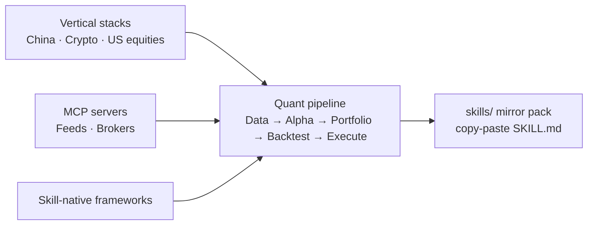

# Awesome Quant Skills [](https://awesome.re) [](LICENSE) [](https://github.com/JerryLiu369/awesome-quant-skills/actions/workflows/ci.yml) [](https://github.com/JerryLiu369/awesome-quant-skills) [](CONTRIBUTING.md)

> A curated directory of **Agent Skills**, **Quant MCP Servers**, and **Skill-Native Systems** for Quantitative Finance, Systematic Research, and Algorithmic Trading — usable from **Claude Code**, **OpenCode**, **Codex**, **Cursor**, **OpenClaw**, **Hermes**, and other `SKILL.md`-compatible harnesses.

**English** | [中文](README.zh-CN.md)

Unlike legacy quant lists cluttered with abandoned libraries, this directory focuses strictly on **autonomous agent capabilities**: machine-executable `SKILL.md` workflows, Model Context Protocol (MCP) tooling, and deterministic quantitative reasoning.

---

## 📌 Scope & Inclusion Standards

Entries are organized across three operational tiers (in rough order of emphasis):

1. **Native Agent Skills**: Portable `SKILL.md` specifications, prompts, and orchestration recipes. Skills follow the open `SKILL.md` convention (`name` + `description` frontmatter), so the same file loads in Claude Code, OpenCode, Codex, Cursor, OpenClaw, Hermes, and other compatible harnesses — only the install path differs (see Quickstart). No proprietary daemon lock-in.
2. **Quant MCP Servers**: Model Context Protocol servers exposing standardized financial tools (market feeds, order routing, statistical testing).
3. **Skill-Native Systems**: Open-source quant agent frameworks that expose modular, plug-and-play skill architectures.



---

## 📦 Embedded Skills Library

This repository doubles as a **quant skill pack**: 33 `SKILL.md` files mirrored directly inside [`skills/`](skills/), ready to copy into your agent harness (see Quickstart for per-harness install paths). Two caveats: mirrors are `SKILL.md`-only excerpts — helper scripts and reference docs stay upstream (see each file's `Imported from` header) — and most but not all are permissively licensed: three are GPL-family and one (`quant-buddy`) needs a commercial API backend. Check per-skill licenses in [NOTICE.md](NOTICE.md) before redistributing.

- **China A-Shares & Futures**: CTP API, PTrade, TqSdk, TDX, Wencai, CnInfo, AKQuant, plus A-share filters and futures workflows.
- **Alpha & Factors**: Paper-derived factor mining, Alpha Zoo, CANSLIM screeners.
- **Backtesting & Auditing**: Lookahead bias avoidance, PBO overfitting checks, VectorBT, Pine Script backtester.
- **Crypto & Web3**: Pine Script developer/debugger, DefiLlama yields & flows, Perp funding basis.
- **Global Equities & Risk**: EDGAR 10-K extraction, LLMQuant equities & macro, OpenQuant VaR risk.

> The bullets above are the mirrored skill set. The directory below additionally links non-mirrored tools (e.g. MiniQMT gateways, Purged CV, Tushare/AKShare MCP servers) — entries without a `mirrored at` note are link-only.

---

## 🚀 Quickstart

**Use a mirrored skill (30 seconds):**

1. Pick a skill under [`skills/`](skills/). Layout is always `skills/<category>/<name>/SKILL.md`; per-skill licenses are in [NOTICE.md](NOTICE.md).
2. Copy the skill folder into your harness's skills directory — e.g. `~/.claude/skills/` for Claude Code (other harnesses use different paths; check your harness docs).
3. Ask your agent to use it — and default to paper trading first (see [SECURITY.md](SECURITY.md)).

```bash
# example: install the CTP futures skill into Claude Code
cp -r skills/china-markets/ctp-api ~/.claude/skills/
```

**Use a directory link:** entries below are upstream repos (skills, MCP servers, frameworks), not vendored code. For MCP servers, register the server in your host's MCP config with your own API keys and start read-only; for skill repos, copy their `SKILL.md` the same way as above. Registration shape (exact command and env keys come from each upstream repo's README — never commit real keys):

```json
{
  "mcpServers": {
    "<server-name>": {
      "command": "<install-command>",
      "env": { "<VENDOR_API_KEY>": "paste-your-key-here" }
    }
  }
}
```

**Find your stack:** A-share / futures trader → [China](#china-a-shares--domestic-futures) + [Data](#1-data-ingestion--market-feeds) + [Execution](#5-execution--order-routing); crypto → [Crypto](#crypto--web3-markets) plus the funding-basis/pine mirrors; US equity researcher → [US](#us--global-equities) + EDGAR/FRED + [Backtesting audit](#4-backtesting--safety-auditing).

**For agents reading this file:** the mirror-to-upstream index is the table in [NOTICE.md](NOTICE.md); each mirrored file also carries an `Imported from` header with its exact upstream source path. Inline `mirrored at` notes mark which directory entries have a local copy. A compact machine summary lives in [llms.txt](llms.txt).

---

## 📑 Table of Contents

- [Quickstart](#-quickstart)
- [Vertical Market Stacks](#-vertical-market-stacks)
  - [China A-Shares & Domestic Futures](#china-a-shares--domestic-futures)
  - [Crypto & Web3 Markets](#crypto--web3-markets)
  - [US & Global Equities](#us--global-equities)
- [Universal Quant Pipeline](#-universal-quant-pipeline)
  - [1. Data Ingestion & Market Feeds](#1-data-ingestion--market-feeds)
  - [2. Alpha Generation & Factor Mining](#2-alpha-generation--factor-mining)
  - [3. Portfolio & Risk Allocation](#3-portfolio--risk-allocation)
  - [4. Backtesting & Safety Auditing](#4-backtesting--safety-auditing)
  - [5. Execution & Order Routing](#5-execution--order-routing)
- [Quant MCP Servers](#-quant-mcp-servers)
  - [Market Feeds & Fundamentals](#market-feeds--fundamentals)
  - [Broker & Exchange Gateways](#broker--exchange-gateways)
- [Skill-Native Quant Frameworks](#-skill-native-quant-frameworks)
- [Agent Evaluation & Benchmarks](#-agent-evaluation--benchmarks)
- [Miscellaneous & Other Skills](#-miscellaneous--other-skills)
- [Contributing](#-contributing)
- [Disclaimer](#-disclaimer)
- [License](#-license)

---

## 🌐 Vertical Market Stacks

*Full-lifecycle skills engineered for specific regional regulations, session rhythms, or market microstructure.*

### China A-Shares & Domestic Futures
- [algoderiv/agent-skills](https://github.com/algoderiv/agent-skills) - Claude Code skills for Chinese quantitative derivatives and CTP 6.7.8 API integration (`skills/china-markets/ctp-api/SKILL.md`), order execution, and position management alongside TqSdk.
- [aliwangzai/myquant-dev](https://github.com/aliwangzai/myquant-dev) - Claude Code skill embedding 29 GM SDK references so an agent writes compliant event-driven MyQuant strategies: subscriptions, multi-frequency queries, backtest config and order execution.
- [CharmYue/ashare-mcp](https://github.com/CharmYue/ashare-mcp) - A-share data MCP server on FastMCP and AKShare with Baostock/Tushare fallback, covering limit-up and limit-down pools, dragon-tiger lists, margin trading, chip distribution and statement filings.
- [dfkai/xtquantai](https://github.com/dfkai/xtquantai) - Agent skills for the QMT research terminal whose `qmt-inner-backtest` skill turns factor research into QMT native cross-sectional backtests with Barra-style normalisation and lookahead audits.
- [gaaiyun/joinquant-skill](https://github.com/gaaiyun/joinquant-skill) - JoinQuant strategy development skill with an AST-based static linter (`scripts/strategy_lint.py`) that blocks lookahead bias and unadjusted-price mistakes, plus a `jqskill_mcp` tool service.
- [guangxiangdebizi/FinanceMCP-DCTHS](https://github.com/guangxiangdebizi/FinanceMCP-DCTHS) - TypeScript MCP server merging Tushare with EastMoney and Tonghuashun sources for sector and concept indices, constituents, leading stocks and sector fund flows over stdio or HTTP.
- [guangxiangdebizi/QMT-MCP](https://github.com/guangxiangdebizi/QMT-MCP) - FastMCP service over XunTou XTQuant (miniQMT) offering quote subscription, position and asset queries plus order placement, with a built-in risk-control layer.
- [hexonal/vnpy_agentbridge](https://github.com/hexonal/vnpy_agentbridge) - FastMCP bridge and IntentEngine running in the VeighNa (vnpy) `MainEngine` process enforcing a "propose-never-execute" boundary with human and `vnpy_riskmanager` approval gating.
- [itsadrianxv/quant-strategy-builder-skill](https://github.com/itsadrianxv/quant-strategy-builder-skill) - Modular skill suite for Claude Code, Codex, and OpenClaw supporting domestic futures (`implement-cn-futures-strategy`) and A-share/ETF execution constraints (`implement-cn-equity-etf-strategy`).
- [juju-w/qmt-mcp](https://github.com/juju-w/qmt-mcp) - Streamable HTTP MCP server running `xtquant` (miniQMT) in Docker/Wine or native Windows for ticker search, historical K-lines, and portfolio inspection.
- [jwangkun/claude-for-financial-services-cn](https://github.com/jwangkun/claude-for-financial-services-cn) - Comprehensive collection of 63 Claude Skills adapted for Chinese financial institutions alongside bundled MCP servers (`akshare-mcp`, `ifind-mcp`, `wind-mcp`; Wind/iFind legs need institutional licenses).
- [lingfan/tdxquant-mcp](https://github.com/lingfan/tdxquant-mcp) - Model Context Protocol server and native `skills/china-markets/tdxquant/SKILL.md` skill for TdxQuant / TongDaXin across Cursor, Claude Code, and Hermes.
- [lzwme/finance-quant-skills](https://github.com/lzwme/finance-quant-skills) - Agent skills tailored for A-share quantitative trading, market analysis, and rule checking (mirrored at `skills/china-markets/akquant/SKILL.md`).
- [NBreeze-Eric/financial-services-plugins-cn](https://github.com/NBreeze-Eric/financial-services-plugins-cn) - A-share and HK research framework adapted from Anthropic's financial-services-plugins, swapping foreign vendors for four Tonghuashun iFinD MCP servers and shipping an equity-research skill tree.
- [QmQsun/Wind-MCP](https://github.com/QmQsun/Wind-MCP) - MCP server bridging the Wind Financial Terminal through WindPy COM, exposing quotes, financial statements, EDB macro series and conditional screening to agents (Windows plus an institutional Wind licence required).
- [quantskills/agent-ssquant](https://github.com/quantskills/agent-ssquant) - Futures quantitative agent workflow with Anthropic-compatible `skills/china-markets/ssquant-futures/SKILL.md` to gate CTP/SimNow runtime execution.
- [quantskills/skill-xingtai-catcher](https://github.com/quantskills/skill-xingtai-catcher) - K-line pattern similarity skill with MCP tools for A-shares and commodity futures, matching natural-language descriptions, hand-drawn curves or chart screenshots against historical shapes.
- [ricequant/ricequant-skills](https://github.com/ricequant/ricequant-skills) - Official RiceQuant skills pack for Claude Code with 14 `SKILL.md` files covering RQData queries, RQAMS portfolio operations, earnings analysis and sector overviews.
- [rollysys/use_cninfo](https://github.com/rollysys/use_cninfo) - Specialized CLI and Claude Code `SKILL.md` skill querying official A-share statutory disclosures on CnInfo and extracting full-text Markdown via PyMuPDF (mirrored at `skills/china-markets/cninfo-disclosure/SKILL.md`).
- [sencloud/futures_mcp](https://github.com/sencloud/futures_mcp) - Domestic commodity and financial futures MCP server combining AKShare market data feeds, multi-indicator technical analysis, and DeepSeek analytical integration.
- [shinnytech/tqsdk-python](https://github.com/shinnytech/tqsdk-python) - Official Tianqin Quant SDK featuring an embedded agent skill (`skills/china-markets/tqsdk-trading/SKILL.md`) for CTP futures/options event loops and margin execution.
- [Wangshengyang2004/myquant-mcp](https://github.com/Wangshengyang2004/myquant-mcp) - MCP server and companion `SKILL.md` on the MyQuant GM API, covering A-share quotes, fundamentals, positions, T+0 intraday trading and paper or live orders.
- [xxbbzy/ptrade-agent-skills](https://github.com/xxbbzy/ptrade-agent-skills) - Dedicated `SKILL.md` skill suite (`skills/china-markets/ptrade-strategy-writing`) for Claude Code and Codex with static AST checkers to write and inspect PTrade institutional trading algorithms.
- [yywx55/qmt-trade-mcp](https://github.com/yywx55/qmt-trade-mcp) - QMT/xtquant MCP server whose tools split into a market-data group (snapshots, adjustment factors, trading calendar) and an execution group (orders, cancellations, positions), served over SSE.
- [zhangchiep/joinquant-skill](https://github.com/zhangchiep/joinquant-skill) - Minimal JoinQuant API reference skill for Claude Code covering strategy lifecycle callbacks, timer tasks, adjustment and slippage settings, fundamental queries and order functions.

### Crypto & Web3 Markets
- [aaronjmars/web3-research-mcp](https://github.com/aaronjmars/web3-research-mcp) - Local MCP server bundling CoinGecko, CoinMarketCap and DeFiLlama lookups (protocol TVL, ATH TVL, period changes) without requiring external API keys.
- [AlgoVaultLabs/crypto-quant-signal-mcp](https://github.com/AlgoVaultLabs/crypto-quant-signal-mcp) - Multi-venue derivatives intelligence MCP server with 20 pre-built Anthropic agent skills scanning cross-venue funding rate arbitrage across 7 perpetual exchanges.
- [binance/binance-skills-hub](https://github.com/binance/binance-skills-hub) - Official Binance skills hub with 21 `SKILL.md` files giving agents an agentic-wallet surface for spot and perpetual orders, on-chain transfer tracking and Web3 DeFi interaction.
- [brandononchain/opentrade](https://github.com/brandononchain/opentrade) - Agent skills supporting 24/7 crypto microstructure, Pine Script v6 strategy synthesis, and high-frequency trading heuristics.
- [caiovicentino/polymarket-mcp-server](https://github.com/caiovicentino/polymarket-mcp-server) - MCP server for Polymarket covering market discovery, WebSocket order-book monitoring, portfolio inspection and live execution.
- [coinbase/agentkit](https://github.com/coinbase/agentkit) - Coinbase Developer Platform framework giving agents wallet management plus action providers for swaps, lending and price feeds across Base, EVM and Solana, with a native MCP smart-wallet server.
- [coinpaprika/dexpaprika-mcp](https://github.com/coinpaprika/dexpaprika-mcp) - MCP server from DexPaprika for multi-chain DEX analytics: pool TVL, swap volume, price impact and historical OHLCV.
- [DefiLlama/defillama-skills](https://github.com/DefiLlama/defillama-skills) - Official agent skills (`yield-strategies`, `defi-data`, `flows-and-events`, mirrored under `skills/crypto-web3/`) connecting agents to DefiLlama for protocol TVL, DEX volumes, yields, and token unlocks.
- [dex-original/okx-agent-trade-kit](https://github.com/dex-original/okx-agent-trade-kit) - AI agent trading kit and MCP server (`okx-trade-mcp`) providing 145 tools across 11 modules for spot and derivatives algorithmic order execution.
- [edkdev/hyperliquid-mcp](https://github.com/edkdev/hyperliquid-mcp) - Python MCP server for Hyperliquid perpetual DEX with EIP-712 order signing, atomic bracket orders (entry + TP + SL), and funding rate streams.
- [GMGNAI/gmgn-skills](https://github.com/GMGNAI/gmgn-skills) - Official GMGN OpenAPI skills pack with 19 `SKILL.md` files for smart-money tracking, wallet PnL, token security audits and swap or conditional-order execution on Solana, Base and Ethereum.
- [helius-labs/core-ai](https://github.com/helius-labs/core-ai) - Helius AI tooling for Solana pairing a `helius-mcp` server (on-chain assets, transaction parsing, priority fees) with 24 `SKILL.md` files including DFlow routing skills.
- [HKUDS/Vibe-Trading](https://github.com/HKUDS/Vibe-Trading) - Multi-asset trading agent framework with native `SKILL.md` packaging and `perp-funding-basis` (`skills/crypto-web3/perp-funding-basis/SKILL.md`) skills for perpetual funding rate cash-and-carry basis arbitrage.
- [kukapay/crypto-liquidations-mcp](https://github.com/kukapay/crypto-liquidations-mcp) - FastMCP streaming server streaming Binance Futures liquidation cascades and order size distributions for market stress detection.
- [kukapay/jupiter-mcp](https://github.com/kukapay/jupiter-mcp) - Dedicated MCP server executing Solana DEX token swaps via Jupiter Ultra API with quote generation, slippage tolerance, and priority fee controls.
- [mirror29/openfinclaw-cli](https://github.com/mirror29/openfinclaw-cli) - Plug-and-play crypto research, backtest, and paper-trade skill integrations for multi-agent environments.
- [sendaifun/solana-agent-kit](https://github.com/sendaifun/solana-agent-kit) - Foundational open-source toolkit connecting AI agents to Solana protocols with 60+ actions (Jupiter, Raydium, Orca, Meteora, Drift).
- [Senpi-ai/senpi-skills](https://github.com/Senpi-ai/senpi-skills) - Hyperliquid perpetuals skill library with 15 `SKILL.md` files covering market pulse, smart-money flow, funding rates, position sizing and risk guardrails.
- [SpartanLabsXyz/simmer-sdk](https://github.com/SpartanLabsXyz/simmer-sdk) - Prediction-market harness for agents: 37 `SKILL.md` files, a bundled `simmer-mcp` server and a Python SDK for paper-trading Polymarket, Kalshi and Hyperliquid.
- [Superior-Trade/superior-skills](https://github.com/Superior-Trade/superior-skills) - Open skill and tool-schema pack for Superior Trade; 31 `SKILL.md` files let an agent author, backtest and deploy strategies on Hyperliquid perpetuals and Polymarket.
- [vooi-app/mcp](https://github.com/vooi-app/mcp) - Unified perpetual futures MCP server connecting AI agents to Hyperliquid, Lighter, Aster, and Kinetiq for cross-venue funding rate spread arbitrage.
- [YichengYang-Ethan/oracle3-prediction-market-agent](https://github.com/YichengYang-Ethan/oracle3-prediction-market-agent) - Prediction-market arbitrage engine and MCP server scanning fee-adjusted no-arbitrage gaps across Kalshi, Polymarket and Solana, with 12 `SKILL.md` files and pre-trade risk rails.

### US & Global Equities
- [AlphaGBM/skills](https://github.com/AlphaGBM/skills) - 27 `SKILL.md` workflows for options and equity research, spanning Greeks attribution, IV percentile ranking, volatility-surface fitting and earnings-crush backtests.
- [daniel3303/Equibles](https://github.com/daniel3303/Equibles) - Self-hosted financial terminal MCP server providing 62+ agent tools across SEC EDGAR, 13F ownership, congressional disclosures, and FRED data.
- [jsconiers/capitol-trades-mcp](https://github.com/jsconiers/capitol-trades-mcp) - FastMCP server providing 23 specialized tools to track US congressional stock trades from Capitol Trades without API keys.
- [LLMQuant/skills](https://github.com/LLMQuant/skills) - Standardized repository of 18 modular agent skills (`llmquant-equities`, `llmquant-macro`, `llmquant-risk`, mirrored under `skills/global-equities/` and `skills/portfolio-risk/`) compatible with Claude Code, Codex, and Hermes Agent.
- [pseudo-longinus/quant-buddy-skills](https://github.com/pseudo-longinus/quant-buddy-skills) - Full infrastructure skills covering US/HK equities, macro indicators, and multi-asset screening for LLM agents (mirrored at `skills/china-markets/quant-buddy/SKILL.md`; needs commercial API backend).
- [simonlin1212/global-stock-data](https://github.com/simonlin1212/global-stock-data) - Zero-auth market data skill for Claude Code / Codex with 50+ endpoints covering CBOE options Greeks, 0DTE flow, and policy rates from 38 central banks.
- [stocktwits/stocktwits-mcp](https://github.com/stocktwits/stocktwits-mcp) - Official StockTwits MCP server exposing zero-auth tools to stream retail investor sentiment scores, trending tickers, and social volume momentum.
- [zen-tradings/retail-skills-us](https://github.com/zen-tradings/retail-skills-us) - Skills tailored for US equity rule enforcement, tax-loss harvesting, and retail algorithmic setups.

---

## ⚙️ Universal Quant Pipeline

*Modular skills aligned with each chronological stage of the quantitative investment lifecycle.*

### 1. Data Ingestion & Market Feeds
*Retrieval, cleaning, split-adjustment, and cross-source alignment.*
- [27dream/mcp-eastmoney](https://github.com/27dream/mcp-eastmoney) - Zero-configuration MCP server for Claude Code and Cursor providing direct access to EastMoney push APIs without API keys (unofficial; can break without notice).
- [btopn/OpenInsider-MCP](https://github.com/btopn/OpenInsider-MCP) - MCP server aggregating OpenInsider Form 4 insider trades, SEC EDGAR 8-K and 13D filings plus FINRA short-volume and failure-to-deliver data for forensic tracking.
- [c-cf/imf-data-mcp](https://github.com/c-cf/imf-data-mcp) - IMF macroeconomic MCP server built on the modern SDMX API, querying IFS, World Economic Outlook and Balance of Payments datasets.
- [CNQQC/xueqiu-mcp](https://github.com/CNQQC/xueqiu-mcp) - MCP server with 29 tools providing structured Xueqiu market data, capital flows, and community sentiment formatted as clean Markdown tables (unofficial; can break without notice).
- [dgunning/edgartools](https://github.com/dgunning/edgartools) - SEC EDGAR toolkit providing a native MCP server (`edgartools-mcp`) and Claude Code skills for extracting 10-K, 10-Q, 8-K, and Form 4 insider filings into typed data (mirrored at `skills/global-equities/edgar-financials/SKILL.md`).
- [elsejj/mcp-cn-a-stock](https://github.com/elsejj/mcp-cn-a-stock) - Dedicated A-share MCP server providing tiered endpoints for quotes, financial fundamentals, and technical indicators backed by the `msd` database.
- [erwanjun/tushare-mcp-server](https://github.com/erwanjun/tushare-mcp-server) - Production MCP server wrapping 173 Tushare Pro endpoints across A-shares, futures, options, indices, and macro metrics (needs a Tushare Pro token; freemium).
- [guangxiangdebizi/FinanceMCP](https://github.com/guangxiangdebizi/FinanceMCP) - Multi-market financial MCP server providing 19 tools integrating Tushare Pro for quotes, financial statements, and macro indicators (needs a Tushare Pro token; freemium).
- [hypier/tradingview-quantitative-skills](https://github.com/hypier/tradingview-quantitative-skills) - Technical pattern recognition, market scanning, and TradingView feed integration skills.
- [kylefu8/tradingview-akshare-mcp](https://github.com/kylefu8/tradingview-akshare-mcp) - Technical analysis MCP server built on AKShare and TradingView indicators with multi-source fallback.
- [lefterisloukas/edgar-crawler](https://github.com/lefterisloukas/edgar-crawler) - Academic SEC EDGAR extraction engine (WWW 2025) converting 10-K, 10-Q, and 8-K reports into clean, item-segmented JSON structures.
- [quantskills/quantskills](https://github.com/quantskills/quantskills) - Panoramic ecosystem navigation and standard data retrieval workflows for financial agents.
- [raidery/quant-skills](https://github.com/raidery/quant-skills) - Quant skill pack featuring `skills/china-markets/wencai-screener/SKILL.md` for natural-language stock screening via `pywencai`.
- [stefanoamorelli/fred-mcp-server](https://github.com/stefanoamorelli/fred-mcp-server) - Dedicated Model Context Protocol server delivering universal access to over 800,000 Federal Reserve Economic Data (FRED®) time series (needs a free FRED API key).
- [stefanoamorelli/sec-edgar-mcp](https://github.com/stefanoamorelli/sec-edgar-mcp) - High-precision MCP server connecting AI coding assistants directly to SEC EDGAR filings (10-K, 10-Q, 8-K), parsed XBRL statements, and Form 4 insider transactions.
- [worldbank/data360-mcp](https://github.com/worldbank/data360-mcp) - Official World Bank Data360 MCP server for searching, validating and retrieving development and macroeconomic indicators from the World Bank API.
- [zwldarren/akshare-one-mcp](https://github.com/zwldarren/akshare-one-mcp) - FastMCP server built on `akshare-one` exposing Chinese equity quotes, K-lines, and financials with multi-source fallback.

### 2. Alpha Generation & Factor Mining
*Hypothesis testing, formulaic alpha derivation, and research document processing.*
- [Abel-ai-lab/predict-anything](https://github.com/Abel-ai-lab/predict-anything) - Causal market analysis, alpha discovery, and predictive market structure extraction skills.
- [CTAAgents/quant-skills](https://github.com/CTAAgents/quant-skills) - AI-driven Commodity Trading Advisor (CTA) skills leveraging genetic programming for factor discovery.
- [Howard-Jerry/quant-agent-skills](https://github.com/Howard-Jerry/quant-agent-skills) - 8,000-line orchestration skill for concept thematic analysis, industry supply chain mapping, and factor screening.
- [ICT-FinD-Lab/alphagen](https://github.com/ICT-FinD-Lab/alphagen) - Formulaic alpha mining framework combining genetic programming and deep symbolic optimisation, with an `alphagen_llm` prompt and client layer plus Qlib backtest integration.
- [minihellboy/factorminer](https://github.com/minihellboy/factorminer) - Quantitative alpha discovery engine with LLM-guided symbolic search, typed DSL execution, and native MCP server support.
- [noahnan-max/governed-dcf-skill](https://github.com/noahnan-max/governed-dcf-skill) - Portable, governed agent skill (`SKILL.md`) for Codex providing auditable multi-scenario FCFF valuation, reverse DCF, and WACC sensitivity matrices.
- [quantskills/skill-factor-alpha191-alpha101](https://github.com/quantskills/skill-factor-alpha191-alpha101) - Formulaic factor skill computing Alpha101, Alpha191 and a Qlib-compatible Alpha158 natively from long-format OHLCV CSVs into wide factor tables.
- [quantskills/skill-factor-mining-pandaai](https://github.com/quantskills/skill-factor-mining-pandaai) - Academic paper factor extraction and structured financial analysis skills (mirrored at `skills/alpha-factors/factor-mining-pandaai/SKILL.md`).
- [quantskills/skill-report-replication](https://github.com/quantskills/skill-report-replication) - Six-stage replication pipeline turning research PDFs into runnable factor code: structured translation, formula extraction, point-in-time alignment, code generation and IC/RankIC verification.
- [stockvaluation-io/stockvaluation_io](https://github.com/stockvaluation-io/stockvaluation_io) - Local-first MCP DCF valuation engine decoupling qualitative thesis generation from deterministic Damodaran-style valuation math.
- [tradermonty/claude-trading-skills](https://github.com/tradermonty/claude-trading-skills) - Collection of 70+ domain-specific trading skills for AI coding agents covering market breadth analysis, technical screening, and trade journaling (retail-workflow oriented; unrelated to agiprolabs' toolkit below; `breadth-chart-analyst` and `canslim-screener` mirrored under `skills/alpha-factors/`; screeners need an FMP key, free tier suffices).
- [TradersPost/pinescript-agents](https://github.com/TradersPost/pinescript-agents) - Claude Code skills (`pine-developer` and `pine-debugger` mirrored under `skills/crypto-web3/`, `pine-backtester` under `skills/backtesting-audit/`) engineered to generate TradingView Pine Script v6 strategies with automated broker alert webhooks.
- [VernonOY/alpha-skills](https://github.com/VernonOY/alpha-skills) - Nine modular research skills led by `alpha-mine` (operator and expression search screened by IC/ICIR) alongside alpha-evaluate, alpha-backtest, alpha-report and alpha-monitor.
- [VernonOY/replicalpha](https://github.com/VernonOY/replicalpha) - Quant research reproduction agent extracting factors from research PDFs into executable Python code with Red Team validation.

### 3. Portfolio & Risk Allocation
*Capital allocation, position sizing, risk parity, and dynamic rebalancing.*
- [agiprolabs/claude-trading-skills](https://github.com/agiprolabs/claude-trading-skills) - 68 trading skills featuring Kelly criterion position sizing, regime detection, and slippage modeling (quant-toolkit oriented; unrelated project sharing a similar name with tradermonty's list above).
- [CarloNicolini/autoresearch-skfolio](https://github.com/CarloNicolini/autoresearch-skfolio) - Autonomous portfolio research harness over skfolio exploring MeanRisk, HRP, RiskBudgeting and NCO, scored out-of-sample with Deflated Sharpe and Combinatorial Purged CV.
- [dcajasn/Riskfolio-Lib](https://github.com/dcajasn/Riskfolio-Lib) - Quantitative strategic asset allocation library supporting 24+ convex risk measures (CVaR, CDaR, EVaR) and nested clustered optimization (HRP, HERC, HER2).
- [ebrandler/mcportfolio](https://github.com/ebrandler/mcportfolio) - MCP server wrapping PyPortfolioOpt and CVXPY for natural-language portfolio construction: mean-variance, max Sharpe, min volatility, Black-Litterman, HRP and mean-CVaR.
- [ElmatadorZ/Money-Atlas-Intelligence-OS](https://github.com/ElmatadorZ/Money-Atlas-Intelligence-OS) - Smart Money Concepts (SMC) market structure and asset allocation guidance skill.
- [jackson-video-resources/markov-hedge-fund-method](https://github.com/jackson-video-resources/markov-hedge-fund-method) - Markov regime detection skill for dynamic portfolio risk-on/risk-off regime switching.
- [mitchellbernstein/openquant](https://github.com/mitchellbernstein/openquant) - Open-source quant operating system providing an MCP server and Hermes/Claude Agent Skills for VaR risk assessment and signal generation (mirrored at `skills/portfolio-risk/openquant-trading/SKILL.md`).
- [nutdnuy/self-driving-portfolio-skill](https://github.com/nutdnuy/self-driving-portfolio-skill) - Governed strategic asset allocation skill set (8 `SKILL.md`) enforcing point-in-time input freezing, positive-definite covariance repair, ten optimisation methods and an audit trail.
- [PyPortfolio/PyPortfolioOpt](https://github.com/PyPortfolio/PyPortfolioOpt) - Production-grade portfolio optimization implementing Mean-Variance Efficient Frontier, Black-Litterman allocation, and Hierarchical Risk Parity (HRP).
- [wshobson/maverick-mcp](https://github.com/wshobson/maverick-mcp) - Open stock-market MCP server combining analysis tools with ATR-based risk-adjusted position sizing, correlation matrices, a risk dashboard and walk-forward backtesting.

### 4. Backtesting & Safety Auditing
*Simulation, lookahead bias prevention, data-leakage auditing, and return attribution.*
- [bettyguo/agent-backtest-lab](https://github.com/bettyguo/agent-backtest-lab) - Statistical-rigor audit harness designed specifically for LLM trading-agent frameworks to prevent lookahead leakage, prompt-bias self-deception, and PBO overfitting.
- [bmouler/lookahead-lint](https://github.com/bmouler/lookahead-lint) - AST-based static analyzer for quantitative code that agents run to flag lookahead bias, future target leakage (`.shift(-1)`), and premature scaler fitting.
- [eslazarev/purged-cross-validation](https://github.com/eslazarev/purged-cross-validation) - Scikit-learn-compatible package implementing López de Prado's Purged K-Fold and Combinatorial Purged Cross-Validation (CPCV) to eliminate time-series leakage.
- [HyperFrequency/skills](https://github.com/HyperFrequency/skills) - Agent skills for performance reporting; its `tearsheet-generator` builds QuantStats tearsheets with SVG charts, MAE percentile analysis and leverage recommendations.
- [LuxAlgo/PineTS](https://github.com/LuxAlgo/PineTS) - Open-source TypeScript transpiler and headless runtime for Pine Script v5/v6 with `AGENTS.md` and `pinets-cli` tool support for local strategy simulation and backtesting.
- [marketcalls/vectorbt-backtesting-skills](https://github.com/marketcalls/vectorbt-backtesting-skills) - Modular suite of agentic coding skills scaffolding VectorBT strategy development, hyperparameter tuning, and tearsheet evaluation (mirrored under `skills/backtesting-audit/`).
- [ml4t/skills](https://github.com/ml4t/skills) - Machine Learning for Algorithmic Trading skills enforcing leakage-safe feature engineering, purged cross-validation boundaries, and rigorous backtest auditing.
- [nautechsystems/nautilus_trader](https://github.com/nautechsystems/nautilus_trader) - Production Rust-native algorithmic trading engine with deterministic event-driven backtesting and in-repo `AGENTS.md` and `CLAUDE.md` operational rules.
- [pineforge-4pass/pineforge-backtest-mcp](https://github.com/pineforge-4pass/pineforge-backtest-mcp) - Local MCP server transpiling PineScript v6 to C++ for deterministic offline backtests, with parameter grid sweeps and TradingView trade-by-trade parity checks.
- [PyneSys/pynecore](https://github.com/PyneSys/pynecore) - Pine Script-compatible Python runtime and AST transpiler running TradingView indicators and strategies in native Python for offline backtesting and bar-by-bar verification.
- [QuantConnect/Lean](https://github.com/QuantConnect/Lean) - Institutional-grade algorithmic trading and backtesting engine (Python/C#) supporting multi-asset modeling, tick-level granularity, and LEAN CLI agent synthesis.
- [quantskills/skill-backtest-overfit](https://github.com/quantskills/skill-backtest-overfit) - Statistical gate skill computing Deflated Sharpe Ratio, Probability of Backtest Overfitting, a multiple-testing Sharpe haircut and MinTRL, returning a PASS/FAIL verdict.
- [quantskills/skill-backtesting-bias-avoidance](https://github.com/quantskills/skill-backtesting-bias-avoidance) - Dedicated `SKILL.md` auditing backtests for lookahead bias, survivorship bias, CSCV Probability of Backtest Overfitting (PBO), and Deflated Sharpe Ratio (DSR) (mirrored at `skills/backtesting-audit/backtesting-bias-avoidance/SKILL.md`).
- [ranaroussi/quantstats](https://github.com/ranaroussi/quantstats) - Portfolio analytics library calculating Sharpe, Sortino, Calmar, and VaR to generate interactive HTML tearsheets for agent backtest evaluation.
- [saksham10arora-dotcom/quant-skills](https://github.com/saksham10arora-dotcom/quant-skills) - Specialized skills for backtest code review, lookahead bias audits, statistical test validation, and paper reproduction across Claude Code / OpenCode / Codex (mirrored under `skills/backtesting-audit/` as `backtest-review`, `data-quality-audit`, `paper-repro`, `stats-test-picker`).
- [stefan-jansen/pyfolio-reloaded](https://github.com/stefan-jansen/pyfolio-reloaded) - Maintained pyfolio risk analytics framework generating tearsheets covering return attribution and Bayesian out-of-sample performance analysis.
- [stefan-jansen/zipline-reloaded](https://github.com/stefan-jansen/zipline-reloaded) - Maintained modern fork of Zipline backtesting engine delivering agent-ready Pipeline APIs for cross-sectional factor simulations.
- [taylorwilsdon/quantconnect-mcp](https://github.com/taylorwilsdon/quantconnect-mcp) - FastMCP server for QuantConnect letting agents create projects, compile code, run full backtests and inspect charts, orders and insights.

### 5. Execution & Order Routing
*Order execution algorithms (TWAP/VWAP), slippage management, and broker integration.*
- [anbotolabs/anboto-agent-kit](https://github.com/anbotolabs/anboto-agent-kit) - Institutional execution desk toolkit and MCP (`@anboto/mcp`) with native Claude Skill (`anboto-trading`) deploying TWAP, VWAP, POV, and Iceberg algorithms across 14 venues.
- [SMU-Rainflow/ctp-mcp](https://github.com/SMU-Rainflow/ctp-mcp) - MCP server built on `vnpy_ctp` exposing CTP tick streaming, limit/market order placement, and cancellation to coding agents.
- [Synpath-ai/synpath](https://github.com/Synpath-ai/synpath) - Python/Rust smart order routing (SOR) and advanced execution algorithms (TWAP, iceberg, pegged orders) for prediction and financial venues.
- [TradeRouter/trade-router-mcp](https://github.com/TradeRouter/trade-router-mcp) - Algorithmic execution MCP server exposing TWAP slicing, DCA, and multi-DEX routing with MEV protection.

---

## 🔌 Quant MCP Servers

*Standardized Model Context Protocol servers providing raw computational and data APIs to quant agents.*

### Market Feeds & Fundamentals
- [Alex2Yang97/yahoo-finance-mcp](https://github.com/Alex2Yang97/yahoo-finance-mcp) - Production-ready Yahoo Finance MCP server exposing historical OHLCV candles, option chains, fundamental ratios, and corporate actions.
- [alphavantage/alpha_vantage_mcp](https://github.com/alphavantage/alpha_vantage_mcp) - Official Alpha Vantage MCP server exposing quotes, 60+ technical indicators, fundamentals, FX and crypto, shipped with a `global-stock-analysis` skill.
- [bidouilles/mcp-tradingview-server](https://github.com/bidouilles/mcp-tradingview-server) - FastMCP server providing direct tool access to TradingView technical indicators (RSI, MACD, EMAs) and OHLCV candlestick feeds.
- [cfdude/mcp-finnhub](https://github.com/cfdude/mcp-finnhub) - FastMCP server over the Finnhub API covering real-time quotes, technical analysis with pattern recognition, fundamentals, price targets, insider transactions and sentiment.
- [doggybee/mcp-server-ccxt](https://github.com/doggybee/mcp-server-ccxt) - Model Context Protocol server exposing unified CCXT trading and market data tools across 20+ cryptocurrency exchanges.
- [eliasfire617/crypto-market-data-mcp](https://github.com/eliasfire617/crypto-market-data-mcp) - CCXT market data MCP server across 100+ exchanges with open interest and perpetual funding rate comparison tools.
- [financial-datasets/mcp-server](https://github.com/financial-datasets/mcp-server) - Dedicated MCP server providing structured 10-K/10-Q financial statements and prices tailored for LLM tool consumption (needs a Financial Datasets API key; paid).
- [imbenrabi/Financial-Modeling-Prep-MCP-Server](https://github.com/imbenrabi/Financial-Modeling-Prep-MCP-Server) - FMP MCP server with dynamic tool loading across statements, earnings-call transcripts, 13F filings, insider trades, SEC filings and DCF models.
- [lazy-dinosaur/ccxt-mcp](https://github.com/lazy-dinosaur/ccxt-mcp) - Standardized Model Context Protocol server bridging CCXT across 100+ cryptocurrency exchanges with post-trade quantitative heuristics.
- [major7apps/tiingo-mcp](https://github.com/major7apps/tiingo-mcp) - Rust MCP server for Tiingo market data, shipping tools, resources and quant prompts over EOD prices, IEX top-of-book quotes, crypto, FX and news sentiment.
- [massive-com/mcp_massive](https://github.com/massive-com/mcp_massive) - Official MCP server from Massive.com (formerly Polygon.io) exposing search, call and query tools over US equities, options chains, FX and crypto, with Black-Scholes Greeks and in-memory SQL analytics.
- [openbq-org/OpenBB](https://github.com/openbq-org/OpenBB) - Core OpenBB platform featuring `openbb-mcp-server`, exposing 100+ multi-asset financial data providers as standardized MCP tools with bundled `SKILL.md` guides.
- [twelvedata/mcp](https://github.com/twelvedata/mcp) - Official Twelve Data MCP server for global prices, technical indicators, fundamentals, earnings and dividends, deployable hosted or locally over stdio.
- [unusual-whales/unusual-whales-official-mcp](https://github.com/unusual-whales/unusual-whales-official-mcp) - Official Unusual Whales MCP server exposing options order flow, gamma and delta exposure, dark-pool prints and congressional trading disclosures.

### Broker & Exchange Gateways
- [alpacahq/alpaca-mcp-server](https://github.com/alpacahq/alpaca-mcp-server) - Official Alpaca MCP server exposing market data and live/paper trading tools for equities, ETFs, crypto, and options.
- [AnalyticAce/binance-mcp-server](https://github.com/AnalyticAce/binance-mcp-server) - Production MCP server exposing Binance spot and futures APIs with order book analysis and position tracking.
- [rcontesti/IB_MCP](https://github.com/rcontesti/IB_MCP) - Model Context Protocol server interfacing with Interactive Brokers' official Web API to monitor liquidity and submit institutional-grade orders.
- [shuizhengqi1/futu-stock-mcp-server](https://github.com/shuizhengqi1/futu-stock-mcp-server) - Futu OpenAPI MCP server for HK, US and A-share Level-2 quotes, candlesticks, positions and order placement, shipped with its own `SKILL.md`.
- [visusnet/coinbase-mcp-server](https://github.com/visusnet/coinbase-mcp-server) - MCP server and native Claude Skill (`coinbase-trading`) integrating Coinbase Advanced Trading API for autonomous trade execution.

---

## 🏗️ Skill-Native Quant Frameworks

*Autonomous multi-agent quantitative platforms designed around composable skills.*
- [AI4Finance-Foundation/FinRobot](https://github.com/AI4Finance-Foundation/FinRobot) - Open-source multi-agent platform orchestrating specialized roles (Market Analyst, 10-K Financial Analyst, Quantitative Trader, Risk Manager) for equity research.
- [jesson-hh/financial-analyst](https://github.com/jesson-hh/financial-analyst) - A-share research-to-trading workstation coordinating 16+ sub-agents whose roles are defined as 28 `SKILL.md` files, covering report parsing, factor screening and bull/bear risk debate.
- [microsoft/RD-Agent](https://github.com/microsoft/RD-Agent) - Autonomous R&D multi-agent framework by Microsoft Research automating hypothesis generation, factor implementation, and backtesting against Microsoft Qlib.
- [Open-Finance-Lab/AgenticTrading](https://github.com/Open-Finance-Lab/AgenticTrading) - Open experimental platform and paper-trading sandbox for LLM trading agents, with multi-model orchestration, simulated matching and traceable decision logs.
- [TauricResearch/TradingAgents](https://github.com/TauricResearch/TradingAgents) - Institutional trading desk multi-agent framework built with LangGraph where specialized LLM roles collaborate in structured debate and risk cycles.
- [tohnee/investagent](https://github.com/tohnee/investagent) - Multi-agent investment research framework combining industry chain analysis, Buffett valuation filters, and QuantDinger backtesting.
- [virattt/ai-hedge-fund](https://github.com/virattt/ai-hedge-fund) - Multi-agent hedge-fund framework where investor-persona, fundamentals, technicals, sentiment, risk and portfolio agents deliberate before a trade decision, with a bundled backtester.
- [yiyan-yixing/quant-trading-skills](https://github.com/yiyan-yixing/quant-trading-skills) - 11-role collaborative quant agent framework featuring 20 core skills, 3-tier memory, and adversarial challenge protocols.

---

## 📊 Agent Evaluation & Benchmarks

*Benchmarks and forward-testing harnesses that score quant agents on executable tasks rather than on prose.*

- [QF-Bench/QuantitativeFinance-Bench](https://github.com/QF-Bench/QuantitativeFinance-Bench) - State-aware interactive benchmark scoring agents on dirty-data cleaning, runtime debugging, factor engineering and portfolio optimisation inside an isolated Docker sandbox.
- [LimexAILab/QuantCode-Bench](https://github.com/LimexAILab/QuantCode-Bench) - Benchmark measuring whether a model can turn a natural-language strategy idea into executable Backtrader code, graded through compile, backtest-execution and semantic-alignment stages.
- [ulab-uiuc/live-trade-bench](https://github.com/ulab-uiuc/live-trade-bench) - Forward-testing harness for LLM trading agents on live equity and prediction-market streams, avoiding lookahead leakage by construction.

## 🧪 Miscellaneous & Other Skills

*A staging ground for emerging, experimental, or cross-cutting skills that do not fit neatly into the categories above. When 3+ related skills accumulate here, they will graduate into their own dedicated category.*

- [BoyceFong/quant-skill-build](https://github.com/BoyceFong/quant-skill-build) - Skill authoring and scaffolding builder optimized for Codex and quantitative prompt authoring.
- [OpenJobs](https://openjobs.thecompound.tech) - OpenJobs keeps your roles, projects, achievements, stories and skills in one experience bank; it tailors each resume and each application answer from that bank for the job.

---

## 🤝 Contributing

We welcome community contributions! Please review our quality gates before submitting a Pull Request:

1. **Agent-Centric**: Must be directly invocable by an LLM Agent via `SKILL.md`, CLI prompt, or MCP tool.
2. **Methodological Rigor**: Backtesting and factor skills must adhere to sound quantitative principles (e.g., lookahead bias prevention, post-split price adjustments `close * adj_factor`).
3. **No Hallucinated Tooling**: Scripts and endpoints referenced in the skill must be verifiable and reproducible.

See [CONTRIBUTING.md](CONTRIBUTING.md) for submission details.

---

## ⚠️ Disclaimer

This project is for research and educational purposes only. Nothing here constitutes investment advice, an offer, or a solicitation to buy or sell any security or derivative.

Many skills and MCP servers listed here can route real orders (CTP, QMT, Alpaca, IB, Hyperliquid, Jupiter, Coinbase, etc.). Default to paper trading and human approval:

- Read-only first, then `propose-never-execute` where supported.
- Never put live API keys or secrets in agent prompts or committed `config.json`.
- Market data, filings, and social sentiment are untrusted inputs. Do not wire them directly to auto-execution.

You are solely responsible for compliance, risk control, and any losses.

See [SECURITY.md](SECURITY.md) for safe defaults (paper-first, human approval, key handling).

---

## 📄 License

This repository's own curation (`README.md`, `.github/`, `CONTRIBUTING.md`) is released under the [MIT License](LICENSE).

Skills under [`skills/`](skills/) are mirrored from upstream projects and **retain their original licenses** (see [NOTICE.md](NOTICE.md) and the `Imported from` header in each `SKILL.md`). Some mirrored skills are GPL-3.0 family — redistribution of those files follows their upstream terms, not MIT.
