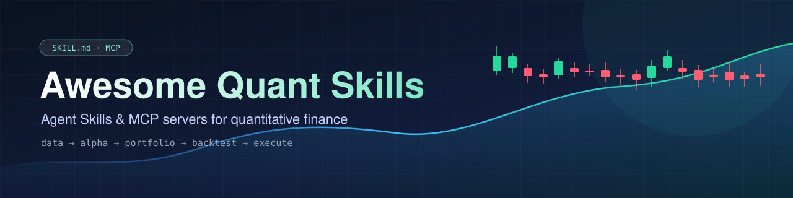
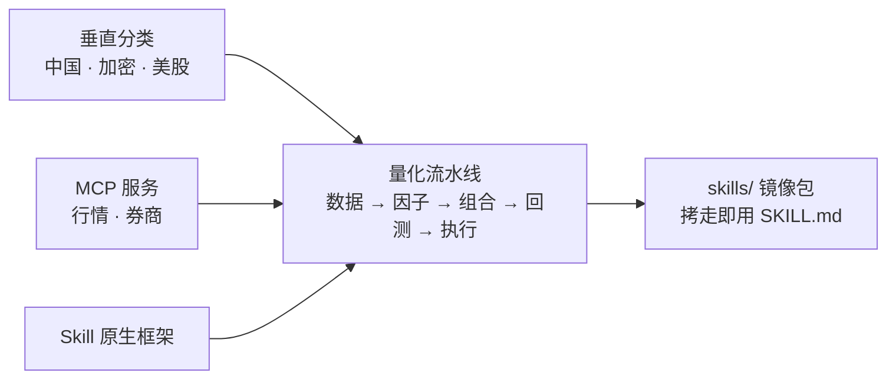

<div align="center">



<h3>面向量化金融、系统化研究与算法交易的 Agent Skill 与 MCP 服务精选目录</h3>

<a href="https://awesome.re"></a> <a href="LICENSE"></a> [](https://github.com/JerryLiu369/awesome-quant-skills/actions/workflows/ci.yml) [](https://github.com/JerryLiu369/awesome-quant-skills) <a href="CONTRIBUTING.md"></a><br>
 

**适用于**:      

<a href="#-快速上手">快速上手</a> · <a href="skills/README.md">技能目录</a> · <a href="#-按垂直市场分类">目录</a> · <a href="#-量化-mcp-服务">MCP 服务</a> · <a href="#-参与贡献">参与贡献</a>

[English](README.md) | **中文**

</div>


与堆满年久失修代码库的传统量化列表不同，本目录只收录**自主 agent 能力**：可机读执行的 `SKILL.md` 工作流、MCP（Model Context Protocol）工具和确定性量化推理。

---

## 一览

| 板块 | 内容 | 条目 |
|:--|:--|--:|
| 🌐 [按垂直市场分类](#-按垂直市场分类) | 分地区的完整栈：中国 A 股与期货、加密与 DeFi、美股与全球股票 | 131 |
| ⚙ [通用量化流水线](#-通用量化流水线) | 数据、因子、组合、回测审计与执行 skill | 86 |
| 🔌 [量化 MCP 服务](#-量化-mcp-服务) | 行情、基本面与券商网关 MCP 服务 | 55 |
| 🏗 [Skill 原生量化框架](#-skill-原生量化框架) | 拥有模块化 skill 架构的开源 agent 框架 | 28 |
| 📊 [Agent 评测与基准](#-agent-评测与基准) | 金融 agent 的评测与基准 | 18 |
| 🧪 [其他 Skill](#-其他-skill) | 其他值得一看的内容 | 1 |

**图例：**带 `mirrored at` 标注的条目在 [`skills/`](skills/) 下有本地 `SKILL.md` 副本（见[技能目录](skills/README.md)），其余为纯链接。

---

## 📌 收录范围与入选标准

条目按三个层级组织（大致按权重排序）：

1. **原生 Agent Skill**：可移植的 `SKILL.md` 规范、prompt 与编排配方。Skill 遵循开放的 `SKILL.md` 约定（`name` + `description` frontmatter），同一份文件可加载于 Claude Code、OpenCode、Codex、Cursor、OpenClaw、Hermes 及其他兼容 harness，只是安装路径不同（见快速上手）。无私有 daemon 绑定。
2. **量化 MCP 服务**：暴露标准化金融工具（行情、订单路由、统计检验）的 MCP 服务器。
3. **Skill 原生系统**：暴露模块化、即插即用 skill 架构的开源量化 agent 框架。



---

## 📦 内置 Skill 库

本仓库同时是一个**量化 skill 包**：[`skills/`](skills/) 内直接镜像了 45 个 `SKILL.md` 文件，拷到你的 agent harness 即可用（各 harness 安装路径见快速上手）。两点说明：镜像只是 `SKILL.md` 单文件摘录——配套脚本和参考文档仍在上游（见各文件头的 `Imported from`）；且并非全部宽松许可：3 个属 GPL 系，1 个（`quant-buddy`）需要商业 API 后端。二次分发前请查 [NOTICE.md](NOTICE.md) 中的逐 skill 许可。

- **中国 A 股与期货**：CTP API、PTrade、TqSdk、TDX、Wencai、CnInfo、AKQuant，另有 A 股过滤与期货工作流。
- **Alpha 与因子**：论文因子挖掘、Alpha Zoo、CANSLIM 筛选。
- **回测与审计**：前视偏差规避、PBO 过拟合检验、VectorBT、Pine Script 回测。
- **加密与 Web3**：Pine Script 开发/调试、DefiLlama 收益与资金流、永续资金费率基差。
- **全球股票与风险**：EDGAR 10-K 提取、LLMQuant 股票与宏观、OpenQuant VaR 风险。

> 以上是镜像的 skill 集合。下面目录还链接了未镜像的工具（如 MiniQMT 网关、Purged CV、Tushare/AKShare 系 MCP）——没有 `mirrored at` 标注的条目都是纯链接。

---

## 🚀 快速上手

**使用镜像 skill（30 秒）：**

1. 在 [`skills/`](skills/) 里挑一个。布局固定为 `skills/<分类>/<名称>/SKILL.md`；逐 skill 许可见 [NOTICE.md](NOTICE.md)。
2. 把 skill 文件夹拷到你的 harness 的 skills 目录——如 Claude Code 用 `~/.claude/skills/`（其他 harness 路径不同，查各自文档）。
3. 让 agent 调用它——默认先 paper 交易（见 [SECURITY.md](SECURITY.md)）。

```bash
# 示例：把 CTP 期货 skill 装进 Claude Code
cp -r skills/china-markets/ctp-api ~/.claude/skills/
# 或使用安装脚本（支持 claude、hermes、codex、opencode、agents 或 all）
./scripts/install_skill.sh ctp-api --target claude
```

**使用目录链接：** 下面条目都是上游仓库（skill、MCP 服务、框架），不是本仓代码。MCP 服务：在你的 MCP 配置里注册、用自己的 API key，先只读；skill 仓库：同上拷 `SKILL.md`。注册长这样（具体 command 与 env key 以各上游 README 为准——真 key 绝不提交）：

```json
{
  "mcpServers": {
    "<server-name>": {
      "command": "<install-command>",
      "env": { "<VENDOR_API_KEY>": "paste-your-key-here" }
    }
  }
}
```

**对号入座：** A 股/期货交易员 → [中国](#中国-a-股与境内期货) + [数据](#1-数据接入与行情) + [执行](#5-执行与订单路由)；crypto → [加密区](#加密与-web3-市场) + 资金费率/Pine 镜像；美股研究员 → [美股区](#美股与全球股票) + EDGAR/FRED + [回测审计](#4-回测与安全审计)。

**读到这里的 agent：** 镜像与上游的对照表在 [NOTICE.md](NOTICE.md)；每个镜像文件头还有 `Imported from` 精确上游路径。正文里的 `mirrored at` 标注了哪些目录条目有本地拷贝。机器可读摘要见 [llms.txt](llms.txt)。

---

## 📑 目录

- [快速上手](#-快速上手)
- [按垂直市场分类](#-按垂直市场分类)
  - [中国 A 股与境内期货](#中国-a-股与境内期货)
  - [加密与 Web3 市场](#加密与-web3-市场)
  - [美股与全球股票](#美股与全球股票)
- [通用量化流水线](#-通用量化流水线)
  - [1. 数据接入与行情](#1-数据接入与行情)
  - [2. Alpha 生成与因子挖掘](#2-alpha-生成与因子挖掘)
  - [3. 组合与风险配置](#3-组合与风险配置)
  - [4. 回测与安全审计](#4-回测与安全审计)
  - [5. 执行与订单路由](#5-执行与订单路由)
- [量化 MCP 服务](#-量化-mcp-服务)
  - [行情与基本面](#行情与基本面)
  - [券商与交易所网关](#券商与交易所网关)
- [Skill 原生量化框架](#-skill-原生量化框架)
- [Agent 评测与基准](#-agent-评测与基准)
- [其他 Skill](#-其他-skill)
- [参与贡献](#-参与贡献)
- [免责声明](#-免责声明)
- [许可证](#-许可证)

---

## 🌐 按垂直市场分类

*面向特定区域监管、交易时段与市场微结构的全链路 skill。*

### 中国 A 股与境内期货
- [adambbhe/tdx-finance-mcp-plugin-v3](https://github.com/adambbhe/TDX-finance-mcp-plugin-v3) - OpenClaw 插件，封装通达信（TDX）A 股数据工具（实时行情、K 线、F10 基本面、智能选股、指标筛选、代码检索），并在 MCP 服务之上内置 48 份投资分析 SKILL.md。
- [agentpit-io/hunter-community](https://github.com/agentpit-io/hunter-community) - 开源自部署的 A 股、港股与美股多智能体投研终端，内置交易日历上下文、合规署名与全量工具审计 Hook（需自备大模型 API key）。
- [aifinlab/finclaw](https://github.com/aifinlab/FinClaw) - A 股分析技能库（1500 份 SKILL.md），覆盖因子 Alpha 衰减与拥挤度、异动检测、突破与日历价差研究，底层由自带的 cn-stock-data 脚本（含 AkShare、adata、efinance 适配器）支撑。
- [akfamily/akquant](https://github.com/akfamily/akquant) - 基于 Rust 内核与 Python 接口的高性能量化回测与交易框架，支持零拷贝 NumPy 数据导入、AKShare 原生集成、A 股 T+1/手数/费率模拟、Walk-Forward 机器学习验证及 MCP 元数据接入。
- [algoderiv/agent-skills](https://github.com/algoderiv/agent-skills) - 面向中国量化衍生品的 Claude Code skill，含 CTP 6.7.8 API 集成（`skills/china-markets/ctp-api/SKILL.md`）、下单执行、持仓管理（结合 TqSdk）。
- [aliwangzai/myquant-dev](https://github.com/aliwangzai/myquant-dev) - 掘金量化 Claude Code Skill，内置 29 篇 GM SDK 参考，指导 Agent 编写合规的事件驱动策略（订阅、多周期查询、回测配置、委托执行）。
- [charliedream1/ai_quant_trade](https://github.com/charliedream1/ai_quant_trade) - 自托管 AI 股票交易平台，其 skills 层提供 10 个 `quant-*` SKILL.md 工作流（个股分析、回测复核、Alpha 挖掘、市场状态研究、A 股多空辩论、ETF 与盘面复盘），统一调用项目自带的数据、回测与 HTML 报告服务。
- [CharmYue/ashare-mcp](https://github.com/CharmYue/ashare-mcp) - 基于 FastMCP 与 AKShare（Baostock/Tushare 降级）的 A 股数据 MCP，覆盖涨跌停池、龙虎榜、融资融券、筹码分布与三大报表公告。
- [dfkai/xtquantai](https://github.com/dfkai/xtquantai) - 面向 QMT 投研终端的 Agent Skills，其中 `qmt-inner-backtest` 把因子研究转成 QMT 原生截面回测，内含 Barra 风格处理与防未来函数检查。
- [dustinliang666-blip/lava-mcp](https://github.com/dustinliang666-blip/lava-mcp) - 熔岩 Lava：托管式 Streamable HTTP MCP、REST API 与 `SKILL.md`，以只读结构化数据提供 A 股个股与概念板块消息面热度（热门概念、相关标的、要点摘要、日频热度面板），支持 Claude Code、Cursor、Codex 等 MCP 客户端（按请求计费的 API key，首充赠送代金券）。
- [electkismet/eltdx](https://github.com/electkismet/eltdx) - Rust 驱动的通达信（TDX）A 股行情协议 Python 库、HTTP/WebSocket 接口与 MCP 服务，支持快照、分时、逐笔、K 线与集合竞价数据（非商业学习与数据研究许可）。
- [gaaiyun/joinquant-skill](https://github.com/gaaiyun/joinquant-skill) - 聚宽策略开发 Skill，内置基于 AST 的静态检查器（`scripts/strategy_lint.py`）拦截未来函数与未复权价格，并提供 `jqskill_mcp` 工具服务。
- [guangxiangdebizi/FinanceMCP-DCTHS](https://github.com/guangxiangdebizi/FinanceMCP-DCTHS) - TypeScript MCP 服务，融合 Tushare 与东财/同花顺双源，提供板块与概念指数、成分股、领涨股及板块资金流，支持 stdio 与 HTTP。
- [guangxiangdebizi/QMT-MCP](https://github.com/guangxiangdebizi/QMT-MCP) - 基于迅投 XTQuant（miniQMT）的 FastMCP 服务，提供行情订阅、持仓与资产查询、下单撤单，并内置风控层。
- [hexonal/vnpy_agentbridge](https://github.com/hexonal/vnpy_agentbridge) - 跑在 VeighNa（vnpy）`MainEngine` 进程内的 FastMCP 桥与 IntentEngine，强制“只提议、不执行”边界，需人工 + `vnpy_riskmanager` 审批。
- [Hithink-Tech-Org/Financial-API](https://github.com/Hithink-Tech-Org/Financial-API) - 同花顺官方 A 股金融数据服务，通过 REST API、MCP、CLI、Python SDK、本地 DuckDB 与内置 Agent Skill 提供行情、集合竞价、财务报表、估值、指数板块、基金及公开期货期权数据（需要同花顺扶摇 API key 或 OAuth 登录；镜像于 `skills/china-markets/hithink-finance-market/SKILL.md`、`skills/china-markets/hithink-finance-financials/SKILL.md`）。
- [itsadrianxv/quant-strategy-builder-skill](https://github.com/itsadrianxv/quant-strategy-builder-skill) - 面向 Claude Code、Codex、OpenClaw 的模块化 skill 套件，支持境内期货（`implement-cn-futures-strategy`）与 A 股/ETF 执行约束（`implement-cn-equity-etf-strategy`）。
- [jasonhu/xqshare](https://github.com/jasonhu/xqshare) - xtquant 远程执行方案：把只能在 Windows 上运行的 `xtquant` 常驻在服务端并通过 RPC 暴露，配四份 SKILL.md（`xtdata`、`xttrader`、`stock-pool`、`stock-strategy-ma-cross`），使 macOS/Linux 上的 agent 也能读取 QMT 行情并下单。
- [juju-w/qmt-mcp](https://github.com/juju-w/qmt-mcp) - 跑 `xtquant`（miniQMT）的流式 HTTP MCP 服务（Docker/Wine 或 Windows 原生），支持代码搜索、历史 K 线与持仓查看。
- [jwangkun/claude-for-financial-services-cn](https://github.com/jwangkun/claude-for-financial-services-cn) - 面向中文金融机构的 63 个 Claude Skill 合集，附带 MCP 服务（`akshare-mcp`、`ifind-mcp`、`wind-mcp`；Wind/iFind 需机构 license）。
- [lingfan/tdxquant-mcp](https://github.com/lingfan/tdxquant-mcp) - TdxQuant / 通达信的 MCP 服务与原生 `skills/china-markets/tdxquant/SKILL.md` skill，支持 Cursor、Claude Code、Hermes。
- [longbridge/skills](https://github.com/longbridge/skills) - 长桥（Longbridge）官方 13 个金融 Skill 套件，覆盖港股、美股、A 股与新加坡市场的行情、缠论/SMC 技术分析、衍生品、基本面、持仓与量化统计，兼容 Claude Code、Codex、Gemini CLI 与 OpenCode（需要 Longbridge CLI 与长桥账户 OAuth 登录；镜像于 `skills/china-markets/longbridge-market-data/SKILL.md`、`skills/china-markets/longbridge-derivatives/SKILL.md`）。
- [lzwme/finance-quant-skills](https://github.com/lzwme/finance-quant-skills) - 面向 A 股量化交易、行情分析与规则检查的 agent skill（镜像于 `skills/china-markets/akquant/SKILL.md`）。
- [NBreeze-Eric/financial-services-plugins-cn](https://github.com/NBreeze-Eric/financial-services-plugins-cn) - 由 Anthropic financial-services-plugins 改造的 A 股/港股投研框架，用 4 个同花顺 iFinD MCP 替换海外数据源，并附带 equity-research 技能树。
- [oopslink/trading-skills](https://github.com/oopslink/trading-skills) - 基于 `tushare-cli` 的 Claude Code 技能包：期货合约、交易所仓单、机构持仓与分钟线，以及 A 股概念、财务、指数、外汇与 Alpha 查询，另附自带 `miniqmt_cli` 下单技能。
- [QmQsun/Wind-MCP](https://github.com/QmQsun/Wind-MCP) - 通过 WindPy COM 封装的万得终端 MCP 服务，向 Agent 暴露行情、三大报表、EDB 宏观序列与条件选股（需 Windows 与机构版 Wind 授权）。
- [quantskills/agent-ssquant](https://github.com/quantskills/agent-ssquant) - 期货量化 agent 工作流，Anthropic 兼容 skill（`skills/china-markets/ssquant-futures/SKILL.md`）管控 CTP/SimNow 实盘执行。
- [quantskills/skill-xingtai-catcher](https://github.com/quantskills/skill-xingtai-catcher) - 面向 A 股与商品期货的 K 线形态相似度 Skill（含 MCP 工具），可用自然语言、手绘曲线或 K 线截图检索历史相似形态。
- [renjiegod/dyt-ashare-cli](https://github.com/renjiegod/dyt-ashare-cli) - 面向 Claude Code、Codex 与 Cursor 的 Rust 命令行工具（`dytcn`）与 `dyt-ashare` Skill，支持 A 股历史分钟 K 线查询、数据质量校验、Parquet 批量下载与本地日线回测（含免费游客额度；扩展历史与批量下载需付费 API key）。
- [ricequant/ricequant-skills](https://github.com/ricequant/ricequant-skills) - 米筐官方 Claude Code 技能包，含 14 个 `SKILL.md`，覆盖 RQData 数据查询、RQAMS 组合操作、财报分析与行业概览。
- [roberts9012062/futures-factor-mining-experiment](https://github.com/roberts9012062/futures-factor-mining-experiment) - 自托管的国内期货因子挖掘、多周期回测、模拟交易与 AI 看盘实验平台，内置 60+ 表达式特征（内置新浪免费行情；可选自配 CTP/OpenCTP 行情前置与大模型 key）。
- [rollysys/use_cninfo [本地归档]](skills/china-markets/cninfo-disclosure/SKILL.md) - 查询巨潮资讯 A 股法定披露的专用 CLI + Claude Code `SKILL.md` skill，经 PyMuPDF 提取全文 Markdown（原上游 `rollysys/use_cninfo` 于 2026-11 起已下线/转私有；本仓库完整保留其 `SKILL.md`，镜像于 `skills/china-markets/cninfo-disclosure/SKILL.md`）。
- [rootSunc/CNEquity](https://github.com/rootSunc/CNEquity) - 开源的中国 A 股本地 Parquet 数据湖，提供 86 个日更数据集，内置复权、PIT 时点数据与退市股保留、行级溯源及原生 MCP 服务（基础采集免注册、免 Token）。
- [sencloud/futures_mcp](https://github.com/sencloud/futures_mcp) - 境内商品与金融期货 MCP 服务，整合 AKShare 行情、多指标技术分析与 DeepSeek 解析。
- [shaoxing-xie/openclaw-data-china-stock](https://github.com/shaoxing-xie/openclaw-data-china-stock) - 面向 OpenClaw 的中国市场数据底座：行情采集与 58 项指标计算，加上 7 份分析类 SKILL.md（技术面、市场扫描、资金流、基本面、宏观、策略回测、盘中哨兵），覆盖 A 股、ETF、指数、期权与资金流。
- [shinnytech/tqsdk-python](https://github.com/shinnytech/tqsdk-python) - 天勤官方 SDK，内嵌 agent skill（`skills/china-markets/tqsdk-trading/SKILL.md`），支持 CTP 期货/期权事件循环与保证金交易。
- [shouldnotappearcalm/a-share-skill](https://github.com/shouldnotappearcalm/a-share-skill) - 面向 Claude Code 等 Agent 运行时的 A 股量化选股与模拟交易 Skill 集合，覆盖实时行情、K 线技术指标、多周期均线回踩策略与模拟账户撮合交易。
- [simonlin1212/a-stock-data](https://github.com/simonlin1212/a-stock-data) - 面向 Claude Code 等 AI 编程助手的 A 股全栈数据 Skill，覆盖 15 层架构、87 个端点与 34 个数据源（K 线、逐笔、财务、资金流向、公告、ETF 期权、宏观、期货及可转债；除 iwencai X-Claw 鉴权外免 API key；镜像于 `skills/china-markets/a-stock-data/SKILL.md`）。
- [simonlin1212/Vibe-Research](https://github.com/simonlin1212/Vibe-Research) - 本地优先的 A 股、美股与港股投研工作台，集成 35 层 168 个数据端点，提供自选持仓跟踪、每日复盘、产业研究、多空辩论与回测能力（需要接入 Claude Code、Codex、WorkBuddy 或模型 API）。
- [songshuquant/ssquant](https://github.com/songshuquant/ssquant) - 国内期货 CTP 量化框架，仓库根目录的 SKILL.md 与 `ai_agent/` 指南约束 agent 只通过 `StrategyAPI` 编写策略，覆盖回测、SIMNOW 仿真与 CTP 实盘，并处理 888/777 主力连续合约复权。
- [TNT-Likely/PanWatch](https://github.com/TNT-Likely/PanWatch) - 自托管的 A 股、港股与美股 AI 盯盘与多账户持仓分析平台，基于 TradingAgents、AKShare、LangGraph 与 MCP 构建（需要 OpenAI 兼容 API key 或本地 Ollama）。
- [waditu-tushare/skills](https://github.com/waditu-tushare/skills) - Tushare 官方 Skill 包（`tushare` 与 `tushare-data` 两份 SKILL.md），把中文自然语言请求转成可执行的 Tushare Pro 取数流程，覆盖 A 股、指数、ETF、财务、估值、资金流与宏观数据（需要 Tushare Pro token）。
- [Wangshengyang2004/myquant-mcp](https://github.com/Wangshengyang2004/myquant-mcp) - 基于掘金量化 GM API 的 MCP 服务与配套 `SKILL.md`，覆盖 A 股行情、基本面、持仓、T+0 日内交易与仿真/实盘委托。
- [wbh604/UZI-Skill](https://github.com/wbh604/UZI-Skill) - 覆盖 A 股、港股与美股的个股深度分析 Skill，融合 66 位投资评审视角、9 大流派、22 维数据与 22 种机构研究方法并输出 HTML 报告，兼容 Claude Code、Hermes Agent 与 WorkBuddy（镜像于 `skills/china-markets/uzi-deep-analysis/SKILL.md`）。
- [xiongcp/stock-skill](https://github.com/xiongcp/stock-skill) - 符合 Agent Skills 规范的 `kline-structure-chart` 技能包，为 Claude Code、Codex、Hermes Agent、Cursor 与 Gemini CLI 提供 A 股/港股/美股 K 线结构识别、三重屏障风控、15 日波动区间与无前视偏差回测。
- [xxbbzy/ptrade-agent-skills](https://github.com/xxbbzy/ptrade-agent-skills) - 面向 Claude Code 与 Codex 的专用 `SKILL.md` 套件（镜像于 `skills/china-markets/ptrade-strategy-writing/SKILL.md`），带静态 AST 检查，用于编写与审查 PTrade 机构交易算法。
- [yywx55/qmt-trade-mcp](https://github.com/yywx55/qmt-trade-mcp) - QMT/xtquant MCP 服务，工具分为行情组（快照、除权因子、交易日历）与交易组（委托、撤单、持仓），通过 SSE 暴露。
- [zer0quant/zer0share](https://github.com/zer0quant/zer0share) - A 股、期货与期权数据本地化管道（Tushare Pro 拉取后按分区存 Parquet，用 DuckDB 以 Tushare 风格的 `pro_api` 查询），并附 `zer0share-data` 技能：查询全部离线完成，不消耗 Tushare 积分。
- [zhangchiep/joinquant-skill](https://github.com/zhangchiep/joinquant-skill) - 面向 Claude Code 的聚宽 API 参考 Skill，覆盖策略生命周期回调、定时任务、复权与滑点设置、财务数据查询与下单函数。
- [zhangxiangliang/stock-api](https://github.com/zhangxiangliang/stock-api) - TypeScript 股票行情工具库与 MCP 服务，支持通过 Node.js、浏览器、CLI 与 MCP 查询来自腾讯、新浪和东方财富的 A 股、港股、美股及场内基金行情。

### 加密与 Web3 市场
- [aaronjmars/web3-research-mcp](https://github.com/aaronjmars/web3-research-mcp) - 本地 MCP 服务，聚合 CoinGecko、CoinMarketCap 与 DeFiLlama（协议 TVL、历史峰值、周期变动），无需外部 API Key。
- [AlgoVaultLabs/crypto-quant-signal-mcp](https://github.com/AlgoVaultLabs/crypto-quant-signal-mcp) - 多场所衍生品情报 MCP 服务，内置 20 个 Anthropic agent skill，扫描 7 家永续合约交易所的跨所资金费率套利。
- [alsk1992/CloddsBot](https://github.com/alsk1992/CloddsBot) - 基于 Claude 的自托管 AI 交易终端，内置 121+ Skill，覆盖 Polymarket、Kalshi、Binance、Hyperliquid、Solana DEX 与 5 条 EVM 链并支持 x402 机器支付（需要 Anthropic/LLM 与交易所或钱包凭据）。
- [asterdex/aster-skills-hub](https://github.com/asterdex/aster-skills-hub) - Aster Finance 官方 `agentskills.io` Skill 集，覆盖 Aster 永续合约与现货（测试网）API 的 v1 HMAC / v3 EIP-712 鉴权、订单管理、WebSocket 流与钱包充值，兼容 OpenClaw 等 Agent（私有接口与交易需 Aster API/钱包签名凭据）。
- [awarexone/web3-bug-bounty-hunting-ai-skills](https://github.com/awarexone/web3-bug-bounty-hunting-ai-skills) - 11 个 Web3 智能合约安全与漏洞赏金 `SKILL.md` 技能模块，基于 2,749 份 Immunefi 报告与 681 个 DeFiHackLabs 复现案例构建，含 Foundry PoC 与分诊模板。
- [binance/binance-skills-hub](https://github.com/binance/binance-skills-hub) - 币安官方 Skills 仓库，21 个 `SKILL.md`，为 Agent 提供 agentic 钱包、现货与合约下单、链上转账追踪及 Web3 DeFi 交互能力。
- [bitget-wallet-ai-lab/bitget-wallet-skill](https://github.com/bitget-wallet-ai-lab/bitget-wallet-skill) - 轻量自包含的 Bitget Wallet AI Agent Skill，支持 7 条 EVM 链与 Solana 上的代币发现、防操纵安全检测、跨链桥与 Gasless 兑换，默认采用人工确认签名。
- [BlockRunAI/blockrun-mcp](https://github.com/BlockRunAI/blockrun-mcp) - 提供 19 个 MCP 工具的服务端，涵盖行情、链上数据、X/Twitter、网络检索与 Polymarket 实盘交易（按次通过 USDC x402 钱包或 BlockRun API key 付费调用）。
- [bowtieddevil/degenbot](https://github.com/BowTiedDevil/degenbot) - Rust 核心加 Python PyO3 封装的 EVM MEV 与 DEX 套利引擎，支持 Uniswap V2/V3/V4、Curve V1、Balancer V2 与 Aave V3，并附带 `.agents/skills/bot-telemetry/SKILL.md`。
- [brandononchain/opentrade](https://github.com/brandononchain/opentrade) - 支持 7×24 加密微结构、Pine Script v6 策略合成与高频交易启发式的 agent skill。
- [bybit-exchange/skills](https://github.com/bybit-exchange/skills) - Bybit 官方自然语言交易 Skill（`SKILL.md`），支持现货、衍生品、理财、交易机器人、跟单与 WebSocket 行情，兼容 OpenClaw、Claude、ChatGPT、Gemini、Cursor 与 Codex（需要 Bybit API key 与 secret）。
- [caiovicentino/polymarket-mcp-server](https://github.com/caiovicentino/polymarket-mcp-server) - Polymarket 的 MCP 服务，覆盖市场发现、WebSocket 订单簿监控、仓位查询与实盘执行。
- [ccxt/ccxt](https://github.com/ccxt/ccxt) - 支持 100+ 加密货币交易所与预测市场（含 Kalshi）的多语言统一交易接口库（Python、JS/TS、Rust、Go 等），常作为交易 Agent 的底层行情与执行底座（私有查询与实盘交易需对应交易所 API key；镜像于 `skills/crypto-web3/ccxt-python/SKILL.md`）。
- [chainstacklabs/polymarket-alpha-bot](https://github.com/chainstacklabs/polymarket-alpha-bot) - Polymarket 对冲交易对发现与执行机器人，内置 6 个 `.claude/skills/` `SKILL.md` 技能覆盖市场筛选、建仓平仓与盈亏追踪（需付费 OpenRouter API Key 及 Polymarket Relayer 密钥）。
- [chrisling-dev/hyperliquid-cli](https://github.com/chrisling-dev/hyperliquid-cli) - 基于 `@nktkas/hyperliquid` 的 Hyperliquid DEX TypeScript CLI 与 `skills/hyperliquid/SKILL.md`，支持终端实时盘口监控、成交追踪与下单执行。
- [coinbase/agentkit](https://github.com/coinbase/agentkit) - Coinbase 开发者平台的链上 Agent 框架，提供钱包管理与 Swap/借贷/价格源的 action provider，覆盖 Base、EVM 与 Solana，并附原生 MCP 智能钱包服务。
- [coinglass-official/coinglass-api-skills](https://github.com/coinglass-official/coinglass-api-skills) - CoinGlass 官方 `SKILL.md` 技能路由与子技能规范，覆盖合约资金费率、未平仓量、清算数据、L2 盘口、期权、ETF 资金流及链上指标（需付费 CoinGlass API 套餐）。
- [coinpaprika/dexpaprika-mcp](https://github.com/coinpaprika/dexpaprika-mcp) - DexPaprika 的 MCP 服务，提供多链 DEX 分析：流动性池 TVL、交易量、价格冲击与历史 OHLCV。
- [darknavysecurity/web3-skills](https://github.com/DarkNavySecurity/web3-skills) - 面向 Claude Code 与 Codex 的 Web3 安全 `SKILL.md` 技能套件，涵盖 Solidity 合约审计、Go/Rust/C++ 链客户端审计及链上攻击交易溯源分析。
- [DefiLlama/defillama-skills](https://github.com/DefiLlama/defillama-skills) - 官方 agent skill（`yield-strategies`、`defi-data`、`flows-and-events`，镜像于 `skills/crypto-web3/defillama-yields/SKILL.md`、`skills/crypto-web3/defillama-data/SKILL.md`、`skills/crypto-web3/defillama-flows/SKILL.md`），连接 DefiLlama 查协议 TVL、DEX 量、收益与代币解锁。
- [dex-original/okx-agent-trade-kit](https://github.com/dex-original/okx-agent-trade-kit) - AI agent 交易套件与 MCP 服务（`okx-trade-mcp`），11 个模块 145 个工具，覆盖现货与衍生品算法下单。
- [dprolabs/dpro-hyperliquid](https://github.com/dProLabs/dpro-hyperliquid) - 融合 Hyperliquid 现货/永续/HIP-3 交易与 dPro 链上分析的 Agent Skill（`SKILL.md`），支持清算热力图、持仓分布、账户状态与市场实时读取。
- [edkdev/hyperliquid-mcp](https://github.com/edkdev/hyperliquid-mcp) - Hyperliquid 永续 DEX 的 Python MCP 服务，支持 EIP-712 签名、原子括号单（入场 + 止盈 + 止损）与资金费率流。
- [emlai/defi-native-skill](https://github.com/emlai/defi-native-skill) - DeFi 资本市场 `SKILL.md`，为 AI Agent 注入收益拆解、Vault 与 Curator 尽调、借贷协议架构、稳定币/RWA 机制及 DefiLlama/Morpho 实时数据源路由能力。
- [galleonlabs/crypto-defi-skills](https://github.com/galleonlabs/crypto-defi-skills) - 模块化 DeFi 技能合集，含 17 个技能包共 85 个 `SKILL.md` 标准流程，覆盖 Aave/Morpho 借贷风险检查、DEX 兑换比价、Vault 退出及 x402 支付流程。
- [gate/gate-skills](https://github.com/gate/gate-skills) - Gate.io 官方 Skill 市场与 Gate CEX Skill 2.0，包含 6 个核心 Skill、376 条 CLI 命令路径（交易、理财、资产、子账户、返佣、机器人）及 Gate Pay x402 MCP 集成（私有查询与交易需 Gate CLI 及 Gate API 凭据）。
- [GMGNAI/gmgn-skills](https://github.com/GMGNAI/gmgn-skills) - GMGN 官方 OpenAPI 技能包，19 个 `SKILL.md`，覆盖聪明钱追踪、钱包盈亏、代币安全审计及 Solana/Base/以太坊上的 Swap 与条件单。
- [guzus/dr-manhattan](https://github.com/guzus/dr-manhattan) - 类 CCXT 风格的预测市场统一 Python 库，支持 Polymarket、Kalshi、Limitless、Opinion 与 Predict.fun 的做市、订单跟踪、WebSocket 行情与数据分析（实盘交易需对应平台 API key）。
- [helius-labs/core-ai](https://github.com/helius-labs/core-ai) - Helius 的 Solana AI 工具集，包含 `helius-mcp`（链上资产、交易解析、优先费率）与 24 个 `SKILL.md`（含 DFlow 路由）。
- [HKUDS/Vibe-Trading](https://github.com/HKUDS/Vibe-Trading) - 多资产交易 agent 框架，原生 `SKILL.md` 打包，含永续资金费率期现基差套利 skill（`skills/crypto-web3/perp-funding-basis/SKILL.md`；镜像于 `skills/alpha-factors/alpha-zoo/SKILL.md`、`skills/china-markets/ashare-pre-st-filter/SKILL.md`）。
- [jesseliverse01/perpetual-arbitrage-skill](https://github.com/Jesseliverse01/perpetual-arbitrage-skill) - 永续合约资金费率套利 `SKILL.md`，附带 Python 实时扫描与可运行回测脚本，覆盖 Hyperliquid 与主流 CEX 的资金费率收割、期现基差及跨所 Delta 中性价差策略。
- [jup-ag/agent-skills](https://github.com/jup-ag/agent-skills) - Jupiter 官方生态 `agentskills.io` Skill 与插件包，为 Claude Code 与 Codex 提供 Solana 兑换、Jupiter Lend 借贷与代币认证集成工作流。
- [kukapay/crypto-liquidations-mcp](https://github.com/kukapay/crypto-liquidations-mcp) - 推送 Binance 合约爆仓 cascade 与委托规模分布的 FastMCP 流服务，用于市场压力检测。
- [kukapay/jupiter-mcp](https://github.com/kukapay/jupiter-mcp) - 经 Jupiter Ultra API 执行 Solana DEX 兑换的专用 MCP 服务，支持报价生成、滑点容忍与优先费控制。
- [mcpdotdirect/evm-mcp-server](https://github.com/mcpdotdirect/evm-mcp-server) - 支持 60+ EVM 兼容链的 MCP 服务器，提供 22 个工具与 10 个提示词模板，覆盖余额查询、ERC-20/NFT 读取、ENS 解析、合约调用与交易（ABI 获取可选配 Etherscan Key）。
- [mirror29/openfinclaw-cli](https://github.com/mirror29/openfinclaw-cli) - 面向多 agent 环境的即插即用加密研究、回测、模拟交易 skill 集成。
- [mncrftfrcnm/mexc-agent-trading-skills](https://github.com/mncrftfrcnm/mexc-agent-trading-skills) - MEXC 官方现货与合约 REST/WebSocket API 的 Agent 技能包，包含 12 个 `SKILL.md` 文件，支持行情查询、签名请求、测试下单与实盘执行（需 MEXC API 凭据）。
- [moss-site/moss-trade-bot-skills](https://github.com/moss-site/moss-trade-bot-skills) - 自我进化的加密交易 Agent Skill 套件，将自然语言转化为涵盖趋势、均值回归、动量、成交量与风控的五维策略，适配 Hyperliquid 永续合约模拟与实盘。
- [nanookai/binance-api](https://github.com/NanookAI/binance-api) - 免 API Key 的 Binance 公开行情 `SKILL.md`，指导 AI Agent 调用币安现货及 U 本位/币本位合约公开 REST 接口获取实时价格、K 线、深度、资金费率、持仓量与多空比。
- [OctagonAI/kalshi-trading-bot-cli](https://github.com/OctagonAI/kalshi-trading-bot-cli) - AI 原生 Kalshi 预测市场交易 CLI，结合深度基本面研究、独立概率估计、半凯利仓位管理与五道风控门禁执行交易（需要 Kalshi API key + RSA 私钥与大模型 API key；可选 Octagon/Tavily key）。
- [okx/onchainos-skills](https://github.com/okx/onchainos-skills) - OKX 官方 OnchainOS Agent Skill 套件，涵盖 20+ 公链上的 Agentic 钱包、只读 DEX 行情与聪明钱分析、x402/MPP/a2a-pay 支付协议、DeFi 聚合及 DApp 路由（镜像于 `skills/crypto-web3/okx-dex-market/SKILL.md`）。
- [pmxt-dev/pmxt](https://github.com/pmxt-dev/pmxt) - 类 CCXT 风格的预测市场统一 API 与可自托管 SDK，支持 Polymarket、Kalshi、Opinion 与 Limitless 的行情获取与交易路由（实盘交易需对应预测市场平台凭据）。
- [qedgen/solana-skills](https://github.com/QEDGen/solana-skills) - 面向 Solana 程序的形态化验证与审计 `SKILL.md` 套件，基于 `.qedspec` 规范生成属性测试、Kani 验证与 Lean 4 证明（深度证明搜索可选配付费 Mistral/Aristotle API Key）。
- [runesleo/polymarket-toolkit](https://github.com/runesleo/polymarket-toolkit) - 面向 Polymarket 交易员画像的 CLI、MCP 服务器与 3 个 `SKILL.md` 工作流，支持地址画像、含手续费 PnL 核算与 Brier 校准评分，直连公开接口无需 API Key。
- [sendaifun/solana-agent-kit](https://github.com/sendaifun/solana-agent-kit) - 连接 AI agent 与 Solana 协议的基础开源工具包，60+ action（Jupiter、Raydium、Orca、Meteora、Drift）。
- [Senpi-ai/senpi-skills](https://github.com/Senpi-ai/senpi-skills) - 面向 Hyperliquid 永续的开源技能库，15 个 `SKILL.md`，覆盖市场脉搏、聪明钱流向、资金费率、仓位管理与风控护栏。
- [sieblyio/agent-skills](https://github.com/sieblyio/agent-skills) - MIT `SKILL.md` for Claude Code, Codex, Cursor and OpenClaw that guides agents writing JavaScript/TypeScript integrations with the open-source Siebly SDKs (Binance, OKX, Bitget, Gate, KuCoin, Kraken, Coinbase, Hyperliquid) for REST, WebSocket streams and WebSocket API requests. Docs: https://sieblyio.github.io/docs/
- [smartcontractkit/chainlink-agent-skills](https://github.com/smartcontractkit/chainlink-agent-skills) - Chainlink 官方 `agentskills.io` 规范 Skill 集，覆盖 CRE 工作流、CCIP 跨链协议、多链 Data Feeds、Data Streams、代币化基金 ACE 合规及节点运维诊断。
- [solana-foundation/solana-dev-skill](https://github.com/solana-foundation/solana-dev-skill) - Solana 基金会官方开发 Agent Skill（`SKILL.md`），涵盖 `@solana/kit`、Anchor、Pinocchio、Codama IDL 生成及 Surfpool/LiteSVM 测试等现代 Solana 开发工作流。
- [SpartanLabsXyz/simmer-sdk](https://github.com/SpartanLabsXyz/simmer-sdk) - 面向 Agent 的预测市场套件：37 个 `SKILL.md`、内置 `simmer-mcp` 服务与 Python SDK，可在 Polymarket、Kalshi 与 Hyperliquid 上做模拟交易。
- [StalkChain/fomo-mcp-api](https://github.com/StalkChain/fomo-mcp-api) - 支持 OAuth 的托管 MCP 服务，提供 Solana 代币持有人数据及跟踪交易者的资金流向，以及 Hyperliquid 资金费率和 K 线。可在 Claude、Codex、Cursor 和 Gemini CLI 中使用（部分查询消耗积分）。
- [Superior-Trade/superior-skills](https://github.com/Superior-Trade/superior-skills) - Superior Trade 的开源技能与工具规范包，31 个 `SKILL.md`，可让 Agent 在 Hyperliquid 永续与 Polymarket 上编写、回测与部署策略。
- [Uniswap/uniswap-ai](https://github.com/Uniswap/uniswap-ai) - Uniswap 官方 AI Skill 与 Claude Code 插件集，涵盖 Trading API 兑换集成、Uniswap v4 Hook 开发、CCA 拍卖、x402/MPP 任意代币支付与自动化定投/跟单工具。
- [vooi-app/mcp](https://github.com/vooi-app/mcp) - 统一永续合约 MCP 服务，连接 Hyperliquid、Lighter、Aster、Kinetiq 四家，做跨所资金费率差套利。
- [vybenetwork/solana-mcp-vybe](https://github.com/vybenetwork/solana-mcp-vybe) - Vybe Solana API 的 MCP 元数据与 3 个 Agent Skill，覆盖钱包分析、代币行情情报、转账追踪及无签名兑换交易构建（需付费 Vybe API Key 或 x402 按次付费）。
- [YichengYang-Ethan/oracle3-prediction-market-agent](https://github.com/YichengYang-Ethan/oracle3-prediction-market-agent) - 预测市场套利引擎与 MCP 服务，跨 Kalshi、Polymarket 与 Solana 搜索扣除手续费后的无套利机会，含 12 个 `SKILL.md` 与交易前风控。

### 美股与全球股票
- [AhaSignals/value-investor-skill](https://github.com/AhaSignals/value-investor-skill) - 面向 Claude Code 与 Codex 的美股非金融企业研究 skill：输入公司名获取 SEC 财务数据与历史行情，扫描现金流和历史 PE，校验来源哈希并断网重放，附可复算的微软财务案例；仅供研究。
- [alpacahq/cli](https://github.com/alpacahq/cli) - Alpaca 官方 Go 语言 CLI，附两份 SKILL.md（`alpaca-cli`、`alpaca-cli-regenerate`），覆盖安装、API Key 认证、profile 管理与脚本化股票/加密交易和行情调用（需要 Alpaca API Key）。
- [AlphaGBM/skills](https://github.com/AlphaGBM/skills) - 27 个面向期权与股票研究的 `SKILL.md`，覆盖希腊字母归因、IV 分位排名、波动率曲面拟合与财报 IV Crush 回测（镜像于 `skills/global-equities/alphagbm-greeks/SKILL.md`、`skills/global-equities/alphagbm-vol-surface/SKILL.md`）。
- [anthropics/financial-services](https://github.com/anthropics/financial-services) - Anthropic 官方金融服务参考 Agent、Skill 与数据连接器套件，面向投行、股票研究、私募股权与财富管理，同时提供 Claude Cowork 插件与 Managed Agent 模板（LSEG、S&P Global 等第三方连接器需对应机构数据源权限；镜像于 `skills/global-equities/dcf-model/SKILL.md`、`skills/global-equities/comps-analysis/SKILL.md`）。
- [daniel3303/Equibles](https://github.com/daniel3303/Equibles) - 自托管金融终端 MCP 服务，62+ agent 工具，覆盖 SEC EDGAR、13F 持仓、国会交易披露与 FRED 数据。
- [defeat-beta/defeatbeta-api](https://github.com/defeat-beta/defeatbeta-api) - Python 库 + MCP 服务 + 5 份 SKILL.md（分析师、DCF、财报前瞻、财报分析、财报关键数据），作为 Yahoo Finance 行情接口的开源替代实现。
- [eodhistoricaldata/eodhd-claude-skills](https://github.com/EodHistoricalData/eodhd-claude-skills) - EODHD 官方 Claude Code 插件，含 13 份 SKILL.md（市场概览、选股器、期权分析、财报监控、宏观看板、组合风险）与 OAuth MCP 服务，覆盖 70 多个交易所、15 万+ 标的（需 EODHD API token；免费档每天 20 次调用，完整覆盖需付费套餐，19.99 美元/月起）。
- [fatwang2/ibkr-cli](https://github.com/fatwang2/ibkr-cli) - `ibkr-cli` 技能与 Python CLI，面向 Interactive Brokers：IB Gateway/TWS 配置与连通性测试、行情、历史 K 线、期权链与 Greeks、扫描器、下单及账户与组合监控（需本机运行 IB Gateway 或 TWS）。
- [himself65/finance-skills](https://github.com/himself65/finance-skills) - 遵循 `agentskills.io` 开放标准的金融分析与交易 Skill 集合，涵盖 DCF/SOTP 估值、财报前瞻与复盘、预期修正、ETF 折溢价、期权收益图与 SEPA 策略，支持 Codex、Claude Code 与 Cursor。
- [Jakeschincariol/day-trader-skill](https://github.com/Jakeschincariol/day-trader-skill) - 面向美股日内交易的 11 个 Claude Code Skill 套件，基于 Yahoo Finance、Nasdaq Trader、SEC EDGAR 等公开数据源实现形态扫描、突发新闻追踪、买卖时机与万次模拟回放，默认仅纸面交易（免注册、免 API key）。
- [JoelLewis/finance_skills](https://github.com/JoelLewis/finance_skills) - 面向 Claude Code 的金融服务插件集，包含跨越 7 大领域（基础金融数学、投资管理、监管合规、投顾实务、交易运营等）的 81+ Skill 及配套 Python 参考脚本。
- [johnisanerd/claude-skill-congress-stock-trades-api](https://github.com/johnisanerd/claude-skill-congress-stock-trades-api) - 面向 Claude Code 与 Codex 的 Agent Skill，通过 Apify Actor 以 JSON 获取美国众议院和参议院议员的股票交易披露（议员、股票代码、金额区间、交易与申报日期）；需要 Apify 账号，按结果计费。
- [jsconiers/capitol-trades-mcp](https://github.com/jsconiers/capitol-trades-mcp) - 跟踪美国国会议员股票交易的 FastMCP 服务，23 个专用工具，数据源 Capitol Trades，无需 API key。
- [LLMQuant/skills](https://github.com/LLMQuant/skills) - 18 个模块化 agent skill 的标准仓库（`llmquant-equities`、`llmquant-macro`、`llmquant-risk`，镜像于 `skills/global-equities/llmquant-equities/SKILL.md`、`skills/global-equities/llmquant-macro/SKILL.md`、`skills/portfolio-risk/llmquant-risk/SKILL.md`），兼容 Claude Code、Codex、Hermes Agent。
- [lumiwealth/lumibot](https://github.com/Lumiwealth/lumibot) - Python 回测与实盘交易框架，其 agent 组件内置 4 份 SKILL.md（stock-trading、options-trading、research-data、web-documents），让 agent 完成研究、回测并经受支持的券商下单（实盘需券商凭据）。
- [octagonai/skills](https://github.com/OctagonAI/skills) - Octagon 的 67 份 SKILL.md，覆盖三大报表、分析师预期、电话会分析、债务条款与估值，全部通过 Octagon MCP 服务执行（需 Octagon API Key；有免费额度，重度使用按量计费）。
- [oft3r/agentic-trading-desk](https://github.com/Oft3r/agentic-trading-desk) - 面向股票与 ETF 的个人交易台：SKILL.md 工作流配纯标准库 Python 指标脚本（EMA、RSI、MACD、TRIX、布林带）与三支柱打分模型，数据经 Robinhood MCP 获取（需开通 Robinhood MCP）。
- [pseudo-longinus/quant-buddy-skills](https://github.com/pseudo-longinus/quant-buddy-skills) - 覆盖美/港股行情、宏观指标与多资产筛选的全套基建 skill（镜像于 `skills/china-markets/quant-buddy/SKILL.md`；需商业 API 后端）。
- [rollingsirius/equity-research-skill](https://github.com/rollingSirius/equity-research-skill) - 单技能个股研究框架，按九章结构产出机构级研报（商业模式、护城河、财务、估值、目标价、多空逻辑），自带行业参考资料与出报告脚本。
- [simonlin1212/global-stock-data](https://github.com/simonlin1212/global-stock-data) - 面向 Claude Code / Codex 的免 auth 行情 skill，50+ 接口，覆盖 CBOE 期权 Greeks、0DTE 资金流与 38 家央行政策利率。
- [star23/day1global-skills](https://github.com/star23/Day1Global-Skills) - 五个打包技能（us-value-investing、tech-earnings-deepdive、us-market-sentiment、macro-liquidity、btc-bottom-model），基于 ROE 可持续性、负债安全、自由现金流质量与护城河四维度框架，用于美股与宏观研判。
- [staskh/trading_skills](https://github.com/staskh/trading_skills) - 面向美股与期权交易者的 Claude Skill 与 23 工具 MCP 服务，覆盖多头/PMCC 扫描、期权希腊字母、财报风险、PDF 研报生成及盈透证券（IBKR）展期与持仓管理（可选 TWS 或 IB Gateway 接入盈透证券持仓管理功能）。
- [stocktwits/stocktwits-mcp](https://github.com/stocktwits/stocktwits-mcp) - 官方 StockTwits MCP 服务，免 auth 推送散户情绪分、热门 ticker 与社群热度动量。
- [yennanliu/InvestSkill](https://github.com/yennanliu/InvestSkill) - 零运行时依赖的 34 个美股投研结构化分析框架合集，适用于 Claude Code、Cursor、Gemini CLI、GitHub Copilot 与 ChatGPT（无需 API key 与付费订阅）。
- [zen-tradings/retail-skills-us](https://github.com/zen-tradings/retail-skills-us) - 面向美股散户的 skill：规则执行、税损收割与零售算法配置。

<p align="right"><a href="#top">⬆ 回到顶部</a></p>

---

## ⚙ 通用量化流水线

*按量化投资全生命周期的时间顺序排列的模块化 skill。*

### 1. 数据接入与行情
*行情获取、清洗、复权与跨源对齐。*
- [27dream/mcp-eastmoney](https://github.com/27dream/mcp-eastmoney) - 面向 Claude Code 与 Cursor 的零配置 MCP 服务，直连东方财富推送 API，无需 key（非官方；随时可能失效）。
- [Blave-TW/blave-quant-skill](https://github.com/Blave-TW/blave-quant-skill) - Blave 数据层技能：提供加密 alpha 与行情、台股与期货及全市场数据、CME/ICE 与 TXF 的 OHLCV、Hyperliquid 大户数据，并附 Binance、OKX、Bybit、Bitget、BitMart、BingX、Bitfinex、KuCoin、Gate.io、StockCoin 与 TWSE 各场所的技能与 API 参考（需付费 Blave API 套餐，含 14 天试用；交易所密钥为可选，仅存本地 .env）。
- [btopn/OpenInsider-MCP](https://github.com/btopn/OpenInsider-MCP) - MCP 服务，聚合 OpenInsider 的 Form 4 内部人交易、SEC EDGAR 8-K/13D 申报与 FINRA 卖空量和交割失败数据。
- [c-cf/imf-data-mcp](https://github.com/c-cf/imf-data-mcp) - 基于新版 SDMX API 的 IMF 宏观 MCP 服务，可查询 IFS、世界经济展望与国际收支数据集。
- [CNQQC/xueqiu-mcp](https://github.com/CNQQC/xueqiu-mcp) - 29 个工具的雪球 MCP 服务，输出结构化行情、资金流与社区情绪（Markdown 表格）（非官方；随时可能失效）。
- [coingecko/skills](https://github.com/coingecko/skills) - CoinGecko 官方 Agent Skill，动态读取实时 API 文档与接口规范，为 Agent 提供多链现货价格、市值排名、代币元数据及 1,000+ DEX 流动性数据。
- [dgunning/edgartools](https://github.com/dgunning/edgartools) - SEC EDGAR 工具包，自带 MCP 服务（`edgartools-mcp`）与 Claude Code skill，把 10-K、10-Q、8-K、Form 4 内幕交易提取为类型化数据（镜像于 `skills/global-equities/edgar-financials/SKILL.md`）。
- [elsejj/mcp-cn-a-stock](https://github.com/elsejj/mcp-cn-a-stock) - 专用 A 股 MCP 服务，基于 `msd` 数据库，分层提供报价、财务基本面与技术指标。
- [erwanjun/tushare-mcp-server](https://github.com/erwanjun/tushare-mcp-server) - 生产级 MCP 服务，封装 173 个 Tushare Pro 接口，覆盖 A 股、期货、期权、指数与宏观（需 Tushare Pro token；免费版可用）。
- [gauss314/skills](https://github.com/gauss314/skills) - 32 份 SKILL.md，用于从免费与免费增值数据源取数（Finviz、CBOE、Barchart、EarningsWhispers、Alpha Vantage、Alpaca、Finnhub、SEC XBRL、CompaniesMarketCap、TradingView），配辅助脚本，技能正文为西班牙语。
- [guangxiangdebizi/FinanceMCP](https://github.com/guangxiangdebizi/FinanceMCP) - 多市场金融 MCP 服务，19 个工具，集成 Tushare Pro 查报价、财报与宏观指标（需 Tushare Pro token；免费版可用）。
- [hypier/tradingview-quantitative-skills](https://github.com/hypier/tradingview-quantitative-skills) - 技术形态识别、市场扫描与 TradingView 行情集成 skill。
- [komako-workshop/digital-oracle](https://github.com/komako-workshop/digital-oracle) - 宏观趋势挖掘 Agent Skill，聚合 Polymarket、Kalshi、CFTC 机构持仓、SEC 内部人交易、美债收益率曲线与央行基准利率等 13 个金融数据源进行多维概率推断。
- [kylefu8/tradingview-akshare-mcp](https://github.com/kylefu8/tradingview-akshare-mcp) - 基于 AKShare 与 TradingView 指标的技术分析 MCP 服务，多源兜底。
- [lefterisloukas/edgar-crawler](https://github.com/lefterisloukas/edgar-crawler) - 学术级 SEC EDGAR 抽取引擎（WWW 2025），把 10-K、10-Q、8-K 转为干净的分 item JSON。
- [pedrobraiti/market-research-mcp](https://github.com/pedrobraiti/market-research-mcp) - Scout MCP 服务，向 agent 开放 62 个研究工具，数据源全部免费且无需 Key：行情、基本面、技术面、期权隐含波动率、含 XBRL 财务的 SEC 文件、宏观、新闻与情绪，另含加密现货 OHLCV、资金费与持仓量、DeFi TVL 与收益率；多数工具支持 as_of 指定时点、返回带类型的结构化数据。
- [quantskills/quantskills](https://github.com/quantskills/quantskills) - 金融 agent 的全景生态导航与标准取数工作流。
- [raidery/quant-skills](https://github.com/raidery/quant-skills) - 量化 skill 包，含 `skills/china-markets/wencai-screener/SKILL.md`，经 `pywencai` 做自然语言选股。
- [stefanoamorelli/fred-mcp-server](https://github.com/stefanoamorelli/fred-mcp-server) - 专用 MCP 服务，开放 80 万+ FRED® 美联储经济时间序列（需免费 FRED API key）。
- [stefanoamorelli/sec-edgar-mcp](https://github.com/stefanoamorelli/sec-edgar-mcp) - 高精度 MCP 服务，直连 SEC EDGAR 公告（10-K、10-Q、8-K）、解析后 XBRL 报表与 Form 4 内幕交易。
- [worldbank/data360-mcp](https://github.com/worldbank/data360-mcp) - 世界银行官方 Data360 MCP 服务，可检索、校验并提取世界银行 API 的发展与宏观经济指标。
- [zwldarren/akshare-one-mcp](https://github.com/zwldarren/akshare-one-mcp) - 基于 `akshare-one` 的 FastMCP 服务，暴露 A 股报价、K 线与财务，多源兜底。

### 2. Alpha 生成与因子挖掘
*假设检验、公式化 alpha 推导与研报文档处理。*
- [Abel-ai-lab/predict-anything](https://github.com/Abel-ai-lab/predict-anything) - 因果市场分析、alpha 发现与预测性市场结构提取 skill。
- [CTAAgents/quant-skills](https://github.com/CTAAgents/quant-skills) - AI 驱动的 CTA（商品交易顾问）skill，用遗传规划做因子发现。
- [Howard-Jerry/quant-agent-skills](https://github.com/Howard-Jerry/quant-agent-skills) - 8000 行编排 skill，做概念题材分析、产业链图谱与因子筛选。
- [ICT-FinD-Lab/alphagen](https://github.com/ICT-FinD-Lab/alphagen) - 公式化 Alpha 挖掘框架，结合遗传规划与深度符号优化，提供 `alphagen_llm` 提示词与客户端层并集成 Qlib 回测。
- [Miasyster/QuantGPT](https://github.com/Miasyster/QuantGPT) - Agent 驱动的 Alpha 因子研究引擎，提供 15 个 MCP 工具以支持因子自主演化、分组回测、4 项防过拟合检验、Walk-Forward 验证、QuantGPT Cloud 独立审计及 WorldQuant BRAIN 提交（可选 WorldQuant BRAIN 因子提交需对应账户）。
- [minihellboy/factorminer](https://github.com/minihellboy/factorminer) - 量化 alpha 发现引擎，LLM 引导符号搜索 + 类型化 DSL 执行，原生支持 MCP 服务。
- [mphinance/alpha-skills](https://github.com/mphinance/alpha-skills) - Alpha Skills Suite 的 quant-skills 插件含 64 个技能：edge 流水线（edge-candidate-agent、edge-hint-extractor、edge-concept-synthesizer、edge-strategy-designer、edge-strategy-reviewer），另含 backtest-expert、CANSLIM、市场宽度与机构资金流筛选器（多数技能零 Key 运行，少数筛选器需付费数据 API）。
- [noahnan-max/governed-dcf-skill](https://github.com/noahnan-max/governed-dcf-skill) - 面向 Codex 的可移植、带治理 agent skill（`SKILL.md`），做可审计多情景 FCFF 估值、反向 DCF 与 WACC 敏感性矩阵。
- [quantskills/skill-factor-alpha191-alpha101](https://github.com/quantskills/skill-factor-alpha191-alpha101) - 公式化因子 Skill，直接从长表 OHLCV CSV 计算 Alpha101、Alpha191 与兼容 Qlib 的原生 Alpha158，输出宽表因子。
- [quantskills/skill-factor-mining-pandaai](https://github.com/quantskills/skill-factor-mining-pandaai) - 学术论文因子提取与结构化财务分析 skill（镜像于 `skills/alpha-factors/factor-mining-pandaai/SKILL.md`）。
- [quantskills/skill-report-replication](https://github.com/quantskills/skill-report-replication) - 六阶段研报复现流水线：把 PDF 研报转成可运行的因子代码，包含结构化翻译、公式抽取、点时对齐、代码生成与 IC/RankIC 验证。
- [rucmeteor1025/chanlun-skills](https://github.com/rucmeteor1025/chanlun-skills) - A 股缠论结构分析技能：分型/笔/中枢流水线，含一二三类买卖点、EMA/SMA 趋势强度评分与策略回测，打包为两个兼容 Hermes 的 SKILL.md 工具，输出 HTML 图表与 CSV 数据（技能文本为中文）。
- [stockvaluation-io/stockvaluation_io](https://github.com/stockvaluation-io/stockvaluation_io) - 本地优先的 MCP DCF 估值引擎，把定性 thesis 生成与确定性 Damodaran 式估值数学解耦。
- [tradermonty/claude-trading-skills](https://github.com/tradermonty/claude-trading-skills) - 70+ 垂直交易 skill 合集，覆盖市场宽度分析、技术筛选与交易日志（散户工作流取向；与下文 agiprolabs 的工具包无关；镜像于 `skills/alpha-factors/breadth-chart-analyst/SKILL.md` 与 `skills/alpha-factors/canslim-screener/SKILL.md`；筛选器需 FMP key，免费版够用）。
- [TradersPost/pinescript-agents](https://github.com/TradersPost/pinescript-agents) - Claude Code skill（镜像于 `skills/crypto-web3/pine-developer/SKILL.md`、`skills/crypto-web3/pine-debugger/SKILL.md`、`skills/backtesting-audit/pine-backtester/SKILL.md`），专为生成 TradingView Pine Script v6 策略（含自动券商 alert webhook）。
- [VernonOY/alpha-skills](https://github.com/VernonOY/alpha-skills) - 9 个模块化研究 Skill，核心 `alpha-mine` 在算子与表达式空间做因子挖掘并按 IC/ICIR 筛选，另有 alpha-evaluate、alpha-backtest、alpha-report、alpha-monitor。
- [VernonOY/replicalpha](https://github.com/VernonOY/replicalpha) - 量化研究复现 agent，从研究 PDF 提取因子生成可执行 Python，带红队校验。

### 3. 组合与风险配置
*资金分配、仓位 sizing、风险平价与动态再平衡。*
- [agiprolabs/claude-trading-skills](https://github.com/agiprolabs/claude-trading-skills) - 68 个交易 skill，含 Kelly 仓位公式、状态识别与滑点建模（量化工具包取向；与上文 tradermonty 同名但无关的项目）。
- [brainbytes-dev/everything-claude-trading](https://github.com/brainbytes-dev/everything-claude-trading) - 面向 Claude Code 的完整交易系统，含 82 个技能、18 个 agent 与 20 个命令；组合类技能覆盖风险平价、Black-Litterman、马科维茨优化、再平衡与归因，风险类技能覆盖仓位管理、VaR、预期短缺、压力测试与回撤管理，回测类技能另含滚动前推与过拟合防范。
- [CarloNicolini/autoresearch-skfolio](https://github.com/CarloNicolini/autoresearch-skfolio) - 基于 skfolio 的自主组合研究框架，探索 MeanRisk、HRP、RiskBudgeting 与 NCO，用 Deflated Sharpe 与组合净化交叉验证做样本外评估。
- [dcajasn/Riskfolio-Lib](https://github.com/dcajasn/Riskfolio-Lib) - 量化战略资产配置库，支持 24+ 凸风险测度（CVaR、CDaR、EVaR）与嵌套聚类优化（HRP、HERC、HER2）。
- [ebrandler/mcportfolio](https://github.com/ebrandler/mcportfolio) - 封装 PyPortfolioOpt 与 CVXPY 的 MCP 服务，支持均值方差、最大夏普、最小波动、Black-Litterman、HRP 与 Mean-CVaR 组合构建。
- [ElmatadorZ/Money-Atlas-Intelligence-OS](https://github.com/ElmatadorZ/Money-Atlas-Intelligence-OS) - 聪明钱（SMC）市场结构与资产配置指导 skill。
- [Iman/agent-driven-risk-desk-and-skills](https://github.com/Iman/agent-driven-risk-desk-and-skills) - 以 38 个 SKILL.md 模块交付的组合风险台，输出人类可读报告：历史 VaR 与预期短缺、带符号线性敞口、显式压力情景、风险限额、流动性、信用与交易对手检查、FRTB、衍生品与盈亏归因（PolyForm 非商业许可，仅限非商业用途）。
- [jackson-video-resources/markov-hedge-fund-method](https://github.com/jackson-video-resources/markov-hedge-fund-method) - 马尔可夫状态识别 skill，做组合风险开/关的动态切换。
- [mitchellbernstein/openquant](https://github.com/mitchellbernstein/openquant) - 开源量化操作系统，带 MCP 服务与 Hermes/Claude Agent Skill，做 VaR 风险评估与信号生成（镜像于 `skills/portfolio-risk/openquant-trading/SKILL.md`）。
- [nutdnuy/self-driving-portfolio-skill](https://github.com/nutdnuy/self-driving-portfolio-skill) - 治理型战略资产配置 Skill 集（8 个 `SKILL.md`），强制点时输入冻结、正定协方差修正、十种优化方法横评与审计追踪。
- [PyPortfolio/PyPortfolioOpt](https://github.com/PyPortfolio/PyPortfolioOpt) - 生产级组合优化，实现均值-方差有效前沿、Black-Litterman 配置与分层风险平价（HRP）。
- [ruujOnChain/HedgeFund-Skills](https://github.com/ruujOnChain/HedgeFund-Skills) - 六个 agent 技能复刻专业量化方法，每个技能都配可计算的 Python 脚本：欧拉因子风险分解、市场模型事件研究与 CAR、波动率目标下的分数凯利仓位、隐马尔可夫状态识别、概率夏普与紧缩夏普检验、财报隐含波动幅度分析。
- [wshobson/maverick-mcp](https://github.com/wshobson/maverick-mcp) - 开源股票 MCP 服务，除分析工具外提供 ATR 风险调整仓位、相关性矩阵、风险仪表盘与 Walk-forward 回测。
- [zubair-trabzada/ai-trading-claude](https://github.com/zubair-trabzada/ai-trading-claude) - 面向 Claude Code 的选股研究引擎，含 16 个技能与 5 个并行 agent；trade-risk 与 trade-portfolio 技能用于评估下行风险、复查持仓配置，另含基本面、期权、板块轮动、情绪与投资逻辑技能并输出 PDF 报告（无需券商账户或数据订阅）。

### 4. 回测与安全审计
*仿真、前视偏差预防、数据泄露审计与收益归因。*
- [algomaschine/algomaschine-kit](https://github.com/algomaschine/algomaschine-kit) - 滚动前推回测工具包，附 Claude Code 技能：预注册且自动标定的 walk-forward 流程，配合净化交叉验证、CPCV、紧缩夏普比率、回测过拟合概率，以及可查前视偏差、选择偏差与脆弱性的取证式审计（可选 eodhd-data 技能需 EODHD 付费数据服务 Key）。
- [bettyguo/agent-backtest-lab](https://github.com/bettyguo/agent-backtest-lab) - 专为 LLM 交易 agent 框架设计的统计严谨审计 harness，防前视泄露、prompt 自欺与 PBO 过拟合。
- [bmouler/lookahead-lint](https://github.com/bmouler/lookahead-lint) - 量化代码的 AST 静态分析器，agent 可调用，标记前视偏差、未来目标泄露（`.shift(-1)`）与过早的 scaler 拟合。
- [eslazarev/purged-cross-validation](https://github.com/eslazarev/purged-cross-validation) - scikit-learn 兼容包，实现 López de Prado 的 Purged K-Fold 与组合 Purged 交叉验证（CPCV），消除时序泄露。
- [HyperFrequency/skills](https://github.com/HyperFrequency/skills) - 绩效报告类 Agent Skills，其中 `tearsheet-generator` 基于 QuantStats 生成含 SVG 图表、MAE 分位分析与杠杆建议的 tearsheet。
- [Jimmy7892/quant-research-skill](https://github.com/Jimmy7892/quant-research-skill) - 单个 Claude 技能，专注诚实的回测：先绘制参数曲面，再在邻近设置上界定稳定区域并汇总该区域结果，而非直接上报单点最优值；附带 Claude 插件清单可一步安装。
- [keel-trade/keel-trade](https://github.com/keel-trade/keel-trade) - Keel CLI 与 stdio MCP 服务，用于构建 Hyperliquid 永续合约策略：9 个技能覆盖类型化策略组装、基于真实交易所历史的确定性回测、过拟合检查、筛选器创建、组合复查与部署监控；实盘运行在 Keel 托管 Web 应用（本地回测免费）。
- [LuxAlgo/PineTS](https://github.com/LuxAlgo/PineTS) - Pine Script v5/v6 开源 TypeScript 转译器与无头运行时，带 `AGENTS.md` 与 `pinets-cli`，支持本地策略仿真与回测。
- [MangroveTechnologies/mangrove-agent](https://github.com/MangroveTechnologies/mangrove-agent) - 交易 agent 的护栏层：本地 MCP 服务与 Claude Code 插件在每笔订单上强制熔断、按风险定仓位、自动生成止损止盈，并以本地 SQLite 留存审计追踪，覆盖 Kraken、Robinhood 与 1inch DEX 场所（需 Mangrove 开发者 API Key，注册免费，或经 x402 按次以 USDC 付费）。
- [marketcalls/vectorbt-backtesting-skills](https://github.com/marketcalls/vectorbt-backtesting-skills) - 模块化 agent 编程 skill 套件，脚手架化 VectorBT 策略开发、超参调优与 tearsheet 评估（镜像于 `skills/backtesting-audit/vectorbt-backtest/SKILL.md` 与 `skills/backtesting-audit/vectorbt-optimize/SKILL.md`）。
- [ml4t/skills](https://github.com/ml4t/skills) - 《机器学习算法交易》的 skill，强制无泄露特征工程、purged 交叉验证边界与严格回测审计。
- [nautechsystems/nautilus_trader](https://github.com/nautechsystems/nautilus_trader) - 生产级 Rust 原生算法交易引擎，确定性事件驱动回测，仓内自带 `AGENTS.md` 与 `CLAUDE.md` 操作规则。
- [pineforge-4pass/pineforge-backtest-mcp](https://github.com/pineforge-4pass/pineforge-backtest-mcp) - 本地 MCP 服务，把 PineScript v6 转译为 C++ 做确定性离线回测，支持参数网格扫描与 TradingView 逐笔对齐校验。
- [PyneSys/pynecore](https://github.com/PyneSys/pynecore) - Pine 兼容的 Python 运行时与 AST 转译器，在原生 Python 跑 TradingView 指标与策略，支持离线回测与逐 bar 验证。
- [QuantConnect/Lean](https://github.com/QuantConnect/Lean) - 机构级算法交易与回测引擎（Python/C#），多资产建模、tick 粒度，支持 LEAN CLI 的 agent 合成。
- [quantskills/skill-backtest-overfit](https://github.com/quantskills/skill-backtest-overfit) - 回测过拟合统计门控 Skill，计算 DSR、PBO、多重检验夏普惩罚与 MinTRL，并输出 PASS/FAIL 结论。
- [quantskills/skill-backtesting-bias-avoidance](https://github.com/quantskills/skill-backtesting-bias-avoidance) - 专用 `SKILL.md`，审计回测的前视偏差、幸存者偏差、CSCV 过拟合概率（PBO）与去通胀夏普（DSR）（镜像于 `skills/backtesting-audit/backtesting-bias-avoidance/SKILL.md`）。
- [ranaroussi/quantstats](https://github.com/ranaroussi/quantstats) - 组合分析库，计算 Sharpe、Sortino、Calmar、VaR，生成可交互 HTML tearsheet，供 agent 回测评估。
- [saksham10arora-dotcom/quant-skills](https://github.com/saksham10arora-dotcom/quant-skills) - 专用 skill：回测代码审查、前视偏差审计、统计检验选择与论文复现，支持 Claude Code / OpenCode / Codex（镜像于 `skills/backtesting-audit/backtest-review/SKILL.md`、`skills/backtesting-audit/data-quality-audit/SKILL.md`、`skills/backtesting-audit/paper-repro/SKILL.md`、`skills/backtesting-audit/stats-test-picker/SKILL.md`）。
- [stefan-jansen/pyfolio-reloaded](https://github.com/stefan-jansen/pyfolio-reloaded) - 持续维护的 pyfolio 风险分析框架，生成 tearsheet，覆盖收益归因与贝叶斯样本外绩效分析。
- [stefan-jansen/zipline-reloaded](https://github.com/stefan-jansen/zipline-reloaded) - 持续维护的 Zipline 回测引擎现代 fork，agent-ready 的 Pipeline API，做截面因子仿真。
- [taylorwilsdon/quantconnect-mcp](https://github.com/taylorwilsdon/quantconnect-mcp) - QuantConnect 的 FastMCP 服务，可让 Agent 建项目、编译代码、跑完整回测并查看图表、订单与洞察。

### 5. 执行与订单路由
*订单执行算法（TWAP/VWAP）、滑点管理与券商对接。*
- [anbotolabs/anboto-agent-kit](https://github.com/anbotolabs/anboto-agent-kit) - 机构执行桌套件与 MCP（`@anboto/mcp`），原生 Claude Skill（`anboto-trading`），在 14 个场所部署 TWAP、VWAP、POV、冰山算法。
- [BitMEX/bitmex-cli](https://github.com/BitMEX/bitmex-cli) - BitMEX 官方 CLI，内置 MCP 服务与 49 个技能，覆盖 TWAP 执行、下单与订单类型、回撤熔断、紧急平仓、费率优化、基差与资金费套利配方和 WebSocket 行情流，134 条命令对应全部 REST 与 WebSocket 端点（需 BitMEX API 凭据，内置 --testnet 测试网模式）。
- [elliottech/lighter-agent-kit](https://github.com/elliottech/lighter-agent-kit) - 面向 Lighter 链上订单簿 DEX 的 Agent Skill，支持 Agent 查询深度盘口、资金费率与 K 线，并自主执行限价/市价委托、杠杆保证金调整及现货/永续转账。
- [galleonlabs/hypergrok-trading-desk](https://github.com/galleonlabs/hypergrok-trading-desk) - 由 17 个技能组成的 Hyperliquid 交易台，按七个交易台角色编排：研究阶段仅用公开端点、无需密钥，随后由风险限额、执行协议、订单生命周期、盘后复盘与事故响应技能推进，单笔订单须经批准工单后才发送至场所（执行需自备仅可交易的 Hyperliquid API 钱包）。
- [infinitefield/hypersdk](https://github.com/infinitefield/hypersdk) - 高性能 Hyperliquid Rust SDK 与 CLI（`hypecli`），附带原生 Agent Skill（`skills/hyperliquid-trading`），向 AI 暴露下单、撤单、杠杆设置与仓位状态同步能力。
- [NT-NinjaTrader/mcp-skills](https://github.com/NT-NinjaTrader/mcp-skills) - NinjaTrader 官方技能，经其 MCP 服务交易期货：13 个技能覆盖按单笔风险的仓位测算与 OCO 括号单、持仓实时健康监控、加减仓梯度、相关性对冲、VWAP 与市场轮廓、主力合约换月识别、成交回放与交易日志；技能只生成订单载荷、不代为提交（需 NinjaTrader 账户，可用模拟服）。
- [okx/agent-skills](https://github.com/okx/agent-skills) - OKX 官方 agent 技能，驱动 okx 交易 CLI：okx-cex-trade 处理现货、永续、交割合约与期权，支持止盈止损、移动止损、冰山、TWAP 与条件/OCO 算法单，okx-cex-bot 运行网格与 DCA 马丁机器人，okx-cex-portfolio 覆盖余额、持仓与盈亏（行情技能无需鉴权，交易技能需 OKX API 凭据）。
- [SMU-Rainflow/ctp-mcp](https://github.com/SMU-Rainflow/ctp-mcp) - 基于 `vnpy_ctp` 的 MCP 服务，向 coding agent 暴露 CTP tick 流、限价/市价下单与撤单。
- [Synpath-ai/synpath](https://github.com/Synpath-ai/synpath) - Python/Rust 智能订单路由（SOR）与高级执行算法（TWAP、冰山、pegged），面向预测与金融场所。
- [TradeRouter/trade-router-mcp](https://github.com/TradeRouter/trade-router-mcp) - 算法执行 MCP 服务，暴露 TWAP 切片、DCA 与多 DEX 路由，带 MEV 保护。
- [voyager67/JaneStreet-Agentic-Skills](https://github.com/voyager67/JaneStreet-Agentic-Skills) - 20 个 Apache-2.0 技能，面向电子化交易：限价簿微观结构与订单流失衡、订单簿重构、队列位置与被动成交建模、带库存约束的做市、ETF 套利、执行分析、事前风控、逐笔数据处理、低延迟性能与交易所网关工程。

<p align="right"><a href="#top">⬆ 回到顶部</a></p>

---

## 🔌 量化 MCP 服务

*为量化 agent 提供 raw 计算与数据 API 的标准 MCP 服务。*

### 行情与基本面
- [akfamily/aktools](https://github.com/akfamily/aktools) - AKShare 官方 HTTP API 与 MCP 服务，向 Claude、Cursor 等 AI 助手完整开放 A 股、国内期货、债券、指数与宏观经济数据的结构化工具接口。
- [Alex2Yang97/yahoo-finance-mcp](https://github.com/Alex2Yang97/yahoo-finance-mcp) - 生产级 Yahoo Finance MCP 服务，暴露历史 OHLCV、期权链、基本面比率与公司行动。
- [alphavantage/alpha_vantage_mcp](https://github.com/alphavantage/alpha_vantage_mcp) - Alpha Vantage 官方 MCP，提供行情、60+ 技术指标、基本面、外汇与加密数据，并附 `global-stock-analysis` 技能。
- [atilaahmettaner/tradingview-mcp](https://github.com/atilaahmettaner/tradingview-mcp) - 涵盖 39 个工具的 TradingView MCP 服务，支持股票、加密、外汇与期货的多周期技术指标计算、市场选股筛选器、回测及情绪分析。
- [azmartone67/dchub-mcp-server](https://github.com/azmartone67/dchub-mcp-server) - DC Hub 官方 MCP 服务：数据中心与能源情报的编排层。先调用 `execute_plan`，即可获得电力与天然气价格、电网与并网排队、数据中心与托管（colocation）市场、光纤、选址与容量方面带日期和引用的答案，包括 Data Center Power Index (DCPI)。远程 streamable-http 端点 `https://dchub.cloud/mcp`，适用于 Claude Code、Codex 等 MCP 客户端；`DCHUB_API_KEY` 可选。
- [bidouilles/mcp-tradingview-server](https://github.com/bidouilles/mcp-tradingview-server) - FastMCP 服务，直调 TradingView 技术指标（RSI、MACD、EMA）与 OHLCV 蜡烛流。
- [cfdude/mcp-finnhub](https://github.com/cfdude/mcp-finnhub) - 基于 Finnhub API 的 FastMCP 服务，覆盖实时行情、含形态识别的技术分析、基本面、目标价、内部人交易与市场情绪。
- [chrisryugj/korean-dart-mcp](https://github.com/chrisryugj/korean-dart-mcp) - 将韩国金融监督院 OpenDART 83 个电子披露接口封装为 15 个工具的 TypeScript MCP 服务器与 CLI，支持公司公告、XBRL 财报、内部人持股及 HWP/PDF 附件转 Markdown（需免费 OpenDART `DART_API_KEY`，每日限额 20,000 次）。
- [cyanheads/secedgar-mcp-server](https://github.com/cyanheads/secedgar-mcp-server) - 支持 stdio 与 Streamable HTTP 的 TypeScript MCP 服务器，提供 16 个工具用于检索 1993 年以来的 SEC EDGAR 公告、解析 XBRL 财务报表及查询机构与内部人持股（无需 API Key，仅需设置 `EDGAR_USER_AGENT`）。
- [danchev/openmarkets](https://github.com/danchev/openmarkets) - 基于 FastMCP 的多资产金融数据服务器（`uvx openmarkets`），按角色分组提供股票、期权链、固收、大宗商品、外汇、加密货币、SEC EDGAR 及组合风险指标（夏普/索提诺/卡玛比率、VaR/CVaR）（使用免费公开数据源；支持可选 Bearer 鉴权）。
- [doggybee/mcp-server-ccxt](https://github.com/doggybee/mcp-server-ccxt) - 统一 CCXT 交易与行情的 MCP 服务，覆盖 20+ 加密交易所。
- [eliasfire617/crypto-market-data-mcp](https://github.com/eliasfire617/crypto-market-data-mcp) - 覆盖 100+ 交易所的 CCXT 行情 MCP 服务，带未平仓与永续资金费率对比工具。
- [EodHistoricalData/EODHD-MCP-Server](https://github.com/EodHistoricalData/EODHD-MCP-Server) - EOD Historical Data 官方 MCP 服务，通过 stdio、SSE 与 streamable-http 暴露 88 个工具，覆盖全球日线/盘中/美股逐笔行情、基本面、新闻情绪、筛选器、宏观、主权/信用风险与 OFAC 制裁名单（需要 EODHD API key）。
- [financial-datasets/mcp-server](https://github.com/financial-datasets/mcp-server) - 专用 MCP 服务，为 LLM 消费裁剪的 10-K/10-Q 财务报表与行情（需 Financial Datasets API key；付费）。
- [imbenrabi/Financial-Modeling-Prep-MCP-Server](https://github.com/imbenrabi/Financial-Modeling-Prep-MCP-Server) - FMP 的 MCP 服务，支持工具动态挂载，覆盖三大报表、财报电话会实录、13F 申报、内部人交易、SEC 申报与 DCF 模型。
- [johnisanerd/alphaosint-mcp-servers](https://github.com/johnisanerd/alphaosint-mcp-servers/tree/main/servers/us-congress-trades) - 托管在 Apify 上的 MCP 服务（Streamable HTTP），查询美国众议院和参议院议员的 STOCK Act 股票交易披露：可按议员、股票代码或日期范围搜索，以 JSON 返回资产、金额区间、交易日期与申报日期；需 Apify OAuth 或 token，按结果计费（付费）。
- [johnisanerd/Apify-Earnings-Call-Transcript-API](https://github.com/johnisanerd/Apify-Earnings-Call-Transcript-API) - 托管在 Apify 上的 MCP 工具（Streamable HTTP），获取美国上市公司财报电话会实录与 SEC 8-K 申报：可按股票代码（或 CIK）与日期范围查询，以 JSON 返回带姓名与职务的发言段落、分析师提问与管理层回答配对及财季，或 8-K 条目代码、新闻稿正文、业绩指引语句与情绪分数，并支持跨全部 8-K 申报的全文关键词搜索；仓库附 Python 与 MCP 配置示例；需 Apify OAuth 或 token，按记录计费（付费）。
- [kukapay/dune-analytics-mcp](https://github.com/kukapay/dune-analytics-mcp) - 将 Dune Analytics 链上 SQL 查询（`run_query`、`get_latest_result`）接入 AI Agent 的 Python MCP 服务器，用于 DeFi、DEX 与链上指标分析（需 Dune Analytics `DUNE_API_KEY`；含免费与付费档位）。
- [lazy-dinosaur/ccxt-mcp](https://github.com/lazy-dinosaur/ccxt-mcp) - 标准 MCP 服务，桥接 100+ 加密交易所的 CCXT，带交易后量化启发式。
- [LuxAlgo/luxalgo-mcp-server](https://github.com/LuxAlgo/luxalgo-mcp-server) - LuxAlgo 官方 MCP 服务器，支持通过本地 stdio（`npx -y @luxalgo/mcp`）或托管 OAuth 2.1 访问技术指标库、交易时段统计、自营交易模拟与交易日志工具（公开工具无需 API Key；个人数据需登录 LuxAlgo）。
- [major7apps/tiingo-mcp](https://github.com/major7apps/tiingo-mcp) - Rust 编写的 Tiingo MCP，含工具、资源与量化提示模板，覆盖 EOD 价格、IEX 盘口报价、加密、外汇与新闻情绪。
- [massive-com/mcp_massive](https://github.com/massive-com/mcp_massive) - Massive.com（原 Polygon.io）官方 MCP，提供美股、期权链、外汇与加密数据的 search/call/query 工具，内置 Black-Scholes 希腊字母与内存 SQL 分析。
- [mrgoonie/vnstock-agent](https://github.com/mrgoonie/vnstock-agent) - 集成 `vnstock` 的越南股市数据 Python MCP 服务器与 CLI，提供 21 个 MCP 工具覆盖 HOSE/HNX/UPCOM 实时行情、历史价格、财务报表与公司概况（需免费 `VNSTOCK_API_KEY`）。
- [msmahdinejad/iran-bourse-mcp](https://github.com/msmahdinejad/iran-bourse-mcp) - 提供德黑兰证券交易所（TSETMC）与 Codal 信息披露数据的 Python MCP 服务器（`uvx iran-bourse-mcp`），支持实时行情、盘口深度、历史价格、市场广度与公告查询，无需 API Key。
- [narumiruna/yfinance-mcp](https://github.com/narumiruna/yfinance-mcp) - 基于 yfinance 构建的 Python MCP 服务器，提供股票基本信息、历史 OHLCV 行情、财务报表、财报数据、期权链及 WebP 图表渲染，无需 API Key。
- [OctagonAI/octagon-mcp-server](https://github.com/OctagonAI/octagon-mcp-server) - 面向公开市场与预测市场研究的 TypeScript MCP 服务器，提供带来源引用的 SEC 文件（10-K/10-Q/8-K/13F）、财报电话会议纪要、财务数据及股票/加密市场数据查询（需 Octagon API Key；含免费额度与付费方案）。
- [openbq-org/OpenBB](https://github.com/openbq-org/OpenBB) - OpenBB 核心平台（含 `openbb-mcp-server`），把 100+ 多资产数据源暴露为标准 MCP 工具，附 `SKILL.md` 指南。
- [Tapetide-hq/nse-bse-indian-stock-market-data-mcp](https://github.com/Tapetide-hq/nse-bse-indian-stock-market-data-mcp) - 面向印度 NSE 与 BSE 股市的 MCP 服务器，通过 OAuth 远程接入或本地 stdio/uvx 提供约 8,000 只股票的 62 个工具，涵盖行情、基本面、公司行动、期货期权链与选股器（需 Tapetide 令牌；7 天免费试用后需付费）。
- [TickDB/tickdb-unified-realtime-marketdata-api](https://github.com/TickDB/tickdb-unified-realtime-marketdata-api) - 统一实时行情 API、Agent 技能及可自部署或托管的 FastMCP 服务器（`mcp/tickdb_mcp/`），覆盖美股、港股、A 股、外汇、贵金属、指数、期货与加密货币（需 TickDB API Key；提供试用 Key 与付费订阅档位）。
- [twelvedata/mcp](https://github.com/twelvedata/mcp) - Twelve Data 官方 MCP，提供全球行情、技术指标、基本面、财报与股息，支持托管或本地 stdio 部署。
- [unusual-whales/unusual-whales-official-mcp](https://github.com/unusual-whales/unusual-whales-official-mcp) - Unusual Whales 官方 MCP，提供期权大单流、Gamma/Delta 敞口、暗池成交与国会交易披露数据。

### 券商与交易所网关
- [adwiteeymauriya/ibkr-portfolio-builder-mcp](https://github.com/adwiteeymauriya/ibkr-portfolio-builder-mcp) - 面向 Interactive Brokers（盈透证券）自上而下组合构建与交易执行的远程 HTTP Python MCP 服务器，支持 OAuth 2.1 或静态 Bearer 令牌鉴权，覆盖市场扫描、历史 K 线与订单路由（需 IBKR 账户及 TWS/IB Gateway）。
- [alpacahq/alpaca-mcp-server](https://github.com/alpacahq/alpaca-mcp-server) - 官方 Alpaca MCP 服务，行情 + 实盘/模拟交易，覆盖股票、ETF、加密与期权。
- [AnalyticAce/binance-mcp-server](https://github.com/AnalyticAce/binance-mcp-server) - 生产级 Binance 现货与合约 MCP 服务，带盘口分析与持仓跟踪。
- [AnteWall/avanza-mcp](https://github.com/AnteWall/avanza-mcp) - 面向瑞典经纪商 Avanza 的 Python MCP 服务器（`uvx avanza-mcp`），支持北欧市场实时行情、持仓、自选股与订单管理，并使用系统原生凭据库安全存储会话（需 Avanza 证券账户及 TOTP/BankID 登录）。
- [ariadng/metatrader-mcp-server](https://github.com/ariadng/metatrader-mcp-server) - 连接 MetaTrader（MT4/MT5）平台的 MCP 服务，支持 AI 助手基于自然语言执行外汇/差价合约交易、查询持仓与账户风险指标。
- [btschwertfeger/python-kraken-sdk](https://github.com/btschwertfeger/python-kraken-sdk) - 面向 Kraken 现货、xStocks 与期货 REST/WebSocket API 的 Python SDK、CLI 及内置 MCP 服务器（`kraken-mcp`），覆盖行情查询、账户余额与订单管理（私有交易接口需 Kraken API/Secret Key）。
- [bybit-exchange/trading-mcp](https://github.com/bybit-exchange/trading-mcp) - Bybit 官方 V5 API TypeScript MCP 服务器（`npx bybit-official-trading-server@latest`），提供 403 个工具覆盖行情、现货与衍生品下单、仓位管理、账户资产、理财及 WebSocket 数据流（23 个行情工具免 Key；交易需 Bybit API 凭据）。
- [byttrade/bytx-skills](https://github.com/byttrade/bytx-skills) - 多交易所加密货币交易 MCP 服务器（`bytx-trader-mcp`）、CLI 与技能套件，默认基于实时盘口进行模拟盘交易，并支持风控校验与一次性确认令牌驱动的模拟/实盘下单（模拟模式免 Key；测试网/实盘需交易所 API Key）。
- [code-rabi/interactive-brokers-mcp](https://github.com/code-rabi/interactive-brokers-mcp) - 基于盈透证券 Client Portal Web API 的 FastMCP 服务，提供合约检索、实时行情、订单路由、持仓查询与成交确认。
- [ferdousbhai/tasty-agent](https://github.com/ferdousbhai/tasty-agent) - 基于 Tastytrade REST API 与 DXLink 的 TypeScript MCP 服务，支持持仓监控、实时报价、期权希腊字母、隐含波动率分析及经试算校验的下单执行（实盘账户与交易需 Tastytrade OAuth 凭据；hosted 公开行情层免账户）。
- [hypurrquant/perp-cli](https://github.com/hypurrquant/perp-cli) - 多 DEX 永续合约 CLI 与 MCP 服务，提供 31 个工具覆盖 Hyperliquid、Pacifica、Lighter 等交易所的交易下单、跨所资金费率套利与跨链桥路由。
- [jkoelker/schwab-mcp](https://github.com/jkoelker/schwab-mcp) - 嘉信理财（Charles Schwab）MCP 服务，提供实时行情、期权链、账户持仓余额、技术指标以及默认经 Discord 审批门禁的股票与期权下单（需要 Schwab Developer App Key 与 Secret）。
- [krakenfx/kraken-cli](https://github.com/krakenfx/kraken-cli) - Kraken 官方 CLI 及其内置 MCP 服务，支持 AI Agent 执行现货、代币化美股、外汇与期货交易，并支持基于真实盘口的模拟交易。
- [kukapay/freqtrade-mcp](https://github.com/kukapay/freqtrade-mcp) - 通过 REST API 将 AI Agent 连接至运行中 Freqtrade 加密货币交易机器人的 Python MCP 服务器，支持查询余额、持仓、收益统计及控制机器人启停与下单（需自备 Freqtrade 实例与 API 凭据）。
- [longbridge/longbridge-mcp](https://github.com/longbridge/longbridge-mcp) - 长桥（Longbridge）官方 Rust MCP 服务器，支持本地 stdio/Docker 部署及托管 OAuth 2.1 端点（`https://mcp.longbridge.com`），覆盖美港A股及新加坡市场行情、期权、自选股与实盘交易（需长桥账户 OAuth 或 OpenAPI 凭据）。
- [masdevid/mt5-quant](https://github.com/masdevid/mt5-quant) - 基于 Rust 开发的 MetaTrader 5 策略研发 MCP 服务器，可在 macOS/Linux（经 Wine）提供 89 个工具，支持 MQL5 EA 编译、回测、成交明细分析、参数优化与账户会话查询（需本地 MT5 终端与经纪商账号）。
- [okx/agent-trade-kit](https://github.com/okx/agent-trade-kit) - OKX 官方 Agent Trade Kit，内置 MCP 服务器（`packages/mcp`）与 CLI，支持现货、永续合约、交割合约、期权与网格策略交易以及 19 个行情和技术指标工具（交易需配置本地 OKX API 密钥；公开行情免 Key）。
- [psyb0t/mt5-httpapi](https://github.com/psyb0t/mt5-httpapi) - 基于 Docker 与 QEMU/KVM Windows 虚拟机运行原生便携版 MetaTrader 5 终端的方案，通过 REST 与 MCP 接口（`mcpunifier/`）提供 K 线拉取、账户查询与程序化下单（需 MT5 经纪商账号与 Bearer 令牌）。
- [QuantConnect/mcp-server](https://github.com/QuantConnect/mcp-server) - QuantConnect 官方远程托管 MCP 服务，支持 Claude 等助手直接在云端创建项目、编译代码、启动全量回测与部署实盘算法。
- [rcontesti/IB_MCP](https://github.com/rcontesti/IB_MCP) - 对接 Interactive Brokers 官方 Web API 的 MCP 服务，监控流动性、下机构级订单。
- [ryanfrigo/kalshi-ai-trading-bot](https://github.com/ryanfrigo/kalshi-ai-trading-bot) - 面向 Kalshi 预测市场的 Agent 工具箱（含 CLI、MCP 与 Claude Skill），具备交易前真实胜率测算、凯利公式仓位管理与严谨实盘执行日志。
- [shuizhengqi1/futu-stock-mcp-server](https://github.com/shuizhengqi1/futu-stock-mcp-server) - 富途 OpenAPI 的 MCP 服务，提供港/美/A 股 Level-2 行情、K 线、持仓与下单，并自带 `SKILL.md`。
- [verygoodplugins/robinhood-mcp](https://github.com/verygoodplugins/robinhood-mcp) - 基于 `robin_stocks` 的只读 Python MCP 服务器（`uvx robinhood-mcp`），用于查询 Robinhood 持仓、期权头寸与账户组合研究（需 Robinhood 账号登录与双重验证；不支持仅启用通行密钥的账号）。
- [visusnet/coinbase-mcp-server](https://github.com/visusnet/coinbase-mcp-server) - 集成 Coinbase Advanced Trading API 的 MCP 服务与原生 Claude Skill（`coinbase-trading`），支持自主交易执行。

<p align="right"><a href="#top">⬆ 回到顶部</a></p>

---

## 🏗 Skill 原生量化框架

*围绕可组合 skill 设计的自主多 agent 量化平台。*
- [AI4Finance-Foundation/FinRobot](https://github.com/AI4Finance-Foundation/FinRobot) - 开源多 agent 平台，编排专业角色（市场分析师、10-K 财务分析师、量化交易员、风控经理）做股票研究。
- [BijectiveLabs/bitra](https://github.com/BijectiveLabs/bitra) - 具备确定性执行架构的自治加密货币交易 Agent 平台（`TRA`），由大模型或规则提出交易提案、系统层基于 CCXT 与 MCP 强制执行风控与订单（实盘执行需配置大模型与交易所 API 凭据）。
- [EthanXiang777/circuit-framework](https://github.com/EthanXiang777/circuit-framework) - TradingAgents 的加密原生化分支：市场结构、衍生品、情绪、催化剂与市场状态分析师围绕同一份不可变行情快照展开辩论，随后由确定性风控闸门对提案定量、限幅或拒单，再进入 SQLite 纸面执行。
- [ginlix-ai/LangAlpha](https://github.com/ginlix-ai/LangAlpha) - 投资研究与交易的智能体运行框架，以持久化研究工作区为核心，配套 44 个 SKILL.md 技能、MCP 服务器、工作流定义与按权限限定的券商下单，技术栈为 LangChain/LangGraph。
- [HimanshuJ16/Algo-Trading-Skills](https://github.com/HimanshuJ16/Algo-Trading-Skills) - 涵盖 16 个工程领域（券商 API、回测、风控、执行、机器学习、合规等）的 501 个 `agentskills.io` 量化交易 Skill 库，均附 Python 参考实现与 20,291 项单元测试，兼容 Claude Code、Copilot、Codex、Cursor 与 Gemini CLI。
- [hsliuping/tradingagents-cn](https://github.com/hsliuping/TradingAgents-CN) - 多智能体 A 股研究平台（FastAPI + Vue 3 + MongoDB/Redis），分析师智能体以辩论方式完成单股与主题研究、覆盖 6000 余只标的的自然语言选股与模拟交易，并提供自定义数据获取技能中心；采用混合授权，核心引擎为 Apache-2.0，应用层为源码可见许可。
- [jesson-hh/financial-analyst](https://github.com/jesson-hh/financial-analyst) - A 股「研究→交易」投研工作台，16+ 子 Agent 协作、各角色由 28 个 `SKILL.md` 定义，覆盖研报解析、因子筛选与多空风控辩论。
- [kyky2347/ALTA](https://github.com/kyky2347/ALTA) - 本地多智能体市场研究工作台：四个专职 scout 智能体发掘机会，独立评审智能体质证证据，策略台比较不同标的；配有操作台、影子模拟，以及与授权分离的券商执行边界。
- [Liu-Ming-Yu/alpha-forge](https://github.com/Liu-Ming-Yu/alpha-forge) - 面向系统化交易的 Agentic AI 操作系统，整合 LLM 原生研究、表征学习、账户级组合编排与带熔断开关及持久化日志的 IBKR 故障关闭执行链路（券商执行链路需 Interactive Brokers 账户）。
- [longsurf-ai/openchart](https://github.com/longsurf-ai/openchart) - 开源图表与交易桌面工作台：智能体在其中完成统计与技术分析、盯盘告警并开展自主研究，同时内置用于行情分析的 Tea 语言，提供 AGENTS.md 协作契约与自托管路径。
- [microsoft/RD-Agent](https://github.com/microsoft/RD-Agent) - 微软研究院的自主研发多 agent 框架，对 Microsoft Qlib 自动做假设生成、因子实现与回测。
- [OnePunchMonk/AgentQuant](https://github.com/OnePunchMonk/AgentQuant) - 具备失败记忆与类型化 Agent 工作流的量化策略研究 Harness，内置可审计实验记忆、显式评估门禁与零密钥确定性离线演示（可选 LLM 引导搜索需 Anthropic/Tavily API key）。
- [Open-Finance-Lab/AgenticTrading](https://github.com/Open-Finance-Lab/AgenticTrading) - 面向 LLM 交易 Agent 的开源实验平台与模拟交易沙箱，含多模型编排、模拟撮合与可追溯决策日志。
- [OpenByteInc/QuantDinger](https://github.com/OpenByteInc/QuantDinger) - 开源 AI 交易操作系统与多 Agent 投研平台，整合 Python 策略生成、事件驱动回测及股票/加密/外汇实盘，支持多租户 SaaS 与用户结算。
- [Polymarket/agents](https://github.com/Polymarket/agents) - [已归档] Polymarket 官方自主交易 Agent 框架，内置基于 LLM 的概率推理决策、做市商流动性管理与跟随交易策略（上游已于 2024-11 归档）。
- [quantskills/agent-quantspace](https://github.com/quantskills/agent-quantspace) - 以 AI 编码工具为先的量化研究框架，其 skills/ 包在 Parquet/DuckDB 数据契约之上提供 ingest、store、compute、analyze、因子挖掘、策略、回测、ML、报告与实盘交易模块，并由项目级 SKILL.md 与 AGENTS.md 规则治理。
- [qusong0627/QuantMind](https://github.com/qusong0627/QuantMind) - 可 Docker 私有化部署的 AI 原生多市场量化平台，集成微软 Qlib、RD-Agent 因子演化、13 种机器学习/深度学习模型工场、通达信联动及微信/QQ/飞书 QuantBot 对话控制（可选填 QuantDB API key 用于在线数据同步）。
- [simonlin1212/TradingAgents-astock](https://github.com/simonlin1212/TradingAgents-astock) - TradingAgents 针对中国 A 股深度特化的多 Agent 投研框架，基于 LangGraph 构建 7 位分析师的多空辩论决策机制，深度适配龙虎榜、游资动向与解禁数据。
- [TauricResearch/TradingAgents](https://github.com/TauricResearch/TradingAgents) - 基于 LangGraph 的机构交易桌多 agent 框架，专业 LLM 角色按结构化辩论与风控循环协作。
- [terence-lim/quant-agents](https://github.com/terence-lim/quant-agents) - QRAFTI：面向量化研究团队的工具增强多智能体框架，整合面板数据研究工具箱、MCP 研究/编码/报告服务器、Pydantic-AI 因子智能体与 Streamlit 调用链查看器（arXiv:2604.18500）。
- [The-Swarm-Corporation/AutoHedge](https://github.com/The-Swarm-Corporation/AutoHedge) - 基于群体智能（Swarm Intelligence）的企业级自主对冲基金架构，调度专用 LLM Agent 协同完成全市场分析、风险预算与自动化交易执行。
- [tohnee/investagent](https://github.com/tohnee/investagent) - 多 agent 投研框架，结合产业链分析、巴菲特估值过滤与 QuantDinger 回测。
- [TraderAlice/OpenAlice](https://github.com/TraderAlice/OpenAlice) - 个人专属全资产 AI 交易编排系统，覆盖美股、加密、大宗商品、外汇与宏观，管控从投研分析、开仓建仓到持续盯盘与平仓退出的全生命周期。
- [ValueCell-ai/valuecell](https://github.com/ValueCell-ai/valuecell) - 社区驱动的多 Agent 金融投研平台，结合模块化 MCP 工具集与多智能体协作工作流，提供股票与加密资产的交互式深度投研。
- [virattt/ai-hedge-fund](https://github.com/virattt/ai-hedge-fund) - 多智能体对冲基金框架，由投资大师人格、基本面、技术面、情绪、风控与组合经理 Agent 依次决策，并自带回测器。
- [xbtlin/ai-berkshire](https://github.com/xbtlin/ai-berkshire) - 面向 Claude Code 与 Codex 的价值投资研究技能合集，将巴菲特、芒格、段永平、李录的方法论固化为 22 个具名技能目录（财报点评、行业漏斗、论点跟踪、组合复盘、一级公司研究），并附带已发布的研究报告索引。
- [YellowPancake/quant-autoresearch](https://github.com/YellowPancake/quant-autoresearch) - 面向量化策略研究的 autoresearch 式闭环：智能体提出策略修改，用固定数据划分的冻结评测器回测，保留或丢弃该次结果，并按预算记录每一次尝试；仓库内含可复现的宽基指数与沪深 300 研究。
- [yiyan-yixing/quant-trading-skills](https://github.com/yiyan-yixing/quant-trading-skills) - 11 角色协作量化 agent 框架，20 个核心 skill、3 层记忆、对抗挑战协议。

<p align="right"><a href="#top">⬆ 回到顶部</a></p>

---

## 📊 Agent 评测与基准

*用可执行任务给量化 Agent 打分的基准与前向测试环境，而不是评作文。*

- [achaljhawar/1rok](https://github.com/achaljhawar/1rok) - 独立评测框架：让七家 LLM 供应商的组合构建智能体共用同一套进程内工具注册表（Alpaca、Yahoo Finance、FRED、Tavily），将结果生成与下单执行严格分离，并发布 Alpaca 模拟盘的实时榜单。
- [agent-next/polymarket-paper-trader](https://github.com/agent-next/polymarket-paper-trader) - 零风险 Polymarket 模拟交易训练场、`polymarket-benchmark` 评测框架、多 Agent 排行榜与 MCP 服务，基于真实订单簿、官方费率与成交机制评估 Agent 预测决策能力。
- [aslcai/OpenPM-Bench](https://github.com/aslcai/OpenPM-Bench) - 时点严格的组合管理基准：对每个决策日只向智能体暴露受泄漏控制的标普 500 历史成分与特征，其提议的目标权重在 5 分钟价格面板上逐 bar 回测并与确定性基线对比，同时产出污染证明、交易归因与偏差检查清单。
- [ChenYXxxx/stockbench](https://github.com/ChenYXxxx/stockbench) - 连续决策式股票交易基准（arXiv:2510.02209）：LLM 智能体在跨月窗口内交易道指权重前 20 只成分股，数据为 2024 年后的 Polygon 行情与基本面及 Finnhub 新闻，按累计收益、最大回撤与索提诺比率计分。
- [DidierRLopes/openbb-workspace-bench](https://github.com/DidierRLopes/openbb-workspace-bench) - 仿 Terminal-Bench 风格的评测基准，用于评测 AI Agent 通过 MCP 工具在 OpenBB Workspace 可组合金融投研环境中的多轮交互与任务执行能力。
- [general-liquidity/sharpebench](https://github.com/general-liquidity/sharpebench) - 具备抗偶发性（Luck-robust）的交易 Agent 评测基准，通过确定性 Rust 内核执行多次重复回放、通胀修正与统计显著性检验，剥离随机运气衡量真实交易能力。
- [HephaestLab/TraderHarness](https://github.com/HephaestLab/TraderHarness) - 面向 LLM 交易 Agent 的抗未来信息污染回测环境与确定性回放引擎，支持中国 A 股高频/日频数据并可合成对齐训练轨迹。
- [HKUSTDial/DeepFund](https://github.com/HKUSTDial/DeepFund) - NeurIPS 2025 的基金投资评测环境，让多智能体系统消化外部市场信息并作出交易决策，以竞技场视图呈现各 LLM 的表现；仅用于研究，不下真实订单。
- [jackson-cmd/risk-aware-trading-agents](https://github.com/jackson-cmd/risk-aware-trading-agents) - LLM 交易智能体基准与公开榜单（rta-bench-1）：按新闻实际发布时刻逐分钟回放 2020、2022 与 2026 三个冻结市场，按模型训练截止日前后分开计分，并对每次提交执行前视偏差检查。
- [LimexAILab/QuantCode-Bench](https://github.com/LimexAILab/QuantCode-Bench) - 评测模型能否把自然语言策略想法转成可执行 Backtrader 代码，按编译、回测执行与语义对齐三个阶段打分。
- [microsoft/FinanceBenchmark](https://github.com/microsoft/FinanceBenchmark) - 微软发布的金融 Agent 评测基准，在接入互联网与 ERP/Finance MCP 真实数据源下，评估智能体在财务合规调研、业绩分析与商业简报生成三大任务上的表现。
- [Nexis-AI/NexBench](https://github.com/Nexis-AI/NexBench) - 面向自主链上智能体的基准，含 8 大类 214 项任务（兑换、跨链、DeFi 头寸、代币研究、貔貅盘识别、组合重建、金库治理），每项在确定性分叉主网环境中重复运行五次，由针对链上状态的程序化判定器评分，而非 LLM 评审。
- [QF-Bench/QuantitativeFinance-Bench](https://github.com/QF-Bench/QuantitativeFinance-Bench) - 状态感知的交互式基准，在隔离 Docker 沙箱内给 Agent 的脏数据清洗、运行时报错调试、因子工程与组合优化打分。
- [SUFE-AIFLM-Lab/FinEval](https://github.com/SUFE-AIFLM-Lab/FinEval) - 中文金融评测基准，含 2.6 万余道题目，覆盖金融学术、行业知识、金融安全、金融智能体、多模态与金融严谨性，在零样本、少样本与思维链设置下按准确率与 ROUGE-L 计分。
- [The-FinAI/Agent_Market_Arena](https://github.com/The-FinAI/Agent_Market_Arena) - 实时跨市场交易 Agent 竞技场评测基准（arXiv:2510.11695），让不同大模型智能体在多资产实时竞争市场环境下同台竞技对决。
- [ulab-uiuc/live-trade-bench](https://github.com/ulab-uiuc/live-trade-bench) - 面向 LLM 交易 Agent 的前向测试环境，直接在股票与预测市场实时数据流上评估，结构上杜绝未来信息泄漏。
- [vals-ai/finance-agent-v2](https://github.com/vals-ai/finance-agent-v2) - Vals AI 金融 Agent 基准评测 v2，评估大模型调用 SEC EDGAR 财报检索、Tavily 网页搜索、HTML 解析与多资产 OHLCV 行情工具完成复杂财务研究的能力（需要申请 Vals 平台 API key 以及 LLM 与 Tavily API key）。
- [wquguru/nof0](https://github.com/wquguru/nof0) - 开源复刻 nof1 Alpha Arena：在 Hyperliquid 上运行的实时交易竞技场，为每个 LLM 或智能体分配 1 万美元本金并按实际盈亏排名，仓库包含 Go-Zero 后端、Next.js 控制台、MCP 数据层与 GitBook 文档。

## 🧪 其他 Skill

*放不进现有分类的新兴、实验或跨界 skill 中转区。同一主题攒够 3 个即独立成类。*

- [BoyceFong/quant-skill-build](https://github.com/BoyceFong/quant-skill-build) - skill 编写脚手架，面向 Codex 与量化 prompt 写作优化。

<p align="right"><a href="#top">⬆ 回到顶部</a></p>

---

## 🤝 参与贡献

欢迎投稿！提 PR 前请先看质量门槛：

1. **Agent 中心**：必须能被 LLM Agent 直接调用（`SKILL.md`、CLI prompt 或 MCP 工具）。
2. **方法严谨**：回测与因子 skill 必须符合量化基本功（如防前视偏差、复权 `close * adj_factor`）。
3. **不编造工具**：skill 引用的脚本与接口必须可验证、可复现。

投稿细则见 [CONTRIBUTING.md](CONTRIBUTING.md)。

<p align="right"><a href="#top">⬆ 回到顶部</a></p>

---

## ⚠ 免责声明

本项目仅供研究与学习，不构成任何投资建议、买卖要约或招揽。

这里不少 skill 与 MCP 服务能下真实订单（CTP、QMT、Alpaca、IB、Hyperliquid、Jupiter、Coinbase 等）。默认先 paper、人工审批：

- 先只读，能 `propose-never-execute` 的地方就用它。
- 实盘 API key 绝不进 prompt，也不提交含 key 的 `config.json`。
- 行情、公告、社群情绪都是不可信输入，别直连自动下单。

合规、风控与一切亏损由你自己负责。

安全默认值见 [SECURITY.md](SECURITY.md)（先 paper、人工审批、key 管理）。

<p align="right"><a href="#top">⬆ 回到顶部</a></p>

---

## 📄 许可证

本仓自己的整理工作（`README.md`、`.github/`、`CONTRIBUTING.md`）按 [MIT License](LICENSE) 发布。

[`skills/`](skills/) 下的文件从上游镜像而来，**保留原许可**（见 [NOTICE.md](NOTICE.md) 与各 `SKILL.md` 文件头的 `Imported from`）。部分镜像属 GPL-3.0 系——这些文件的二次分发遵循上游条款，不是 MIT。

## Star 趋势

<a href="https://star-history.com/#JerryLiu369/awesome-quant-skills&Date"></a>

<p align="right"><a href="#top">⬆ 回到顶部</a></p>
