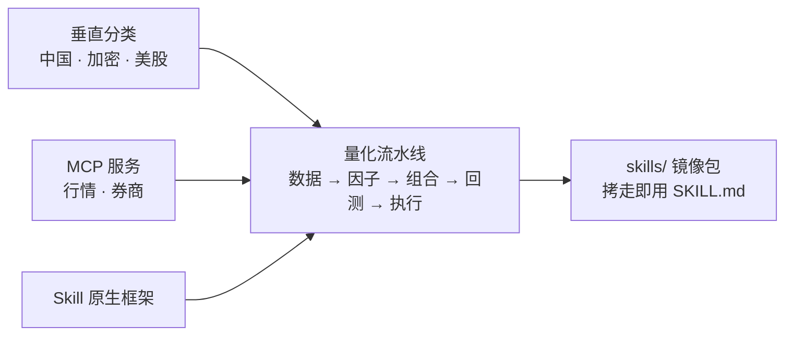

# Awesome Quant Skills [](https://awesome.re) [](LICENSE) [](https://github.com/JerryLiu369/awesome-quant-skills/actions/workflows/ci.yml) [](https://github.com/JerryLiu369/awesome-quant-skills) [](CONTRIBUTING.md)

[English](README.md) | **中文**

> 精选 **Agent Skill**、**量化 MCP 服务**与 **Skill 原生系统**目录，覆盖量化金融、系统化研究与算法交易，可用于 **Claude Code**、**OpenCode**、**Codex**、**Cursor**、**OpenClaw**、**Hermes** 及其他兼容 `SKILL.md` 的 harness。

与堆满年久失修代码库的传统量化列表不同，本目录只收录**自主 agent 能力**：可机读执行的 `SKILL.md` 工作流、MCP（Model Context Protocol）工具和确定性量化推理。

---

## 📌 收录范围与入选标准

条目按三个层级组织（大致按权重排序）：

1. **原生 Agent Skill**：可移植的 `SKILL.md` 规范、prompt 与编排配方。Skill 遵循开放的 `SKILL.md` 约定（`name` + `description` frontmatter），同一份文件可加载于 Claude Code、OpenCode、Codex、Cursor、OpenClaw、Hermes 及其他兼容 harness，只是安装路径不同（见快速上手）。无私有 daemon 绑定。
2. **量化 MCP 服务**：暴露标准化金融工具（行情、订单路由、统计检验）的 MCP 服务器。
3. **Skill 原生系统**：暴露模块化、即插即用 skill 架构的开源量化 agent 框架。



---

## 📦 内置 Skill 库

本仓库同时是一个**量化 skill 包**：[`skills/`](skills/) 内直接镜像了 33 个 `SKILL.md` 文件，拷到你的 agent harness 即可用（各 harness 安装路径见快速上手）。两点说明：镜像只是 `SKILL.md` 单文件摘录——配套脚本和参考文档仍在上游（见各文件头的 `Imported from`）；且并非全部宽松许可：3 个属 GPL 系，1 个（`quant-buddy`）需要商业 API 后端。二次分发前请查 [NOTICE.md](NOTICE.md) 中的逐 skill 许可。

- **中国 A 股与期货**：CTP API、PTrade、TqSdk、TDX、Wencai、CnInfo、AKQuant，另有 A 股过滤与期货工作流。
- **Alpha 与因子**：论文因子挖掘、Alpha Zoo、CANSLIM 筛选。
- **回测与审计**：前视偏差规避、PBO 过拟合检验、VectorBT、Pine Script 回测。
- **加密与 Web3**：Pine Script 开发/调试、DefiLlama 收益与资金流、永续资金费率基差。
- **全球股票与风险**：EDGAR 10-K 提取、LLMQuant 股票与宏观、OpenQuant VaR 风险。

> 以上是镜像的 skill 集合。下面目录还链接了未镜像的工具（如 MiniQMT 网关、Purged CV、Tushare/AKShare 系 MCP）——没有 `mirrored at` 标注的条目都是纯链接。

---

## 🚀 快速上手

**使用镜像 skill（30 秒）：**

1. 在 [`skills/`](skills/) 里挑一个。布局固定为 `skills/<分类>/<名称>/SKILL.md`；逐 skill 许可见 [NOTICE.md](NOTICE.md)。
2. 把 skill 文件夹拷到你的 harness 的 skills 目录——如 Claude Code 用 `~/.claude/skills/`（其他 harness 路径不同，查各自文档）。
3. 让 agent 调用它——默认先 paper 交易（见 [SECURITY.md](SECURITY.md)）。

```bash
# 示例：把 CTP 期货 skill 装进 Claude Code
cp -r skills/china-markets/ctp-api ~/.claude/skills/
```

**使用目录链接：** 下面条目都是上游仓库（skill、MCP 服务、框架），不是本仓代码。MCP 服务：在你的 MCP 配置里注册、用自己的 API key，先只读；skill 仓库：同上拷 `SKILL.md`。注册长这样（具体 command 与 env key 以各上游 README 为准——真 key 绝不提交）：

```json
{
  "mcpServers": {
    "<server-name>": {
      "command": "<install-command>",
      "env": { "<VENDOR_API_KEY>": "paste-your-key-here" }
    }
  }
}
```

**对号入座：** A 股/期货交易员 → [中国](#中国-a-股与境内期货) + [数据](#1-数据接入与行情) + [执行](#5-执行与订单路由)；crypto → [加密区](#加密与-web3-市场) + 资金费率/Pine 镜像；美股研究员 → [美股区](#美股与全球股票) + EDGAR/FRED + [回测审计](#4-回测与安全审计)。

**读到这里的 agent：** 镜像与上游的对照表在 [NOTICE.md](NOTICE.md)；每个镜像文件头还有 `Imported from` 精确上游路径。正文里的 `mirrored at` 标注了哪些目录条目有本地拷贝。机器可读摘要见 [llms.txt](llms.txt)。

---

## 📑 目录

- [快速上手](#-快速上手)
- [按垂直市场分类](#-按垂直市场分类)
  - [中国 A 股与境内期货](#中国-a-股与境内期货)
  - [加密与 Web3 市场](#加密与-web3-市场)
  - [美股与全球股票](#美股与全球股票)
- [通用量化流水线](#-通用量化流水线)
  - [1. 数据接入与行情](#1-数据接入与行情)
  - [2. Alpha 生成与因子挖掘](#2-alpha-生成与因子挖掘)
  - [3. 组合与风险配置](#3-组合与风险配置)
  - [4. 回测与安全审计](#4-回测与安全审计)
  - [5. 执行与订单路由](#5-执行与订单路由)
- [量化 MCP 服务](#-量化-mcp-服务)
  - [行情与基本面](#行情与基本面)
  - [券商与交易所网关](#券商与交易所网关)
- [Skill 原生量化框架](#-skill-原生量化框架)
- [Agent 评测与基准](#-agent-评测与基准)
- [其他 Skill](#-其他-skill)
- [参与贡献](#-参与贡献)
- [免责声明](#-免责声明)
- [许可证](#-许可证)

---

## 🌐 按垂直市场分类

*面向特定区域监管、交易时段与市场微结构的全链路 skill。*

### 中国 A 股与境内期货
- [algoderiv/agent-skills](https://github.com/algoderiv/agent-skills) - 面向中国量化衍生品的 Claude Code skill，含 CTP 6.7.8 API 集成（`skills/china-markets/ctp-api/SKILL.md`）、下单执行、持仓管理（结合 TqSdk）。
- [aliwangzai/myquant-dev](https://github.com/aliwangzai/myquant-dev) - 掘金量化 Claude Code Skill，内置 29 篇 GM SDK 参考，指导 Agent 编写合规的事件驱动策略（订阅、多周期查询、回测配置、委托执行）。
- [CharmYue/ashare-mcp](https://github.com/CharmYue/ashare-mcp) - 基于 FastMCP 与 AKShare（Baostock/Tushare 降级）的 A 股数据 MCP，覆盖涨跌停池、龙虎榜、融资融券、筹码分布与三大报表公告。
- [dfkai/xtquantai](https://github.com/dfkai/xtquantai) - 面向 QMT 投研终端的 Agent Skills，其中 `qmt-inner-backtest` 把因子研究转成 QMT 原生截面回测，内含 Barra 风格处理与防未来函数检查。
- [gaaiyun/joinquant-skill](https://github.com/gaaiyun/joinquant-skill) - 聚宽策略开发 Skill，内置基于 AST 的静态检查器（`scripts/strategy_lint.py`）拦截未来函数与未复权价格，并提供 `jqskill_mcp` 工具服务。
- [guangxiangdebizi/FinanceMCP-DCTHS](https://github.com/guangxiangdebizi/FinanceMCP-DCTHS) - TypeScript MCP 服务，融合 Tushare 与东财/同花顺双源，提供板块与概念指数、成分股、领涨股及板块资金流，支持 stdio 与 HTTP。
- [guangxiangdebizi/QMT-MCP](https://github.com/guangxiangdebizi/QMT-MCP) - 基于迅投 XTQuant（miniQMT）的 FastMCP 服务，提供行情订阅、持仓与资产查询、下单撤单，并内置风控层。
- [hexonal/vnpy_agentbridge](https://github.com/hexonal/vnpy_agentbridge) - 跑在 VeighNa（vnpy）`MainEngine` 进程内的 FastMCP 桥与 IntentEngine，强制“只提议、不执行”边界，需人工 + `vnpy_riskmanager` 审批。
- [itsadrianxv/quant-strategy-builder-skill](https://github.com/itsadrianxv/quant-strategy-builder-skill) - 面向 Claude Code、Codex、OpenClaw 的模块化 skill 套件，支持境内期货（`implement-cn-futures-strategy`）与 A 股/ETF 执行约束（`implement-cn-equity-etf-strategy`）。
- [juju-w/qmt-mcp](https://github.com/juju-w/qmt-mcp) - 跑 `xtquant`（miniQMT）的流式 HTTP MCP 服务（Docker/Wine 或 Windows 原生），支持代码搜索、历史 K 线与持仓查看。
- [jwangkun/claude-for-financial-services-cn](https://github.com/jwangkun/claude-for-financial-services-cn) - 面向中文金融机构的 63 个 Claude Skill 合集，附带 MCP 服务（`akshare-mcp`、`ifind-mcp`、`wind-mcp`；Wind/iFind 需机构 license）。
- [lingfan/tdxquant-mcp](https://github.com/lingfan/tdxquant-mcp) - TdxQuant / 通达信的 MCP 服务与原生 `skills/china-markets/tdxquant/SKILL.md` skill，支持 Cursor、Claude Code、Hermes。
- [lzwme/finance-quant-skills](https://github.com/lzwme/finance-quant-skills) - 面向 A 股量化交易、行情分析与规则检查的 agent skill（镜像于 `skills/china-markets/akquant/SKILL.md`）。
- [NBreeze-Eric/financial-services-plugins-cn](https://github.com/NBreeze-Eric/financial-services-plugins-cn) - 由 Anthropic financial-services-plugins 改造的 A 股/港股投研框架，用 4 个同花顺 iFinD MCP 替换海外数据源，并附带 equity-research 技能树。
- [QmQsun/Wind-MCP](https://github.com/QmQsun/Wind-MCP) - 通过 WindPy COM 封装的万得终端 MCP 服务，向 Agent 暴露行情、三大报表、EDB 宏观序列与条件选股（需 Windows 与机构版 Wind 授权）。
- [quantskills/agent-ssquant](https://github.com/quantskills/agent-ssquant) - 期货量化 agent 工作流，Anthropic 兼容 skill（`skills/china-markets/ssquant-futures/SKILL.md`）管控 CTP/SimNow 实盘执行。
- [quantskills/skill-xingtai-catcher](https://github.com/quantskills/skill-xingtai-catcher) - 面向 A 股与商品期货的 K 线形态相似度 Skill（含 MCP 工具），可用自然语言、手绘曲线或 K 线截图检索历史相似形态。
- [ricequant/ricequant-skills](https://github.com/ricequant/ricequant-skills) - 米筐官方 Claude Code 技能包，含 14 个 `SKILL.md`，覆盖 RQData 数据查询、RQAMS 组合操作、财报分析与行业概览。
- [rollysys/use_cninfo](https://github.com/rollysys/use_cninfo) - 查询巨潮资讯 A 股法定披露的专用 CLI + Claude Code `SKILL.md` skill，经 PyMuPDF 提取全文 Markdown（镜像于 `skills/china-markets/cninfo-disclosure/SKILL.md`）。
- [sencloud/futures_mcp](https://github.com/sencloud/futures_mcp) - 境内商品与金融期货 MCP 服务，整合 AKShare 行情、多指标技术分析与 DeepSeek 解析。
- [shinnytech/tqsdk-python](https://github.com/shinnytech/tqsdk-python) - 天勤官方 SDK，内嵌 agent skill（`skills/china-markets/tqsdk-trading/SKILL.md`），支持 CTP 期货/期权事件循环与保证金交易。
- [Wangshengyang2004/myquant-mcp](https://github.com/Wangshengyang2004/myquant-mcp) - 基于掘金量化 GM API 的 MCP 服务与配套 `SKILL.md`，覆盖 A 股行情、基本面、持仓、T+0 日内交易与仿真/实盘委托。
- [xxbbzy/ptrade-agent-skills](https://github.com/xxbbzy/ptrade-agent-skills) - 面向 Claude Code 与 Codex 的专用 `SKILL.md` 套件（`skills/china-markets/ptrade-strategy-writing`），带静态 AST 检查，用于编写与审查 PTrade 机构交易算法。
- [yywx55/qmt-trade-mcp](https://github.com/yywx55/qmt-trade-mcp) - QMT/xtquant MCP 服务，工具分为行情组（快照、除权因子、交易日历）与交易组（委托、撤单、持仓），通过 SSE 暴露。
- [zhangchiep/joinquant-skill](https://github.com/zhangchiep/joinquant-skill) - 面向 Claude Code 的聚宽 API 参考 Skill，覆盖策略生命周期回调、定时任务、复权与滑点设置、财务数据查询与下单函数。

### 加密与 Web3 市场
- [aaronjmars/web3-research-mcp](https://github.com/aaronjmars/web3-research-mcp) - 本地 MCP 服务，聚合 CoinGecko、CoinMarketCap 与 DeFiLlama（协议 TVL、历史峰值、周期变动），无需外部 API Key。
- [AlgoVaultLabs/crypto-quant-signal-mcp](https://github.com/AlgoVaultLabs/crypto-quant-signal-mcp) - 多场所衍生品情报 MCP 服务，内置 20 个 Anthropic agent skill，扫描 7 家永续合约交易所的跨所资金费率套利。
- [binance/binance-skills-hub](https://github.com/binance/binance-skills-hub) - 币安官方 Skills 仓库，21 个 `SKILL.md`，为 Agent 提供 agentic 钱包、现货与合约下单、链上转账追踪及 Web3 DeFi 交互能力。
- [brandononchain/opentrade](https://github.com/brandononchain/opentrade) - 支持 7×24 加密微结构、Pine Script v6 策略合成与高频交易启发式的 agent skill。
- [caiovicentino/polymarket-mcp-server](https://github.com/caiovicentino/polymarket-mcp-server) - Polymarket 的 MCP 服务，覆盖市场发现、WebSocket 订单簿监控、仓位查询与实盘执行。
- [coinbase/agentkit](https://github.com/coinbase/agentkit) - Coinbase 开发者平台的链上 Agent 框架，提供钱包管理与 Swap/借贷/价格源的 action provider，覆盖 Base、EVM 与 Solana，并附原生 MCP 智能钱包服务。
- [coinpaprika/dexpaprika-mcp](https://github.com/coinpaprika/dexpaprika-mcp) - DexPaprika 的 MCP 服务，提供多链 DEX 分析：流动性池 TVL、交易量、价格冲击与历史 OHLCV。
- [DefiLlama/defillama-skills](https://github.com/DefiLlama/defillama-skills) - 官方 agent skill（`yield-strategies`、`defi-data`、`flows-and-events`，镜像于 `skills/crypto-web3/` 目录），连接 DefiLlama 查协议 TVL、DEX 量、收益与代币解锁。
- [dex-original/okx-agent-trade-kit](https://github.com/dex-original/okx-agent-trade-kit) - AI agent 交易套件与 MCP 服务（`okx-trade-mcp`），11 个模块 145 个工具，覆盖现货与衍生品算法下单。
- [edkdev/hyperliquid-mcp](https://github.com/edkdev/hyperliquid-mcp) - Hyperliquid 永续 DEX 的 Python MCP 服务，支持 EIP-712 签名、原子括号单（入场 + 止盈 + 止损）与资金费率流。
- [GMGNAI/gmgn-skills](https://github.com/GMGNAI/gmgn-skills) - GMGN 官方 OpenAPI 技能包，19 个 `SKILL.md`，覆盖聪明钱追踪、钱包盈亏、代币安全审计及 Solana/Base/以太坊上的 Swap 与条件单。
- [helius-labs/core-ai](https://github.com/helius-labs/core-ai) - Helius 的 Solana AI 工具集，包含 `helius-mcp`（链上资产、交易解析、优先费率）与 24 个 `SKILL.md`（含 DFlow 路由）。
- [HKUDS/Vibe-Trading](https://github.com/HKUDS/Vibe-Trading) - 多资产交易 agent 框架，原生 `SKILL.md` 打包，含永续资金费率期现基差套利 skill（`skills/crypto-web3/perp-funding-basis/SKILL.md`）。
- [kukapay/crypto-liquidations-mcp](https://github.com/kukapay/crypto-liquidations-mcp) - 推送 Binance 合约爆仓 cascade 与委托规模分布的 FastMCP 流服务，用于市场压力检测。
- [kukapay/jupiter-mcp](https://github.com/kukapay/jupiter-mcp) - 经 Jupiter Ultra API 执行 Solana DEX 兑换的专用 MCP 服务，支持报价生成、滑点容忍与优先费控制。
- [mirror29/openfinclaw-cli](https://github.com/mirror29/openfinclaw-cli) - 面向多 agent 环境的即插即用加密研究、回测、模拟交易 skill 集成。
- [sendaifun/solana-agent-kit](https://github.com/sendaifun/solana-agent-kit) - 连接 AI agent 与 Solana 协议的基础开源工具包，60+ action（Jupiter、Raydium、Orca、Meteora、Drift）。
- [Senpi-ai/senpi-skills](https://github.com/Senpi-ai/senpi-skills) - 面向 Hyperliquid 永续的开源技能库，15 个 `SKILL.md`，覆盖市场脉搏、聪明钱流向、资金费率、仓位管理与风控护栏。
- [SpartanLabsXyz/simmer-sdk](https://github.com/SpartanLabsXyz/simmer-sdk) - 面向 Agent 的预测市场套件：37 个 `SKILL.md`、内置 `simmer-mcp` 服务与 Python SDK，可在 Polymarket、Kalshi 与 Hyperliquid 上做模拟交易。
- [Superior-Trade/superior-skills](https://github.com/Superior-Trade/superior-skills) - Superior Trade 的开源技能与工具规范包，31 个 `SKILL.md`，可让 Agent 在 Hyperliquid 永续与 Polymarket 上编写、回测与部署策略。
- [vooi-app/mcp](https://github.com/vooi-app/mcp) - 统一永续合约 MCP 服务，连接 Hyperliquid、Lighter、Aster、Kinetiq 四家，做跨所资金费率差套利。
- [YichengYang-Ethan/oracle3-prediction-market-agent](https://github.com/YichengYang-Ethan/oracle3-prediction-market-agent) - 预测市场套利引擎与 MCP 服务，跨 Kalshi、Polymarket 与 Solana 搜索扣除手续费后的无套利机会，含 12 个 `SKILL.md` 与交易前风控。

### 美股与全球股票
- [AlphaGBM/skills](https://github.com/AlphaGBM/skills) - 27 个面向期权与股票研究的 `SKILL.md`，覆盖希腊字母归因、IV 分位排名、波动率曲面拟合与财报 IV Crush 回测。
- [daniel3303/Equibles](https://github.com/daniel3303/Equibles) - 自托管金融终端 MCP 服务，62+ agent 工具，覆盖 SEC EDGAR、13F 持仓、国会交易披露与 FRED 数据。
- [jsconiers/capitol-trades-mcp](https://github.com/jsconiers/capitol-trades-mcp) - 跟踪美国国会议员股票交易的 FastMCP 服务，23 个专用工具，数据源 Capitol Trades，无需 API key。
- [LLMQuant/skills](https://github.com/LLMQuant/skills) - 18 个模块化 agent skill 的标准仓库（`llmquant-equities`、`llmquant-macro`、`llmquant-risk`，镜像于 `skills/global-equities/` 与 `skills/portfolio-risk/`），兼容 Claude Code、Codex、Hermes Agent。
- [pseudo-longinus/quant-buddy-skills](https://github.com/pseudo-longinus/quant-buddy-skills) - 覆盖美/港股行情、宏观指标与多资产筛选的全套基建 skill（镜像于 `skills/china-markets/quant-buddy/SKILL.md`；需商业 API 后端）。
- [simonlin1212/global-stock-data](https://github.com/simonlin1212/global-stock-data) - 面向 Claude Code / Codex 的免 auth 行情 skill，50+ 接口，覆盖 CBOE 期权 Greeks、0DTE 资金流与 38 家央行政策利率。
- [stocktwits/stocktwits-mcp](https://github.com/stocktwits/stocktwits-mcp) - 官方 StockTwits MCP 服务，免 auth 推送散户情绪分、热门 ticker 与社群热度动量。
- [zen-tradings/retail-skills-us](https://github.com/zen-tradings/retail-skills-us) - 面向美股散户的 skill：规则执行、税损收割与零售算法配置。

---

## ⚙️ 通用量化流水线

*按量化投资全生命周期的时间顺序排列的模块化 skill。*

### 1. 数据接入与行情
*行情获取、清洗、复权与跨源对齐。*
- [27dream/mcp-eastmoney](https://github.com/27dream/mcp-eastmoney) - 面向 Claude Code 与 Cursor 的零配置 MCP 服务，直连东方财富推送 API，无需 key（非官方；随时可能失效）。
- [btopn/OpenInsider-MCP](https://github.com/btopn/OpenInsider-MCP) - MCP 服务，聚合 OpenInsider 的 Form 4 内部人交易、SEC EDGAR 8-K/13D 申报与 FINRA 卖空量和交割失败数据。
- [c-cf/imf-data-mcp](https://github.com/c-cf/imf-data-mcp) - 基于新版 SDMX API 的 IMF 宏观 MCP 服务，可查询 IFS、世界经济展望与国际收支数据集。
- [CNQQC/xueqiu-mcp](https://github.com/CNQQC/xueqiu-mcp) - 29 个工具的雪球 MCP 服务，输出结构化行情、资金流与社区情绪（Markdown 表格）（非官方；随时可能失效）。
- [dgunning/edgartools](https://github.com/dgunning/edgartools) - SEC EDGAR 工具包，自带 MCP 服务（`edgartools-mcp`）与 Claude Code skill，把 10-K、10-Q、8-K、Form 4 内幕交易提取为类型化数据（镜像于 `skills/global-equities/edgar-financials/SKILL.md`）。
- [elsejj/mcp-cn-a-stock](https://github.com/elsejj/mcp-cn-a-stock) - 专用 A 股 MCP 服务，基于 `msd` 数据库，分层提供报价、财务基本面与技术指标。
- [erwanjun/tushare-mcp-server](https://github.com/erwanjun/tushare-mcp-server) - 生产级 MCP 服务，封装 173 个 Tushare Pro 接口，覆盖 A 股、期货、期权、指数与宏观（需 Tushare Pro token；免费版可用）。
- [guangxiangdebizi/FinanceMCP](https://github.com/guangxiangdebizi/FinanceMCP) - 多市场金融 MCP 服务，19 个工具，集成 Tushare Pro 查报价、财报与宏观指标（需 Tushare Pro token；免费版可用）。
- [hypier/tradingview-quantitative-skills](https://github.com/hypier/tradingview-quantitative-skills) - 技术形态识别、市场扫描与 TradingView 行情集成 skill。
- [kylefu8/tradingview-akshare-mcp](https://github.com/kylefu8/tradingview-akshare-mcp) - 基于 AKShare 与 TradingView 指标的技术分析 MCP 服务，多源兜底。
- [lefterisloukas/edgar-crawler](https://github.com/lefterisloukas/edgar-crawler) - 学术级 SEC EDGAR 抽取引擎（WWW 2025），把 10-K、10-Q、8-K 转为干净的分 item JSON。
- [quantskills/quantskills](https://github.com/quantskills/quantskills) - 金融 agent 的全景生态导航与标准取数工作流。
- [raidery/quant-skills](https://github.com/raidery/quant-skills) - 量化 skill 包，含 `skills/china-markets/wencai-screener/SKILL.md`，经 `pywencai` 做自然语言选股。
- [stefanoamorelli/fred-mcp-server](https://github.com/stefanoamorelli/fred-mcp-server) - 专用 MCP 服务，开放 80 万+ FRED® 美联储经济时间序列（需免费 FRED API key）。
- [stefanoamorelli/sec-edgar-mcp](https://github.com/stefanoamorelli/sec-edgar-mcp) - 高精度 MCP 服务，直连 SEC EDGAR 公告（10-K、10-Q、8-K）、解析后 XBRL 报表与 Form 4 内幕交易。
- [worldbank/data360-mcp](https://github.com/worldbank/data360-mcp) - 世界银行官方 Data360 MCP 服务，可检索、校验并提取世界银行 API 的发展与宏观经济指标。
- [zwldarren/akshare-one-mcp](https://github.com/zwldarren/akshare-one-mcp) - 基于 `akshare-one` 的 FastMCP 服务，暴露 A 股报价、K 线与财务，多源兜底。

### 2. Alpha 生成与因子挖掘
*假设检验、公式化 alpha 推导与研报文档处理。*
- [Abel-ai-lab/predict-anything](https://github.com/Abel-ai-lab/predict-anything) - 因果市场分析、alpha 发现与预测性市场结构提取 skill。
- [CTAAgents/quant-skills](https://github.com/CTAAgents/quant-skills) - AI 驱动的 CTA（商品交易顾问）skill，用遗传规划做因子发现。
- [Howard-Jerry/quant-agent-skills](https://github.com/Howard-Jerry/quant-agent-skills) - 8000 行编排 skill，做概念题材分析、产业链图谱与因子筛选。
- [ICT-FinD-Lab/alphagen](https://github.com/ICT-FinD-Lab/alphagen) - 公式化 Alpha 挖掘框架，结合遗传规划与深度符号优化，提供 `alphagen_llm` 提示词与客户端层并集成 Qlib 回测。
- [minihellboy/factorminer](https://github.com/minihellboy/factorminer) - 量化 alpha 发现引擎，LLM 引导符号搜索 + 类型化 DSL 执行，原生支持 MCP 服务。
- [noahnan-max/governed-dcf-skill](https://github.com/noahnan-max/governed-dcf-skill) - 面向 Codex 的可移植、带治理 agent skill（`SKILL.md`），做可审计多情景 FCFF 估值、反向 DCF 与 WACC 敏感性矩阵。
- [quantskills/skill-factor-alpha191-alpha101](https://github.com/quantskills/skill-factor-alpha191-alpha101) - 公式化因子 Skill，直接从长表 OHLCV CSV 计算 Alpha101、Alpha191 与兼容 Qlib 的原生 Alpha158，输出宽表因子。
- [quantskills/skill-factor-mining-pandaai](https://github.com/quantskills/skill-factor-mining-pandaai) - 学术论文因子提取与结构化财务分析 skill（镜像于 `skills/alpha-factors/factor-mining-pandaai/SKILL.md`）。
- [quantskills/skill-report-replication](https://github.com/quantskills/skill-report-replication) - 六阶段研报复现流水线：把 PDF 研报转成可运行的因子代码，包含结构化翻译、公式抽取、点时对齐、代码生成与 IC/RankIC 验证。
- [stockvaluation-io/stockvaluation_io](https://github.com/stockvaluation-io/stockvaluation_io) - 本地优先的 MCP DCF 估值引擎，把定性 thesis 生成与确定性 Damodaran 式估值数学解耦。
- [tradermonty/claude-trading-skills](https://github.com/tradermonty/claude-trading-skills) - 70+ 垂直交易 skill 合集，覆盖市场宽度分析、技术筛选与交易日志（散户工作流取向；与下文 agiprolabs 的工具包无关；`breadth-chart-analyst` 与 `canslim-screener` 镜像于 `skills/alpha-factors/`；筛选器需 FMP key，免费版够用）。
- [TradersPost/pinescript-agents](https://github.com/TradersPost/pinescript-agents) - Claude Code skill（`pine-developer` 与 `pine-debugger` 镜像于 `skills/crypto-web3/`，`pine-backtester` 镜像于 `skills/backtesting-audit/`），专为生成 TradingView Pine Script v6 策略（含自动券商 alert webhook）。
- [VernonOY/alpha-skills](https://github.com/VernonOY/alpha-skills) - 9 个模块化研究 Skill，核心 `alpha-mine` 在算子与表达式空间做因子挖掘并按 IC/ICIR 筛选，另有 alpha-evaluate、alpha-backtest、alpha-report、alpha-monitor。
- [VernonOY/replicalpha](https://github.com/VernonOY/replicalpha) - 量化研究复现 agent，从研究 PDF 提取因子生成可执行 Python，带红队校验。

### 3. 组合与风险配置
*资金分配、仓位 sizing、风险平价与动态再平衡。*
- [agiprolabs/claude-trading-skills](https://github.com/agiprolabs/claude-trading-skills) - 68 个交易 skill，含 Kelly 仓位公式、状态识别与滑点建模（量化工具包取向；与上文 tradermonty 同名但无关的项目）。
- [CarloNicolini/autoresearch-skfolio](https://github.com/CarloNicolini/autoresearch-skfolio) - 基于 skfolio 的自主组合研究框架，探索 MeanRisk、HRP、RiskBudgeting 与 NCO，用 Deflated Sharpe 与组合净化交叉验证做样本外评估。
- [dcajasn/Riskfolio-Lib](https://github.com/dcajasn/Riskfolio-Lib) - 量化战略资产配置库，支持 24+ 凸风险测度（CVaR、CDaR、EVaR）与嵌套聚类优化（HRP、HERC、HER2）。
- [ebrandler/mcportfolio](https://github.com/ebrandler/mcportfolio) - 封装 PyPortfolioOpt 与 CVXPY 的 MCP 服务，支持均值方差、最大夏普、最小波动、Black-Litterman、HRP 与 Mean-CVaR 组合构建。
- [ElmatadorZ/Money-Atlas-Intelligence-OS](https://github.com/ElmatadorZ/Money-Atlas-Intelligence-OS) - 聪明钱（SMC）市场结构与资产配置指导 skill。
- [jackson-video-resources/markov-hedge-fund-method](https://github.com/jackson-video-resources/markov-hedge-fund-method) - 马尔可夫状态识别 skill，做组合风险开/关的动态切换。
- [mitchellbernstein/openquant](https://github.com/mitchellbernstein/openquant) - 开源量化操作系统，带 MCP 服务与 Hermes/Claude Agent Skill，做 VaR 风险评估与信号生成（镜像于 `skills/portfolio-risk/openquant-trading/SKILL.md`）。
- [nutdnuy/self-driving-portfolio-skill](https://github.com/nutdnuy/self-driving-portfolio-skill) - 治理型战略资产配置 Skill 集（8 个 `SKILL.md`），强制点时输入冻结、正定协方差修正、十种优化方法横评与审计追踪。
- [PyPortfolio/PyPortfolioOpt](https://github.com/PyPortfolio/PyPortfolioOpt) - 生产级组合优化，实现均值-方差有效前沿、Black-Litterman 配置与分层风险平价（HRP）。
- [wshobson/maverick-mcp](https://github.com/wshobson/maverick-mcp) - 开源股票 MCP 服务，除分析工具外提供 ATR 风险调整仓位、相关性矩阵、风险仪表盘与 Walk-forward 回测。

### 4. 回测与安全审计
*仿真、前视偏差预防、数据泄露审计与收益归因。*
- [bettyguo/agent-backtest-lab](https://github.com/bettyguo/agent-backtest-lab) - 专为 LLM 交易 agent 框架设计的统计严谨审计 harness，防前视泄露、prompt 自欺与 PBO 过拟合。
- [bmouler/lookahead-lint](https://github.com/bmouler/lookahead-lint) - 量化代码的 AST 静态分析器，agent 可调用，标记前视偏差、未来目标泄露（`.shift(-1)`）与过早的 scaler 拟合。
- [eslazarev/purged-cross-validation](https://github.com/eslazarev/purged-cross-validation) - scikit-learn 兼容包，实现 López de Prado 的 Purged K-Fold 与组合 Purged 交叉验证（CPCV），消除时序泄露。
- [HyperFrequency/skills](https://github.com/HyperFrequency/skills) - 绩效报告类 Agent Skills，其中 `tearsheet-generator` 基于 QuantStats 生成含 SVG 图表、MAE 分位分析与杠杆建议的 tearsheet。
- [LuxAlgo/PineTS](https://github.com/LuxAlgo/PineTS) - Pine Script v5/v6 开源 TypeScript 转译器与无头运行时，带 `AGENTS.md` 与 `pinets-cli`，支持本地策略仿真与回测。
- [marketcalls/vectorbt-backtesting-skills](https://github.com/marketcalls/vectorbt-backtesting-skills) - 模块化 agent 编程 skill 套件，脚手架化 VectorBT 策略开发、超参调优与 tearsheet 评估（镜像于 `skills/backtesting-audit/` 目录）。
- [ml4t/skills](https://github.com/ml4t/skills) - 《机器学习算法交易》的 skill，强制无泄露特征工程、purged 交叉验证边界与严格回测审计。
- [nautechsystems/nautilus_trader](https://github.com/nautechsystems/nautilus_trader) - 生产级 Rust 原生算法交易引擎，确定性事件驱动回测，仓内自带 `AGENTS.md` 与 `CLAUDE.md` 操作规则。
- [pineforge-4pass/pineforge-backtest-mcp](https://github.com/pineforge-4pass/pineforge-backtest-mcp) - 本地 MCP 服务，把 PineScript v6 转译为 C++ 做确定性离线回测，支持参数网格扫描与 TradingView 逐笔对齐校验。
- [PyneSys/pynecore](https://github.com/PyneSys/pynecore) - Pine 兼容的 Python 运行时与 AST 转译器，在原生 Python 跑 TradingView 指标与策略，支持离线回测与逐 bar 验证。
- [QuantConnect/Lean](https://github.com/QuantConnect/Lean) - 机构级算法交易与回测引擎（Python/C#），多资产建模、tick 粒度，支持 LEAN CLI 的 agent 合成。
- [quantskills/skill-backtest-overfit](https://github.com/quantskills/skill-backtest-overfit) - 回测过拟合统计门控 Skill，计算 DSR、PBO、多重检验夏普惩罚与 MinTRL，并输出 PASS/FAIL 结论。
- [quantskills/skill-backtesting-bias-avoidance](https://github.com/quantskills/skill-backtesting-bias-avoidance) - 专用 `SKILL.md`，审计回测的前视偏差、幸存者偏差、CSCV 过拟合概率（PBO）与去通胀夏普（DSR）（镜像于 `skills/backtesting-audit/backtesting-bias-avoidance/SKILL.md`）。
- [ranaroussi/quantstats](https://github.com/ranaroussi/quantstats) - 组合分析库，计算 Sharpe、Sortino、Calmar、VaR，生成可交互 HTML tearsheet，供 agent 回测评估。
- [saksham10arora-dotcom/quant-skills](https://github.com/saksham10arora-dotcom/quant-skills) - 专用 skill：回测代码审查、前视偏差审计、统计检验选择与论文复现，支持 Claude Code / OpenCode / Codex（镜像于 `skills/backtesting-audit/` 目录：`backtest-review`、`data-quality-audit`、`paper-repro`、`stats-test-picker`）。
- [stefan-jansen/pyfolio-reloaded](https://github.com/stefan-jansen/pyfolio-reloaded) - 持续维护的 pyfolio 风险分析框架，生成 tearsheet，覆盖收益归因与贝叶斯样本外绩效分析。
- [stefan-jansen/zipline-reloaded](https://github.com/stefan-jansen/zipline-reloaded) - 持续维护的 Zipline 回测引擎现代 fork，agent-ready 的 Pipeline API，做截面因子仿真。
- [taylorwilsdon/quantconnect-mcp](https://github.com/taylorwilsdon/quantconnect-mcp) - QuantConnect 的 FastMCP 服务，可让 Agent 建项目、编译代码、跑完整回测并查看图表、订单与洞察。

### 5. 执行与订单路由
*订单执行算法（TWAP/VWAP）、滑点管理与券商对接。*
- [anbotolabs/anboto-agent-kit](https://github.com/anbotolabs/anboto-agent-kit) - 机构执行桌套件与 MCP（`@anboto/mcp`），原生 Claude Skill（`anboto-trading`），在 14 个场所部署 TWAP、VWAP、POV、冰山算法。
- [SMU-Rainflow/ctp-mcp](https://github.com/SMU-Rainflow/ctp-mcp) - 基于 `vnpy_ctp` 的 MCP 服务，向 coding agent 暴露 CTP tick 流、限价/市价下单与撤单。
- [Synpath-ai/synpath](https://github.com/Synpath-ai/synpath) - Python/Rust 智能订单路由（SOR）与高级执行算法（TWAP、冰山、pegged），面向预测与金融场所。
- [TradeRouter/trade-router-mcp](https://github.com/TradeRouter/trade-router-mcp) - 算法执行 MCP 服务，暴露 TWAP 切片、DCA 与多 DEX 路由，带 MEV 保护。

---

## 🔌 量化 MCP 服务

*为量化 agent 提供 raw 计算与数据 API 的标准 MCP 服务。*

### 行情与基本面
- [Alex2Yang97/yahoo-finance-mcp](https://github.com/Alex2Yang97/yahoo-finance-mcp) - 生产级 Yahoo Finance MCP 服务，暴露历史 OHLCV、期权链、基本面比率与公司行动。
- [alphavantage/alpha_vantage_mcp](https://github.com/alphavantage/alpha_vantage_mcp) - Alpha Vantage 官方 MCP，提供行情、60+ 技术指标、基本面、外汇与加密数据，并附 `global-stock-analysis` 技能。
- [bidouilles/mcp-tradingview-server](https://github.com/bidouilles/mcp-tradingview-server) - FastMCP 服务，直调 TradingView 技术指标（RSI、MACD、EMA）与 OHLCV 蜡烛流。
- [cfdude/mcp-finnhub](https://github.com/cfdude/mcp-finnhub) - 基于 Finnhub API 的 FastMCP 服务，覆盖实时行情、含形态识别的技术分析、基本面、目标价、内部人交易与市场情绪。
- [doggybee/mcp-server-ccxt](https://github.com/doggybee/mcp-server-ccxt) - 统一 CCXT 交易与行情的 MCP 服务，覆盖 20+ 加密交易所。
- [eliasfire617/crypto-market-data-mcp](https://github.com/eliasfire617/crypto-market-data-mcp) - 覆盖 100+ 交易所的 CCXT 行情 MCP 服务，带未平仓与永续资金费率对比工具。
- [financial-datasets/mcp-server](https://github.com/financial-datasets/mcp-server) - 专用 MCP 服务，为 LLM 消费裁剪的 10-K/10-Q 财务报表与行情（需 Financial Datasets API key；付费）。
- [imbenrabi/Financial-Modeling-Prep-MCP-Server](https://github.com/imbenrabi/Financial-Modeling-Prep-MCP-Server) - FMP 的 MCP 服务，支持工具动态挂载，覆盖三大报表、财报电话会实录、13F 申报、内部人交易、SEC 申报与 DCF 模型。
- [lazy-dinosaur/ccxt-mcp](https://github.com/lazy-dinosaur/ccxt-mcp) - 标准 MCP 服务，桥接 100+ 加密交易所的 CCXT，带交易后量化启发式。
- [major7apps/tiingo-mcp](https://github.com/major7apps/tiingo-mcp) - Rust 编写的 Tiingo MCP，含工具、资源与量化提示模板，覆盖 EOD 价格、IEX 盘口报价、加密、外汇与新闻情绪。
- [massive-com/mcp_massive](https://github.com/massive-com/mcp_massive) - Massive.com（原 Polygon.io）官方 MCP，提供美股、期权链、外汇与加密数据的 search/call/query 工具，内置 Black-Scholes 希腊字母与内存 SQL 分析。
- [openbq-org/OpenBB](https://github.com/openbq-org/OpenBB) - OpenBB 核心平台（含 `openbb-mcp-server`），把 100+ 多资产数据源暴露为标准 MCP 工具，附 `SKILL.md` 指南。
- [twelvedata/mcp](https://github.com/twelvedata/mcp) - Twelve Data 官方 MCP，提供全球行情、技术指标、基本面、财报与股息，支持托管或本地 stdio 部署。
- [unusual-whales/unusual-whales-official-mcp](https://github.com/unusual-whales/unusual-whales-official-mcp) - Unusual Whales 官方 MCP，提供期权大单流、Gamma/Delta 敞口、暗池成交与国会交易披露数据。

### 券商与交易所网关
- [alpacahq/alpaca-mcp-server](https://github.com/alpacahq/alpaca-mcp-server) - 官方 Alpaca MCP 服务，行情 + 实盘/模拟交易，覆盖股票、ETF、加密与期权。
- [AnalyticAce/binance-mcp-server](https://github.com/AnalyticAce/binance-mcp-server) - 生产级 Binance 现货与合约 MCP 服务，带盘口分析与持仓跟踪。
- [rcontesti/IB_MCP](https://github.com/rcontesti/IB_MCP) - 对接 Interactive Brokers 官方 Web API 的 MCP 服务，监控流动性、下机构级订单。
- [shuizhengqi1/futu-stock-mcp-server](https://github.com/shuizhengqi1/futu-stock-mcp-server) - 富途 OpenAPI 的 MCP 服务，提供港/美/A 股 Level-2 行情、K 线、持仓与下单，并自带 `SKILL.md`。
- [visusnet/coinbase-mcp-server](https://github.com/visusnet/coinbase-mcp-server) - 集成 Coinbase Advanced Trading API 的 MCP 服务与原生 Claude Skill（`coinbase-trading`），支持自主交易执行。

---

## 🏗️ Skill 原生量化框架

*围绕可组合 skill 设计的自主多 agent 量化平台。*
- [AI4Finance-Foundation/FinRobot](https://github.com/AI4Finance-Foundation/FinRobot) - 开源多 agent 平台，编排专业角色（市场分析师、10-K 财务分析师、量化交易员、风控经理）做股票研究。
- [jesson-hh/financial-analyst](https://github.com/jesson-hh/financial-analyst) - A 股「研究→交易」投研工作台，16+ 子 Agent 协作、各角色由 28 个 `SKILL.md` 定义，覆盖研报解析、因子筛选与多空风控辩论。
- [microsoft/RD-Agent](https://github.com/microsoft/RD-Agent) - 微软研究院的自主研发多 agent 框架，对 Microsoft Qlib 自动做假设生成、因子实现与回测。
- [Open-Finance-Lab/AgenticTrading](https://github.com/Open-Finance-Lab/AgenticTrading) - 面向 LLM 交易 Agent 的开源实验平台与模拟交易沙箱，含多模型编排、模拟撮合与可追溯决策日志。
- [TauricResearch/TradingAgents](https://github.com/TauricResearch/TradingAgents) - 基于 LangGraph 的机构交易桌多 agent 框架，专业 LLM 角色按结构化辩论与风控循环协作。
- [tohnee/investagent](https://github.com/tohnee/investagent) - 多 agent 投研框架，结合产业链分析、巴菲特估值过滤与 QuantDinger 回测。
- [virattt/ai-hedge-fund](https://github.com/virattt/ai-hedge-fund) - 多智能体对冲基金框架，由投资大师人格、基本面、技术面、情绪、风控与组合经理 Agent 依次决策，并自带回测器。
- [yiyan-yixing/quant-trading-skills](https://github.com/yiyan-yixing/quant-trading-skills) - 11 角色协作量化 agent 框架，20 个核心 skill、3 层记忆、对抗挑战协议。

---

## 📊 Agent 评测与基准

*用可执行任务给量化 Agent 打分的基准与前向测试环境，而不是评作文。*

- [QF-Bench/QuantitativeFinance-Bench](https://github.com/QF-Bench/QuantitativeFinance-Bench) - 状态感知的交互式基准，在隔离 Docker 沙箱内给 Agent 的脏数据清洗、运行时报错调试、因子工程与组合优化打分。
- [LimexAILab/QuantCode-Bench](https://github.com/LimexAILab/QuantCode-Bench) - 评测模型能否把自然语言策略想法转成可执行 Backtrader 代码，按编译、回测执行与语义对齐三个阶段打分。
- [ulab-uiuc/live-trade-bench](https://github.com/ulab-uiuc/live-trade-bench) - 面向 LLM 交易 Agent 的前向测试环境，直接在股票与预测市场实时数据流上评估，结构上杜绝未来信息泄漏。

## 🧪 其他 Skill

*放不进现有分类的新兴、实验或跨界 skill 中转区。同一主题攒够 3 个即独立成类。*

- [BoyceFong/quant-skill-build](https://github.com/BoyceFong/quant-skill-build) - skill 编写脚手架，面向 Codex 与量化 prompt 写作优化。

---

## 🤝 参与贡献

欢迎投稿！提 PR 前请先看质量门槛：

1. **Agent 中心**：必须能被 LLM Agent 直接调用（`SKILL.md`、CLI prompt 或 MCP 工具）。
2. **方法严谨**：回测与因子 skill 必须符合量化基本功（如防前视偏差、复权 `close * adj_factor`）。
3. **不编造工具**：skill 引用的脚本与接口必须可验证、可复现。

投稿细则见 [CONTRIBUTING.md](CONTRIBUTING.md)。

---

## ⚠️ 免责声明

本项目仅供研究与学习，不构成任何投资建议、买卖要约或招揽。

这里不少 skill 与 MCP 服务能下真实订单（CTP、QMT、Alpaca、IB、Hyperliquid、Jupiter、Coinbase 等）。默认先 paper、人工审批：

- 先只读，能 `propose-never-execute` 的地方就用它。
- 实盘 API key 绝不进 prompt，也不提交含 key 的 `config.json`。
- 行情、公告、社群情绪都是不可信输入，别直连自动下单。

合规、风控与一切亏损由你自己负责。

安全默认值见 [SECURITY.md](SECURITY.md)（先 paper、人工审批、key 管理）。

---

## 📄 许可证

本仓自己的整理工作（`README.md`、`.github/`、`CONTRIBUTING.md`）按 [MIT License](LICENSE) 发布。

[`skills/`](skills/) 下的文件从上游镜像而来，**保留原许可**（见 [NOTICE.md](NOTICE.md) 与各 `SKILL.md` 文件头的 `Imported from`）。部分镜像属 GPL-3.0 系——这些文件的二次分发遵循上游条款，不是 MIT。
